# Books

A cataloged index of my books, in three groups: **Influential** books that have shaped how I think, **Read** books that I valued but that were less formative, and books **On the Shelf** that I haven't read yet. Textbooks have their own catalog: [Technical](Technical.md).

Within the influential section, books are organized by author or subject. Each entry links to a dedicated file with a full summary, critical analysis, and personal takeaways.

---

## Influential Books

Books that have reshaped how I think, see, or act. Organized by author.

### Albert Camus

| Book | Summary |
|------|---------|
| [The Stranger](influential/the-stranger.md) 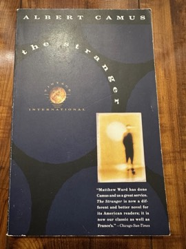 | Meursault kills an Arab on an Algerian beach, apparently without motive, and is tried less for the murder than for his emotional indifference at his mother's funeral. Camus uses Meursault's flat, affectless prose to dramatize the absurdist argument: the world offers no inherent meaning, and the authentic response is neither despair nor false consolation. The novel's power lies in its refusal to make Meursault sympathetic in conventional ways while making his clarity feel like a form of integrity. |
| [The Plague](influential/the-plague.md) 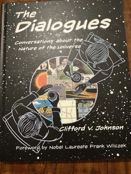 | A bubonic plague descends on the Algerian city of Oran, and a group of citizens respond in different ways. The plague functions as allegory (for occupation, for the human condition, for evil in general) while remaining a concrete medical and social reality. Camus's argument is that solidarity and perseverance in the face of meaningless suffering is the only genuine form of heroism available. |
| [The Myth of Sisyphus](influential/the-myth-of-sisyphus.md) | Camus's philosophical essay on the absurd argues that the recognition that life has no inherent meaning does not justify suicide; instead, the only honest response is revolt—to live fully in spite of the absurd, not to resolve it through religion or ideology. Sisyphus, condemned to roll his boulder eternally, must be imagined happy. Introduces "the absurd" as a philosophical concept. |
| [The Fall](influential/the-fall.md) | Jean-Baptiste Clamence, a former Parisian defense lawyer, narrates his life to a stranger in an Amsterdam bar—the story of a successful man's recognition of his own hypocrisy, and his construction of a new identity as a "judge-penitent" who accuses himself to have the right to accuse others. Camus's most psychologically concentrated work. |
| [The First Man](influential/the-first-man.md) 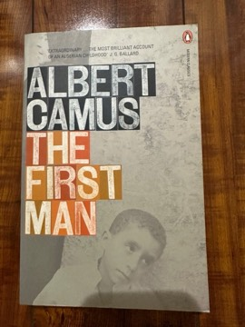 | Camus's unfinished final novel, found in his jacket after his fatal car crash, is a fictionalized account of his childhood in colonial Algeria—poverty, a mute mother, a formative relationship with his schoolteacher. Written with the urgency of someone who had found his deepest subject. |

---

### F. Scott Fitzgerald

| Book | Summary |
|------|---------|
| [The Great Gatsby](influential/the-great-gatsby.md) | Jay Gatsby's pursuit of the green light—Daisy Buchanan, the American Dream, the self he invented from nothing—ends in violence and obliteration while the old-money Buchanans retreat into their carelessness. Fitzgerald's prose achieves something almost impossible: it makes the corruption of the American Dream feel beautiful and tragic simultaneously. |
| [Tender is the Night](influential/tender-is-the-night.md) | Dick Diver, a brilliant American psychiatrist on the French Riviera, begins the novel as the most charming man in any room and ends it a wreck—eroded by his marriage to a wealthy patient, by money, by the social performance he has made of his life. Fitzgerald's most autobiographically complex novel; the structural shift (told partly in retrospect) enacts the collapse it describes. |

---

### Ernest Hemingway

| Book | Summary |
|------|---------|
| [For Whom the Bell Tolls](influential/for-whom-the-bell-tolls.md) 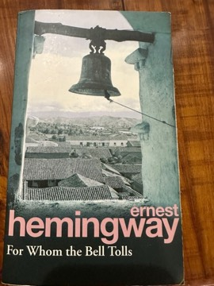 | Robert Jordan, an American fighting with Republican guerrillas in the Spanish Civil War, is tasked with blowing a bridge. Over three days he falls in love, confronts death, and thinks through what it means to act for a cause you know is probably lost. Hemingway's most politically serious novel refuses both cynicism and idealism. |
| [The Sun Also Rises](influential/the-sun-also-rises.md) 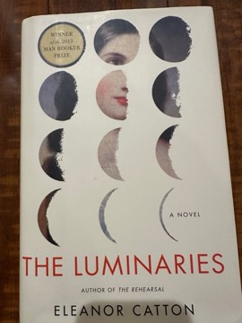 | Jake Barnes, an American journalist in Paris and Pamplona with a war wound that precludes consummation, loves Brett Ashley, who loves him, and they move through bullfights and bars with their generation's specific combination of exhaustion and vitality. The Lost Generation's defining document. |
| [A Farewell to Arms](influential/a-farewell-to-arms.md) 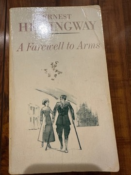 | Lieutenant Frederic Henry, an American ambulance driver on the Italian WWI front, falls in love with nurse Catherine Barkley and eventually makes his "separate peace"—deserting to flee with her to Switzerland. The rain running through the novel, Catherine's death in childbirth, and Henry's stripped-down prose are all formal expressions of the same truth: the world will break you, and there is no consolation. |
| [The Old Man and the Sea](influential/the-old-man-and-the-sea.md) | Santiago, an aging Cuban fisherman, hooks a great marlin and fights it alone at sea for three days, then loses it to sharks on the way back. Hemingway's late masterpiece is his fullest statement of his code: what matters is not victory but the quality of the struggle. A man can be destroyed but not defeated. |

---

### Joseph Heller

| Book | Summary |
|------|---------|
| [Catch-22](influential/catch-22.md) 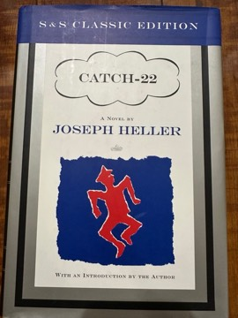 | Yossarian is a WWII bombardier who wants to be grounded for insanity, but Catch-22 specifies that concern for one's own safety in the face of real danger is proof of a rational mind—so anyone who asks to be grounded cannot be insane. The definitive satirical account of bureaucratic insanity; its black comedy is structurally inseparable from its moral seriousness. |
| [Something Happened](influential/something-happened.md) | Bob Slocum, a comfortable middle manager in an unnamed American corporation, narrates his fears, his work politics, his failing family relationships, and his emotional paralysis in 500 pages of suffocating interior monologue. The dark side of American success—what the achieved life feels like from inside—ending with Slocum inadvertently killing his son through an act of "protective" love. More demanding and more devastating than Catch-22. |

---

### S. L. Bhyrappa

| Book | Summary |
|------|---------|
| [Parva (ಪರ್ವ)](influential/parva.md) 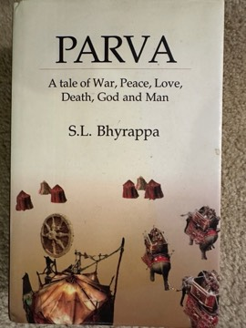 | Bhyrappa's monumental retelling of the Mahabharata strips the epic of divine machinery and reimagines it as entirely human beings driven by desire, ambition, and the irreducible complexity of dharma. Characters speak in first-person voices—Karna, Draupadi, Kunti each offer irreconcilable perspectives. The result is a 700-page ethical inquiry into dharma demonstrating how obligations fracture under pressure into competing claims that cannot all be honored. One of the great novels in any Indian language. |
| [SAkSi (ಸಾಕ್ಷಿ)](influential/saksi.md) 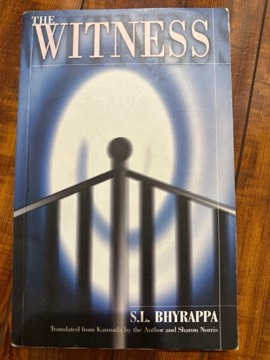 | An early Bhyrappa novel structured around whether objective moral truth can be known, or whether all witness is inevitably subjective. Multiple characters testify to the "same" events; each partial perspective reveals how witnessing is an act of interpretation. Engages Western phenomenology and existentialism while grounding the inquiry in Indian philosophical categories. |
| [AvaraNa (ಆವರಣ)](influential/avarana.md) 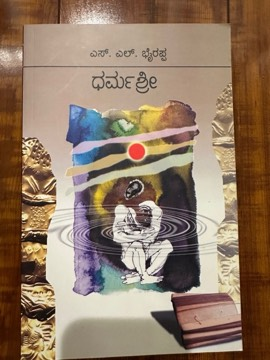 | Bhyrappa's most controversial novel follows Lakshmi, who has converted to Islam, as her research into Aurangzeb's reign brings her into conflict with a politically managed historical consensus. A serious inquiry into the relationship between historical narrative, power, and personal identity. |
| [VamSaVrukSa (ವಂಶವೃಕ್ಷ)](influential/vamsavruksa.md) 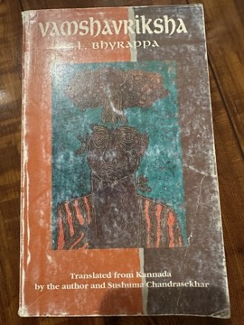 | An early Bhyrappa novel exploring a Karnataka Brahmin family across generations—tradition, modernity, and the relationship between a grandfather and his granddaughter Nandini whose choices bring those tensions to a head. Asks whether traditional ethical frameworks and individual freedom can coexist. Adapted into one of the finest Kannada films of the 1970s. |
| [Mandra (ಮಂದ್ರ)](influential/mandra.md) | A sustained exploration of classical Indian music, artistic obsession, and what the single-minded pursuit of mastery costs in human terms. Bhyrappa's research into Carnatic and Hindustani music is evident throughout. The title—the bass note, the lowest register—is a statement: the deepest sound is the foundation. |

---

### Robert Pirsig

| Book | Summary |
|------|---------|
| [Zen and the Art of Motorcycle Maintenance](influential/zen-and-the-art-of-motorcycle-maintenance.md) | A motorcycle journey from Minneapolis to San Francisco is the vehicle for a sustained philosophical inquiry into Quality—the pre-intellectual reality underlying all value judgments. Pirsig argues that the split between romantic understanding (immediate, aesthetic) and classical understanding (analytical, technical) is the central pathology of modern Western thought. The most widely read philosophical novel of the 20th century. |
| [Lila](influential/lila.md) | The philosophical sequel to Zen, developing the Quality concept into a systematic Metaphysics of Quality: Quality manifests in four levels (inorganic, biological, social, intellectual), each with its own values. The river journey with the disturbed passenger Lila is both the frame and the test: can Quality account for a human life that seems to embody its absence? |

---

### Steven Pinker

| Book | Summary |
|------|---------|
| [The Language Instinct](influential/the-language-instinct.md) 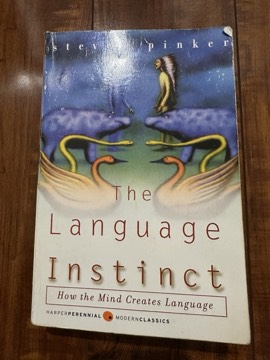 | Pinker's argument that language is a biological instinct—a faculty shaped by natural selection, not a cultural invention—draws on Chomsky's generative grammar, creole languages, acquisition research, and linguistic universals. Written with encyclopedic range and wit. Permanently changed how cognitive scientists and educated general readers think about language's relationship to mind. |
| [How the Mind Works](influential/how-the-mind-works.md) | An ambitious synthesis of cognitive science, evolutionary psychology, and computational theories of mind—arguing that the mind is a neural computer shaped by natural selection to solve adaptive problems. The book covers vision, emotions, social reasoning, and the arts using the computational metaphor. The best single-volume account of the computational theory of mind for general readers. |
| [The Better Angels of Our Nature](influential/the-better-angels-of-our-nature.md) | Pinker's 800-page argument that violence has declined across human history—homicide rates, war casualties, slavery, torture across centuries—is the most comprehensive data-driven challenge to the intuition that the present is especially violent. Its methods and conclusions have been extensively debated, but the core argument about the long-term trajectory of human violence is better supported than the intuition it displaces. |

---

### Nassim Nicholas Taleb

| Book | Summary |
|------|---------|
| [Skin in the Game](influential/skin-in-the-game.md)  | The fourth book in Taleb's Incerto series argues that having personal exposure to the consequences of one's decisions is the foundational requirement for reliable judgment, ethical behavior, and functioning institutions. Risk transfer—advising others while being personally insulated from consequences—corrupts judgment. Simultaneously a philosophy of ethics, a critique of expert class thinking, and a meditation on what it means to be a man of honor. |

---

### Richard Dawkins

| Book | Summary |
|------|---------|
| [The Selfish Gene](influential/the-selfish-gene.md) | The gene-centered view of evolution: natural selection operates at the level of genes, not organisms or groups; organisms are "survival machines" genes build to maximize their own replication. The book reframes altruism, cooperation, and social behavior as gene-level strategies, introduces the concept of the "meme" as a unit of cultural transmission analogous to the gene, and remains one of the most influential works in the public understanding of evolutionary biology. |

---

### Douglas Adams

| Book | Summary |
|------|---------|
| [The Hitchhiker's Guide to the Galaxy](influential/hitchhikers-guide-to-the-galaxy.md) | Arthur Dent survives the destruction of Earth (demolished for a hyperspace bypass) thanks to his friend Ford Prefect, who turns out to be an alien researcher. The novel uses science fiction's cosmic scale to satirize bureaucracy, consumerism, and the human search for meaning with extraordinary comic precision. The answer to Life, the Universe, and Everything is 42. Consistently funnier on re-reading, and more philosophically serious than its reputation suggests. |

---

### J. R. R. Tolkien

| Book | Summary |
|------|---------|
| [The Lord of the Rings](influential/the-lord-of-the-rings.md) 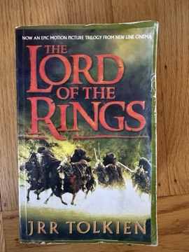 | The foundational work of modern high fantasy: Frodo Baggins inherits the One Ring and must carry it to Mount Doom to prevent the Dark Lord Sauron from enslaving Middle-earth. Built on decades of world-construction—complete languages, mythologies, histories—the novel has a quality of age and loss that distinguishes it from its imitators. Tolkien's concept of subcreation and his theory of eucatastrophe remain the most influential ideas in fantasy literature. |
| [The Hobbit](influential/the-hobbit.md) | Bilbo Baggins—a comfort-loving hobbit—is recruited by Gandalf and thirteen dwarves to help reclaim Erebor from the dragon Smaug. The prequel to The Lord of the Rings establishes Middle-earth with a lighter tone, but "Riddles in the Dark"—where Bilbo encounters Gollum and acquires the Ring—introduces moral complexity that reverberates through everything that follows. Bilbo's mercy toward Gollum is the most important act of pity in Tolkien's mythology. |

---

### Vikram Seth

| Book | Summary |
|------|---------|
| [A Suitable Boy](influential/a-suitable-boy.md) 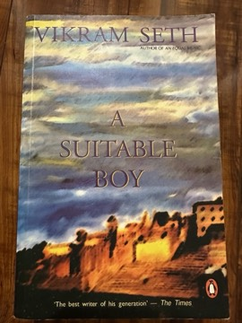 | One of the longest novels in English—1,500 pages—set in 1950s North India, following Mrs. Rupa Mehra's campaign to find a husband for her daughter Lata, while Lata navigates three very different suitors. Around the central love story, Seth weaves an extraordinary panorama of post-independence India: land reform, communal tensions, classical music, early democracy. Social realism in the tradition of Tolstoy and George Eliot, researched for thirteen years. |

---

### Salman Rushdie

| Book | Summary |
|------|---------|
| [Midnight's Children](influential/midnights-children.md) | Saleem Sinai is born at the exact moment of Indian independence—midnight, August 15, 1947—and discovers that all children born in that first hour have supernatural powers. Rushdie's Booker Prize-winning novel uses magical realism to tell the story of India's first decades: partition, emergency, the corruption of idealism. One of the defining texts of postcolonial literature. |
| [The Satanic Verses](influential/the-satanic-verses.md) | Two Indian actors survive a hijacked airliner's explosion over the English Channel through supernatural transformation and land in Thatcher's Britain; interleaved with dream sequences reimagining early Islamic history. Explores identity, migration, religious doubt, and the experience of the Indian immigrant in England. One of the most contested novels of the 20th century; Khomeini's 1989 fatwa made dispassionate reading nearly impossible. |

---

### George Orwell

| Book | Summary |
|------|---------|
| [1984](influential/1984.md) 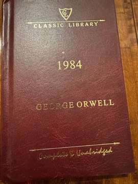 | Winston Smith secretly rebels against Big Brother's totalitarian regime in Oceania and falls in love with Julia—until the Thought Police catch them. Orwell's diagnosis of totalitarianism—the rewriting of history, the management of language, the systematic destruction of private thought—remains the most influential political novel of the 20th century. Room 101, doublethink, and the Ministry of Truth have entered the language because the concepts they name are real. |

---

### Fyodor Dostoevsky

| Book | Summary |
|------|---------|
| [The Brothers Karamazov](influential/brothers-karamazov.md) | Three brothers—the sensual Dmitri, the intellectual Ivan, the spiritual Alyosha—and their brutal father Fyodor collide in a story that is simultaneously a murder mystery, a philosophical debate about God and morality, and a profound psychological study. Ivan's "Grand Inquisitor" chapter is one of the most sustained challenges to religious faith in all of fiction. Dostoevsky's last and greatest novel. |

---

### James Gleick

| Book | Summary |
|------|---------|
| [Chaos: Making a New Science](influential/chaos-making-a-new-science.md) | The story of how chaos theory—the study of nonlinear, sensitive-initial-conditions systems—emerged across multiple scientific disciplines in the 1970s-80s. Gleick shows how the same mathematical insights appeared independently in meteorology, ecology, fluid dynamics, and cardiology; the butterfly effect, strange attractors, and fractal geometry are explained with the clarity that earned Gleick a Pulitzer nomination. |

---

### Siddhartha Mukherjee

| Book | Summary |
|------|---------|
| [The Gene: An Intimate History](influential/the-gene.md) | A sweeping narrative history of genetics from Mendel's peas through the double helix to CRISPR, interwoven with the author's own family history of mental illness. Mukherjee traces the rise and catastrophic fall of eugenics and uses this history as context for evaluating the ethics of modern gene editing. One of the finest examples of science writing that refuses to separate technical content from ethical weight. |

---

### Kannada Literature

| Book | Summary |
|------|---------|
| [MaraLi maNNige (ಮರಳಿ ಮಣ್ಣಿಗೆ)](influential/marali-mannige.md) | Shivarama Karanth's 1942 novel follows an educated man who returns to his coastal Karnataka village and must negotiate a life between the world his education has opened and the world he comes from. Karanth renders the Tulu Nadu landscape, its yakshagana culture, and its social hierarchies with the intimacy of a lifetime of documentation. One of the defining novels of the Navodaya period of Kannada fiction. |
| [nAgarahAvu (ನಾಗರಹಾವು)](influential/nagarahavu.md) 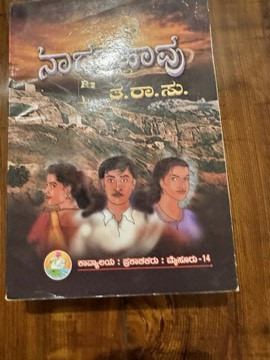 | ta ra subba rao's 1959 Kannada novel follows three women whose lives are damaged by the same charismatic, emotionally unavailable man across years of love, betrayal, and consequence. Among the first major Kannada writers, ta ra subba rao brought sustained attention to women's inner lives. The most widely-read Kannada novel ever written; adapted into one of the most successful Kannada films of the 1970s. |
| [Durgastamana (ದುರ್ಗಾಸ್ತಮಾನ)](influential/durgastamana.md) *T. R. Subba Rao (Ta. Ra. Su.)* 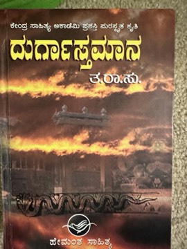 | Ta. Ra. Su.'s final novel, a historical epic about the fall of Chitradurga and its last Nayaka ruler, Madakari Nayaka, to Hyder Ali in the eighteenth century. Regarded as the author's masterpiece, it won the Sahitya Akademi Award posthumously in 1985 and is considered a classic of Kannada historical fiction. |
| [Huchchu Manassina Hattu Mukhagalu (ಹುಚ್ಚು ಮನಸ್ಸಿನ ಹತ್ತು ಮುಖಗಳು)](influential/huchchu-manassina-hattu-mukhagalu.md) *(partially read)* *K. Shivarama Karanth* 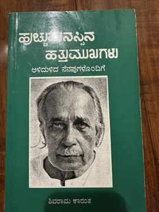 | The autobiography of Kota Shivarama Karanth, the polymath Kannada novelist, Yakshagana reformer, environmentalist and Jnanpith laureate. Its title, 'Ten Faces of a Crazy Mind,' refers to the many pursuits of his restless life. It was translated into English by H. Y. Sharada Prasad as *Ten Faces of a Crazy Mind*. |
| [Rasaphala (ರಸಫಲ)](influential/rasaphala.md) *Gorur Ramaswamy Iyengar* | A Kannada work by Gorur Ramaswamy Iyengar (1904–1991), the humorist and essayist known for his gentle, affectionate sketches of village life in the Hassan region. Little published information about this particular title is available in English; it belongs to the body of Gorur's prose that made him a beloved figure in twentieth-century Kannada literature. |

---

### Indian Classical Texts

| Book | Summary |
|------|---------|
| [Ashtavakra Gita (aShTAvakra gItA)](influential/ashtavakra-gita.md) 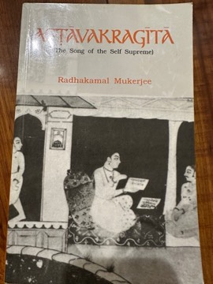 | The most radical non-dual philosophical text in the Indian tradition—a dialogue between the sage Ashtavakra and King Janaka arguing that liberation is immediately available because the self is already free; the apparent bondage is simply mistaken identification. Goes further than most Advaita texts in rejecting even spiritual practice as a form of bondage: "You are already free; why are you seeking?" |
| [Isha Upanishad (ISOpaniShad)](influential/isha-upanishad.md) | One of the shortest and most complete of the major Upanishads—18 verses that encompass a full philosophical and ethical vision. "All this is enveloped by the Lord; enjoy by renouncing; covet not what belongs to anyone." Gandhi's favorite text. The Isha's synthesis of engaged action and non-grasping non-attachment distinguishes it from more radically renunciatory strands of Indian philosophy. |
| [Ashtadhyayi (ashTAdhyAyi)](influential/ashtadhyayi.md) | Panini's 4th-century BCE grammar of Sanskrit—approximately 3,959 rules encoding all grammatically correct Sanskrit—is the world's first formal generative grammar and one of the greatest intellectual achievements in human history. The economy of Panini's formulation (thousands of rules in a few thousand syllables through metalinguistic compression) is the most extreme example of formal elegance in any intellectual tradition. Designed to be memorized and internalized, not consulted. |

---

### D. N. Shankara Bhat

| Book | Summary |
|------|---------|
| mAtina oLaguTTu 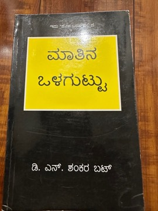 | Foundational Kannada linguistics work exploring the internal structure and historical development of the Kannada language from within the Dravidian typological framework. |
| Sound Change 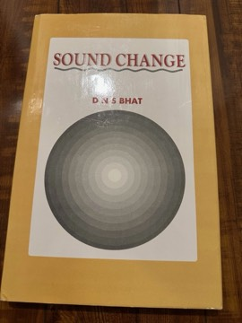 | Systematic study of phonological change in the Dravidian language family, with detailed attention to Kannada. |
| kannaDa beLadu banda dAri | History of the Kannada language's development — tracing the path from ancient Dravidian roots through Sanskrit and Prakrit influence to modern registers. |
| kannaDakke bEku kannaDadde vyAkaraNa 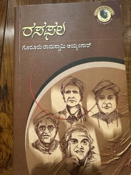 | Argument for a Kannada-internal grammar — rejecting Sanskrit grammatical categories imposed on a language with fundamentally different typological properties. |
| kannaDa baravaNigeyannu saripadisONa 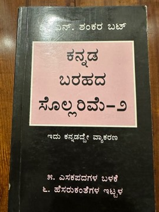 | Study of Kannada orthography and script reform — rationalizing written conventions to better represent spoken Kannada. |
| kannaDa sollarime | Exploration of Kannada vocabulary — its Dravidian base, Sanskrit borrowings, and native innovations as a window into cultural history. |
| [kannadadalle hosapadagalannu kaTTuva bage](influential/kannadadalle-hosapadagalannu-kattuva-bage.md) | Practical handbook for creating new Kannada vocabulary using native Dravidian morphological resources. Documents three word classes, two creation methods, and four prefix groups — applied affix-by-affix across 52 parts. Primary source for the DNS Bhat word-formation methodology. |
| [kannaDakke mahAprANa yAke bEDa](influential/kannadakke-mahaprana-yake-beda.md) 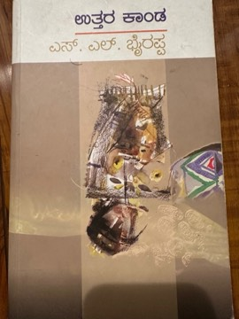 | Concise advocacy booklet arguing Kannada script does not need its aspirated-stop letters (borrowed from Sanskrit, absent from spoken Kannada). Frames retention as a literacy barrier; surveys script reforms in six other languages; dismantles ten objections. |
| [nijakku halegannaDa vyAkaraNa entahadu?](influential/nijakku-halegannada-vyakarana-entahadu.md) | Scholarly investigation of Old Kannada grammar — distinguishing genuine Dravidian rules from Sanskrit-imposed categories applied by ancient grammarians like Keshiraja. Shows how both classical and modern Kannada grammars went astray by following Sanskrit models. |

---

### Science and Biology

| Book | Summary |
|------|---------|
| [Genome: The Autobiography of a Species in 23 Chapters](influential/genome.md) 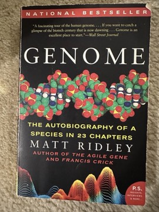 | Matt Ridley's 1999 book—one chapter per chromosome—uses each chromosome as a jumping-off point for a theme in genetics: fate, immunity, personality, memory, prehistory. Written at the moment of the Human Genome Project's near-completion. Makes the central distinction between blueprint (what genetics isn't) and recipe (what it is). |
| [Why We Sleep](influential/why-we-sleep.md) | Neuroscientist Matthew Walker's account of sleep's biological functions—memory consolidation, glymphatic waste clearance, immune regulation, emotional processing—and the catastrophic consequences of chronic deprivation. Controversial for some overstatements, but the core argument (that sleep is dramatically undervalued) is well-supported. Required reading for anyone who treats sleep as optional. |
| [Gene Machine (Decoding the Ribosome)](influential/gene-machine-ribosome.md) | Venkatraman Ramakrishnan's memoir of the decades-long effort to determine the atomic structure of the ribosome—the molecular machine translating genetic information into proteins—which earned him the 2009 Nobel Prize in Chemistry. A scientific memoir, insider account of competitive structural biology, and unusually candid account of scientific credit allocation. |
| [Who We Are and How We Got Here](influential/who-we-are-and-how-we-got-here.md) | David Reich's account of the ancient DNA revolution and what it has revealed about the deep history of human populations: mass population replacements in prehistoric Europe, Neanderthal admixture in modern humans, the three-way ancestry of South Asian populations. Findings that have fundamentally revised our understanding of the human past. |
| [The Horse, the Wheel and Language](influential/the-horse-the-wheel-and-language.md) | Archaeologist David Anthony's comprehensive account of the origins and spread of the Proto-Indo-European language family—arguing that the Pontic-Caspian steppe was the homeland, horse riding and wheeled vehicles were the enabling technology, and the Yamnaya expansion (3000-2000 BCE) spread Indo-European languages from Ireland to India. |
| [Why We Die: The New Science of Aging and the Quest for Immortality](influential/why-we-die.md) *Venki Ramakrishnan*  | Nobel laureate structural biologist Venki Ramakrishnan surveys the biology of aging—from DNA damage and telomeres to protein quality control, cellular senescence and metabolism—and assesses the claims of the booming longevity industry. The book balances genuine scientific progress against hype, and asks what radically longer lives would mean for society. |

---

### History and Biography

| Book | Summary |
|------|---------|
| [The Silk Roads: A New History](influential/the-silk-roads.md) | Peter Frankopan's revisionist global history recenters the world's historical narrative away from Europe toward the trade routes connecting China to the Mediterranean. Baghdad under the Abbasids was the world's intellectual and commercial center; Columbus was looking for the Silk Roads, not a "new world." One of the most important shifts of historical perspective available in popular form. |
| [The Anarchy: The Relentless Rise of the East India Company](influential/the-anarchy.md) | William Dalrymple's account of the East India Company's rise from a small trading operation to the ruler of the Indian subcontinent—the most extraordinary act of corporate aggrandizement in history. Drawing on Persian and Urdu sources rarely used in Anglophone histories, Dalrymple renders the Indian political actors as complex protagonists and makes the EIC's conduct directly relevant to questions about corporate accountability today. |
| [A People's History of the United States](influential/a-peoples-history-of-the-united-states.md) | Howard Zinn's retelling of American history from the perspective of those typically excluded—Native Americans, enslaved people, workers, women, dissidents. Explicitly non-neutral; permanently installs the question "from whose perspective?" in the reading of any historical account. |
| [A Corner of a Foreign Field](influential/a-corner-of-a-foreign-field.md) | Ramachandra Guha's history of cricket in India and of India through cricket: the Bombay Quadrangular tournaments organized on religious identity lines; Palwankar Baloo, a Dalit cricketer of genius excluded from full humanity by caste; cricket as a domain where India's social conflicts were enacted with unusual explicitness. The best cricket history ever written. |
| [The Path to Power](influential/the-path-to-power.md) | The first volume of Robert Caro's massive biography of Lyndon Johnson—from his boyhood in the impoverished Texas Hill Country through his election to Congress in 1937. A study in political genius and what political power requires and costs. Caro uses biography to develop a general theory of how power is accumulated. |
| [Barbarian Days: A Surfing Life](influential/barbarian-days.md) | William Finnegan's Pulitzer Prize-winning memoir of a life organized around surfing—from California and Hawaii through decades in the Pacific, South Africa, and Madeira. Beyond the sport, a meditation on devotion to a practice that offers nothing beyond the practice itself. The wave is Finnegan's model for the relationship between skill, attention, and an indifferent physical reality. |
| [Alan Turing: The Enigma](influential/alan-turing-the-enigma.md) 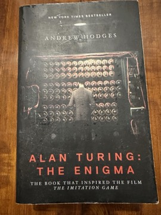 | Andrew Hodges's definitive biography of Alan Turing—the Turing machine, Bletchley Park's codebreaking, early digital computing, and Turing's prosecution, chemical castration, and apparent suicide for the crime of homosexuality. A mathematical biography of extraordinary precision and a sustained indictment of the state's treatment of one of its most valuable servants. |
| [Epigraphia Carnatica](influential/epigraphia-carnatica.md) | Benjamin Lewis Rice's monumental 12-volume compilation of inscriptions from the Mysore/Karnataka region—the primary source material for a millennium of Karnataka political, social, and cultural history. The inscriptions of the Ganga, Hoysala, Rashtrakuta, and Vijayanagara periods. The foundation on which all modern Karnataka historical scholarship is built. |
| [The Wright Brothers](influential/the-wright-brothers.md) | David McCullough's account of how Orville and Wilbur Wright achieved powered flight through methodical experimentation—wind tunnels, hundreds of wing configurations, glider testing—rather than resources or inspiration. A case study in systematic elimination of error as the path to breakthrough. |
| [A Mind at Play: How Claude Shannon Invented the Information Age](influential/a-mind-at-play.md) 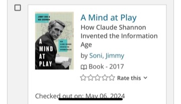 | The biography of Claude Shannon, whose 1948 paper "A Mathematical Theory of Communication" founded information theory and underwrites all modern digital communication. Shannon defined information as entropy, deliberately excluded meaning from the definition, and proved fundamental limits on reliable communication. A portrait of a playful, indifferent-to-recognition genius. |
| [Master of the Senate (The Years of Lyndon Johnson, Vol. 3)](influential/master-of-the-senate-the-years-of-lyndon-johnson-vol-3.md) *Robert A. Caro* | The third volume follows Lyndon Johnson's twelve years in the United States Senate (1949–1960), where he became the youngest and most powerful Majority Leader in its history. Caro combines a history of the Senate as an institution with a study of legislative genius, culminating in the Civil Rights Act of 1957. It won the Pulitzer Prize and the National Book Award. |
| [Means of Ascent (The Years of Lyndon Johnson, Vol. 2)](influential/means-of-ascent-the-years-of-lyndon-johnson-vol-2.md) *Robert A. Caro* | The second volume of Caro's biography covers Lyndon Johnson's years from 1941 to 1948, culminating in the stolen 1948 Texas Senate primary he won by 87 votes. Caro sets Johnson's ruthless ambition against the integrity of his opponent, former governor Coke Stevenson. It is the shortest and most morally pointed volume of the series. |
| [Savaging the Civilized: Verrier Elwin, His Tribals, and India](influential/savaging-the-civilized.md) *Ramachandra Guha* | Ramachandra Guha's biography of Verrier Elwin, the Oxford-educated Englishman who came to India as a missionary, left the church, lived among the Gonds and other tribes of central India, and became independent India's leading advocate and adviser on tribal affairs. The book is also a history of debates over how India should treat its tribal peoples. |
| [The Passage of Power (The Years of Lyndon Johnson, Vol. 4)](influential/the-passage-of-power-the-years-of-lyndon-johnson-vol-4.md) *Robert A. Caro* | The fourth volume covers Lyndon Johnson from 1958 to 1964: his failed 1960 bid for the presidential nomination, his humiliating years as John F. Kennedy's vice president, and his assumption of the presidency after Kennedy's assassination. Caro's account of the weeks after Dallas, when Johnson revived Kennedy's stalled legislative agenda, is the book's centrepiece. |
| [The Power Broker: Robert Moses and the Fall of New York](influential/the-power-broker.md) *(partially read)* *Robert A. Caro* 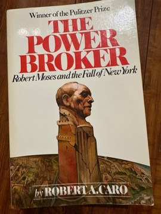 | Caro's monumental biography of Robert Moses, the unelected official who reshaped New York over four decades through parks, bridges, highways and housing projects. It is an exhaustive study of how power is acquired and used outside democratic accountability. It won the 1975 Pulitzer Prize for Biography. |

---

### Mathematical and Computing Thought

| Book | Summary |
|------|---------|
| [Gödel's Proof](influential/godels-proof.md) 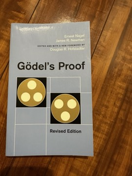 | Ernest Nagel and James Newman's 100-page exposition of Gödel's incompleteness theorems—the 1931 results proving that any consistent formal system powerful enough to express arithmetic contains true statements that cannot be proven within the system. One of the most important mathematical results of the 20th century, explained with patience and rigor. |
| [Something Deeply Hidden](influential/something-deeply-hidden.md) 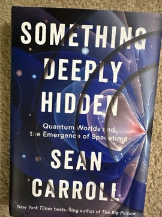 | Sean Carroll's accessible defense of the Everett (many-worlds) interpretation of quantum mechanics—arguing that the universe branches rather than collapses at quantum measurement. The best popular account of foundational quantum mechanics and why the measurement problem is a real problem that the physics community has largely avoided. |
| [Fermat's Last Theorem](influential/fermats-last-theorem.md) 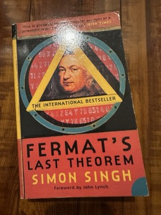 | Simon Singh's narrative of the 350-year search for a proof of Fermat's conjecture—culminating in Andrew Wiles's 1995 proof using elliptic curves and modular forms. The book that demonstrated to a generation that mathematics could sustain compelling popular narrative. |
| [Infinite Powers: How Calculus Reveals the Secrets of the Universe](influential/infinite-powers.md) | Steven Strogatz's narrative history of calculus from Archimedes through Newton and Leibniz to modern applications in medicine and physics, organized around the "infinity principle." The best popular account of what calculus is and why it works, without requiring the reader to perform any calculations. |
| [Beyond Infinity](influential/beyond-infinity.md)  | Eugenia Cheng's exploration of mathematical infinity—Cantor's diagonal argument, the hierarchy of infinities, the Continuum Hypothesis—organized around the central result that some infinities are strictly larger than others. Makes Cantor's discovery not just comprehensible but thrilling. |
| [A History of Vector Analysis](influential/a-history-of-vector-analysis.md) 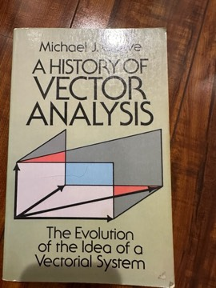 | Michael Crowe's account of the "battle of the systems" between Hamilton's quaternions and the vector analysis of Gibbs and Heaviside—showing how the mathematical notation we use daily was chosen through community politics, pedagogy, and physical intuition as much as logical correctness. |
| [The Universal History of Computing](influential/universal-history-of-computing.md)  | Georges Ifrah's encyclopedic history of computing instruments—from the abacus through Babbage to ENIAC and the von Neumann architecture—with unusual breadth across non-Western computing traditions. Documents the lineage from Leibniz's binary arithmetic through Boole through Shannon to the modern computer. |
| [Gödel, Escher, Bach: An Eternal Golden Braid](influential/godel-escher-bach.md) *(partially read)* *Douglas Hofstadter* 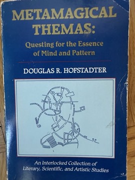 | Hofstadter's Pulitzer Prize-winning exploration of self-reference, formal systems and the emergence of mind, built around the work of mathematician Kurt Gödel, artist M. C. Escher and composer J. S. Bach. Alternating chapters with playful dialogues between Achilles and the Tortoise, it argues that consciousness arises from 'strange loops' in complex systems. |

---

### Martial Arts and Physical Practice

| Book | Summary |
|------|---------|
| [Light on Yoga](influential/light-on-yoga.md) 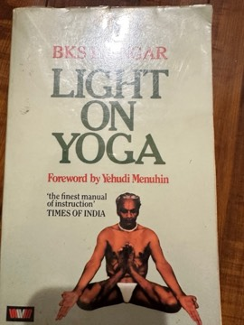 | B. K. S. Iyengar's foundational text on Hatha Yoga—200+ asanas documented with step-by-step instructions and 600+ photographs, plus a theoretical framework arguing that precise geometric alignment is the path to yoga's deeper effects. Iyengar's prop system emerged from his therapeutic work with injured students. The book transformed global yoga practice by establishing a standard that distinguishes the practice it documents from fitness-oriented imitations. |
| [Born to Run](influential/born-to-run.md) | Christopher McDougall's account of the Tarahumara—an indigenous Mexican people who run ultramarathon distances with minimal injury into old age—and his investigation into the evolutionary biology of human endurance. Draws on Daniel Lieberman's persistence hunting hypothesis; argues that humans evolved as endurance predators and that modern cushioned running shoes may disrupt natural biomechanics. Sparked the minimalist running movement. |
| [Lore of Running](influential/lore-of-running.md) | Tim Noakes's 900-page reference on the science of distance running—physiology, training theory, nutrition, injury prevention—most significant for Noakes's "central governor" theory of fatigue: exercise limitation is regulated centrally by the brain to prevent catastrophic damage, not by peripheral muscle failure. The most evidence-based engagement with running available in popular form. |
| [Stretching Scientifically](influential/stretching-scientifically.md) 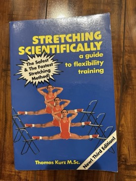 | Thomas Kurz's guide to developing extreme flexibility—arguing that flexibility is primarily a neural phenomenon and that isometric contracting, dynamic stretching, and strength through full range of motion are more effective than passive static stretching. The physiology is sound; training the nervous system rather than mechanically elongating tissue is consistent with contemporary sports science. |
| [Tao of Jeet Kune Do](influential/tao-of-jeet-kune-do.md) | Bruce Lee's posthumous compilation of martial arts notes centered on "using no way as way, having no limitation as limitation." Lee's rejection of fixed styles—his argument that any predetermined technique is a cage preventing effective response—anticipated mixed martial arts by decades and extends into a general principle about adaptive performance under uncertainty. "Be water, my friend." |
| [My Art of Karate](influential/my-art-of-karate.md) | Choki Motobu's 1926 account of his pragmatic, fighting-focused Okinawan karate—developed through intensive makiwara training and real combat rather than formal instruction. Motobu's skepticism about kata practice and emphasis on direct application represents the pragmatic pole of the tradition. His rivalry with Funakoshi defined a fundamental tension in 20th-century karate that has never been fully resolved. |
| [The Essence of Okinawan Karate-Do](influential/essence-of-okinawan-karate-do.md) 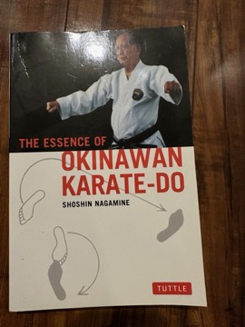 | Shoshin Nagamine's account of the classical Okinawan karate tradition—historical documentation, philosophical framework, and photographic record of the Matsubayashi-ryu system. Nagamine articulates karate as complete self-development rooted in Okinawan cultural values; his concept of bushi no nasake (warrior's compassion) is among the most important ethical principles in martial arts literature. |
| [The Martial Arts of Indonesia](influential/martial-arts-of-indonesia.md) 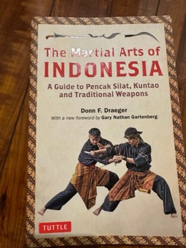 | Donn Draeger's comprehensive English-language account of pencak silat—hundreds of regional Indonesian fighting systems—documenting their diversity and integration with Sumatran adat, Javanese mysticism, and Balinese Hindu culture. Draeger's methodology (train seriously in the art before writing about it) established a standard for martial arts scholarship. |
| [Alone on the Wall](influential/alone-on-the-wall.md) 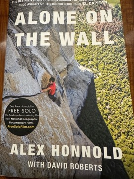 | Alex Honnold's memoir of free soloing—climbing without rope—focused on his preparation process (months of rope-rehearsal until every move is automated) and his philosophy of risk management (eliminating the sources of uncertainty that would make fear appropriate). The most precise account available of elite performance preparation under extreme conditions. |
| [Karate 1.0: Parameter of an Ancient Martial Art](influential/karate-1-0.md) *Andreas Quast* | A large independent historical study of the origins of karate and kobudō in the Ryūkyū Kingdom, by the German researcher Andreas Quast. It examines how the kingdom's military, police and security organisation shaped Okinawan fighting traditions, compiles historical written sources, and identifies hundreds of martial artists of the kingdom era. |
| [Pranayama Dipika (ಪ್ರಾಣಾಯಾಮ ದೀಪಿಕಾ) / Light on Pranayama](influential/pranayama-dipika.md) *(partially read)* *B. K. S. Iyengar* 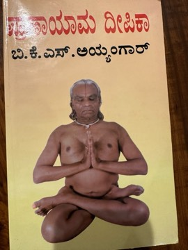 | B. K. S. Iyengar's systematic guide to yogic breath control, the companion to his *Light on Yoga* (Yoga Dipika). It sets out the theory of pranayama in the yoga tradition and then gives detailed, graded instructions for preparation, posture, and techniques such as ujjayi, viloma, nadi shodhana and kumbhaka, with warnings about their risks. It is regarded as a standard reference in the Iyengar tradition. |
| [Yoga Body: The Origins of Modern Posture Practice](influential/yoga-body.md) *Mark Singleton* 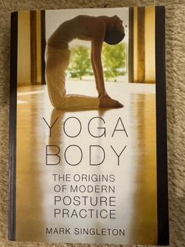 | A scholarly history arguing that modern posture-based yoga owes as much to late nineteenth- and early twentieth-century physical culture, gymnastics and Indian nationalism as to ancient tradition. Singleton traces how asana, marginal in most premodern yoga texts, became the centre of global yoga practice. The book reshaped academic understanding of modern yoga and provoked debate among practitioners. |

---

### Fiction (World Literature)

| Book | Summary |
|------|---------|
| [Train to Pakistan](influential/train-to-pakistan.md) | Khushwant Singh's 1956 novel set in Mano Majra—a border village during the 1947 Partition—where decades of peaceful coexistence dissolve into retributive violence as the trains begin carrying their new cargo. The most widely-read English-language novel about Partition. Its power comes from its refusal of distance: specific people, specific community, specific destruction. |
| [The Catcher in the Rye](influential/the-catcher-in-the-rye.md) | Holden Caulfield, recently expelled from his fourth school, spends three days in New York City processing the death of his brother Allie through a sustained interior monologue of performed contempt and actual longing. Not a novel about adolescence but about grief and the impossibility of protecting what you love. |
| [Narcissus and Goldmund](influential/narcissus-and-goldmund.md) | Hermann Hesse's medieval German novel of two young men at a monastery—Narcissus the ascetic intellectual and Goldmund the sensuous wanderer—embodying the two great human poles: spirit and nature, thought and sense, monastery and world. The novel's final conversation—two men acknowledging that they needed each other's way to understand their own—is one of the most emotionally complete endings in 20th-century fiction. |
| [The Trial](influential/the-trial.md) | Josef K. is arrested without explanation, charged with an unspecified crime before an opaque legal system, and eventually executed without ever learning what he was accused of. Kafka's posthumously published novel is the most influential fictional account of bureaucracy as a system of power operating independently of any agent's intentions—not malicious but procedural, and that is the source of its horror. |
| [The Magic Mountain](influential/the-magic-mountain.md) | Hans Castorp arrives at a Swiss Alpine sanatorium for a three-week visit and stays seven years, absorbed by the mountain's suspension of ordinary time. The sanatorium is pre-WWI European civilization in miniature; the debate between Settembrini (progressive humanism) and Naphta (reactionary irrationalism) is the ideological conflict tearing the continent apart. The war's arrival destroys seven years of philosophical education in an instant. |
| [Growth of the Soil](influential/growth-of-the-soil.md) 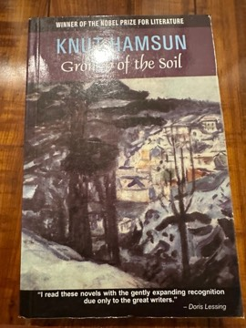 | Knut Hamsun's Nobel Prize-winning novel follows Isak—a solitary Norwegian settler who clears wilderness and builds a farm through patient, generative labor. Simultaneously a love poem to agricultural life and an ideologically troubling text: the same qualities that make Isak heroic in Hamsun's vision connect to the agrarian nationalism of European fascism, which Hamsun later embraced. Requires active reading under its shadow. |
| [The Feast of the Goat](influential/the-feast-of-the-goat.md) 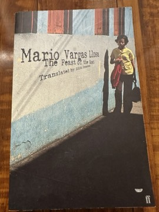 | Mario Vargas Llosa's reconstruction of the final day of Trujillo's Dominican Republic dictatorship—narrated through Trujillo himself, the conspirators, and Urania Cabral, returning after 35 years to confront what was done to her at age 14. One of the most analytically precise fictional accounts of how a dictatorship maintains itself through the active, voluntary collaboration of the elite. |
| [Disgrace](influential/disgrace.md) 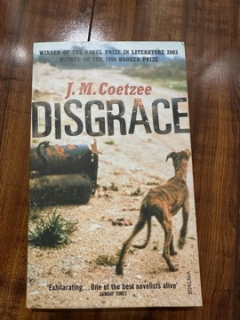 | South African professor David Lurie's coercive affair with a student leads to his resignation; his retreat to his daughter Lucy's smallholding ends in a brutal rape and Lucy's decision to remain, pregnant, under a protective arrangement with her neighbor. Coetzee refuses to resolve Lucy's choice—the most contested in contemporary fiction—and traces Lurie's transformation through his compassion for dying dogs with formal austerity. |
| [Things Fall Apart](influential/things-fall-apart.md) 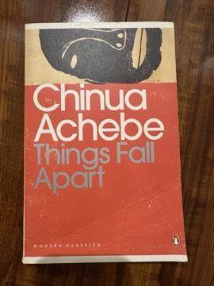 | Chinua Achebe's Igbo protagonist Okonkwo meets colonial disruption in southeastern Nigeria with violence and is destroyed. Written as a direct response to the tradition of European fiction about Africa, the novel insists on the interiority and coherence of Igbo society before and during colonialism. The district commissioner's plan for a paragraph about Okonkwo in his book on "the pacification of the primitive tribes" is one of the most devastating endings in literature. |
| [Shantaram](influential/shantaram.md) 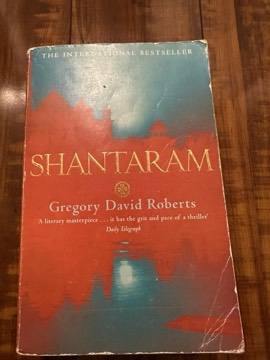 | Gregory David Roberts's semi-autobiographical novel follows Lin—an escaped Australian convict in Bombay—through the slums, the film industry, the underworld, and eventually the Afghan mujahideen resistance. Over 900 pages of vivid, philosophically extravagant prose; the Bombay sections are the most authentic portrait of the city in the 1980s available in any fiction. |
| [The Black Book](influential/the-black-book.md) 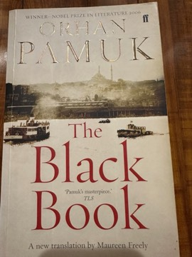 | Orhan Pamuk's Istanbul novel—Galip searching for his missing wife through the city's labyrinthine streets, interleaved with newspaper columns by the celebrity writer Celal—is simultaneously a thriller, a meditation on identity and imitation, and a Sufi mystical text. Galip's gradual absorption into Celal's identity raises questions about whether selfhood is original or constituted through imitation. |
| [Island](influential/island.md) | Aldous Huxley's final novel (1962) imagines Pala—a utopian island society synthesizing Buddhist philosophy, Western science, and progressive education—through the eyes of a cynical journalist sent to facilitate its destruction. The oil company's coup that destroys the utopia at the end refuses the comfort of a utopia that could simply exist if only people were better. |
| [Ibis Trilogy](influential/ibis-trilogy.md) 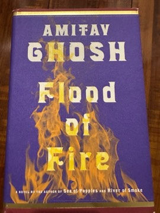 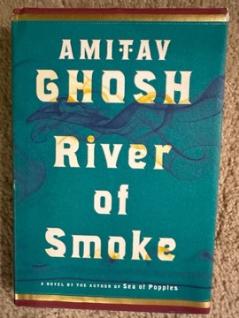 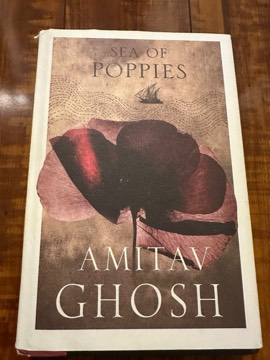 | Amitav Ghosh's three-novel sequence set against the opium trade between British India and China in the 1830s and the First Opium War. The trilogy makes visible the systemic nature of colonial economics through a linguistically inventive ensemble narrative centered on the repurposed slave ship Ibis. One of the most important works of Indian fiction of the last generation. |
| [Kim](influential/kim.md) *Rudyard Kipling* | Kimball O'Hara, an orphaned Irish boy growing up on the streets of Lahore, becomes the disciple of a Tibetan lama seeking a sacred river while also being recruited into British intelligence in the 'Great Game' against Russia. Kipling's most admired novel is a panoramic, affectionate portrait of the Grand Trunk Road and late nineteenth-century India. It is also a central text in debates about empire and literature. |
| [Lord of the Flies](influential/lord-of-the-flies.md) *William Golding* | A group of British schoolboys stranded on an uninhabited island after a plane crash try to govern themselves and descend into tribal violence. Golding's first novel inverts the Victorian castaway adventure into a bleak fable about the fragility of civilization and the capacity for savagery within ordinary people. It became one of the most widely taught novels of the twentieth century. |
| [The Glass Bead Game](influential/the-glass-bead-game.md) *Hermann Hesse* 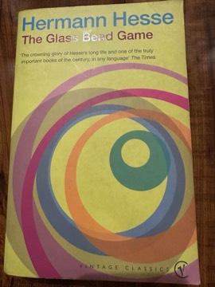 | Hesse's last and longest novel is set in a future province, Castalia, devoted to pure intellectual life, whose supreme art is the Glass Bead Game, a synthesis of music, mathematics and all knowledge. It follows Joseph Knecht's rise to Magister Ludi and his eventual decision to leave the order. The novel contributed to Hesse's Nobel Prize in Literature in 1946. |

---

### Economics, Politics, and Ideas

| Book | Summary |
|------|---------|
| [A Random Walk Down Wall Street](influential/a-random-walk-down-wall-street.md)  | Burton Malkiel's sustained argument that stock prices follow a random walk and that no active investment manager can consistently beat the market after fees—so most investors are best served by low-cost index funds. The intellectual foundation of the index fund revolution; updated across 12 editions as the evidence has grown stronger. |
| [Class Warfare](influential/class-warfare.md)  | Interviews with Noam Chomsky covering American political economy, media structure, and US foreign policy through Chomsky's consistent framework: follow material interests to understand political behavior, and recognize that mainstream discourse systematically excludes class analysis. Most valuable as a corrective and a challenge; the analytical framework and the specific historical claims require independent evaluation. |

---

### Indian Fiction in English

| Book | Summary |
|------|---------|
| [A Fine Balance](influential/a-fine-balance.md) *Rohinton Mistry* | Four strangers—a Parsi widow, two Dalit tailors and a student from the hills—are thrown together in a cramped flat in an unnamed Indian city during the Emergency of the mid-1970s. Mistry's epic novel of endurance and loss follows how state power, caste and poverty grind down ordinary lives. Shortlisted for the Booker Prize, it is regarded as one of the major Indian novels in English. |
| [The Glass Palace](influential/the-glass-palace.md) *Amitav Ghosh*  | Beginning with the British invasion of Mandalay in 1885 and the exile of Burma's last king, Ghosh's multigenerational novel follows an orphan who becomes a teak and rubber magnate and the families connected to him across Burma, India and Malaya. It is a sweeping historical saga about empire, migration, war and divided loyalties, including the Indian soldiers who served Britain and the Indian National Army. |

---

### Indian History and Society

| Book | Summary |
|------|---------|
| [Lords of the Deccan: Southern India from the Chalukyas to the Cholas](influential/lords-of-the-deccan.md) *Anirudh Kanisetti* | A narrative history of the Deccan and southern India from roughly the sixth to the thirteenth century, covering the Chalukyas, Rashtrakutas, Cholas and their rivals. Kanisetti draws on inscriptions and recent scholarship to present medieval South India as a world of ambitious, cosmopolitan empires rather than a backwater to northern history. |
| [The Discovery of India](influential/the-discovery-of-india.md) *(partially read)* *Jawaharlal Nehru*  | Written while Nehru was imprisoned in Ahmednagar Fort during 1942–1946, this sweeping account of Indian history, philosophy and culture from the Indus Valley to the end of British rule presents India as a civilisation unified by continuity and synthesis. It is a foundational text of Indian secular nationalism. |
| [The Muria and Their Ghotul](influential/the-muria-and-their-ghotul.md) *(partially read)* *Verrier Elwin*  | Verrier Elwin's large ethnographic study of the Muria Gonds of Bastar in central India, centred on the ghotul, the village dormitory where young unmarried men and women lived, learned and formed relationships. It is a landmark of Indian anthropology, notable for its sympathetic portrait of tribal life and its frank discussion of sexuality. |

---

### Outdoors, Climbing and Travel

| Book | Summary |
|------|---------|
| [The Motorcycle Diaries](influential/the-motorcycle-diaries.md) *(partially read)* *Ernesto 'Che' Guevara*  | The young medical student Ernesto Guevara's journal of a 1952 journey across South America with his friend Alberto Granado, first on a failing motorcycle and then on foot, by raft and hitchhiking. The trip exposed him to poverty and exploitation that he later saw as formative of his political awakening. Published posthumously, it became a bestseller and the basis of a 2004 film. |
| [Waterlog: A Swimmer's Journey Through Britain](influential/waterlog.md) *(partially read)* *Roger Deakin* | Roger Deakin's account of swimming through Britain's rivers, lakes, lidos, tarns and seas, beginning in the moat of his Suffolk farmhouse. Part travelogue, part natural history and part reflection on access to the countryside, it became a cult classic and is credited with helping inspire the modern wild-swimming movement. |

---

## Read but Not That Influential

Books I have read (or partly read) and valued, but which haven't reshaped how I think the way the books above have. Each links to a page with a summary and the critics' take; personal takeaways are still to be written.

---

### Business, Self-help and Psychology

| Book | Author | Summary |
|------|--------|---------|
| [Let My People Go Surfing: The Education of a Reluctant Businessman](read/let-my-people-go-surfing.md) *(partially read)*  | Yvon Chouinard | Patagonia founder Yvon Chouinard's memoir and business philosophy, tracing his path from climber and blacksmith making pitons to head of an outdoor-clothing company run on environmental principles. It sets out Patagonia's philosophies on product design, production, distribution, image, finance, human resources, management and the environment. |

---

### Economics, Politics, and Ideas

| Book | Author | Summary |
|------|--------|---------|
| [The Myth of the Rational Market: A History of Risk, Reward, and Delusion on Wall Street](read/the-myth-of-the-rational-market.md) | Justin Fox | An intellectual history of the efficient market hypothesis and the rise of financial economics, from early twentieth-century statistics through modern portfolio theory, options pricing and behavioral finance. Published just after the 2008 financial crisis, it explains how the belief that markets price risk correctly came to dominate finance, and how that belief came under attack. |

---

### Fiction (World Literature)

| Book | Author | Summary |
|------|--------|---------|
| [A Rising Man](read/a-rising-man.md)  | Abir Mukherjee | The first Wyndham and Banerjee mystery is set in Calcutta in 1919, where Captain Sam Wyndham, a traumatised Scotland Yard veteran newly arrived in India, investigates the murder of a senior British official with the help of Sergeant Surendranath 'Surrender-not' Banerjee. The whodunit is a vehicle for a sharp look at the Raj after the First World War and the Amritsar massacre. It won the CWA Historical Dagger and launched a popular series. |
| [Animal Farm](read/animal-farm.md) | George Orwell | Orwell's beast fable in which the animals of Manor Farm overthrow their human owner, only to see the pigs, led by Napoleon, become a new tyranny. A barely veiled allegory of the Russian Revolution and Stalinism, it is one of the most famous political satires in English. |
| [Atlas Shrugged](read/atlas-shrugged.md) | Ayn Rand | Rand's magnum opus imagines an America collapsing under government control as its most productive people, led by the mysterious John Galt, go on strike and disappear. Through railroad executive Dagny Taggart and steel magnate Hank Rearden, it presents Rand's philosophy of Objectivism in full, and it remains enormously popular and polarizing. |
| [Beloved](read/beloved.md) *(partially read)*  | Toni Morrison | Sethe, who escaped slavery, lives in Ohio after the Civil War in a house haunted by the ghost of the daughter she killed to save her from being returned to slavery, until a young woman calling herself Beloved arrives. Morrison's Pulitzer Prize-winning novel is a central work of American literature on the psychological legacy of slavery and the struggle to remember and survive it. |
| [Brave New World](read/brave-new-world.md) | Aldous Huxley | In the World State of 'the year of our Ford 632', people are mass-produced in hatcheries, conditioned into fixed castes, and kept content with sex, entertainment and the drug soma. When Bernard Marx brings John 'the Savage' from a reservation into this society, the cost of engineered happiness becomes visible. Alongside *1984*, it is one of the two defining dystopias of the twentieth century, imagining control through pleasure rather than terror. |
| [Complete Tales and Poems of Edgar Allan Poe](read/complete-tales-and-poems-of-edgar-allan-poe.md) *(partially read)*  | Edgar Allan Poe | A collected edition of Poe's short fiction and poetry: the gothic horror tales ("The Fall of the House of Usher", "The Tell-Tale Heart", "The Masque of the Red Death"), the detective stories that founded the genre ("The Murders in the Rue Morgue"), his novel *The Narrative of Arthur Gordon Pym*, and poems such as "The Raven" and "Annabel Lee". |
| [Disclosure](read/disclosure.md) | Michael Crichton | A corporate thriller in which tech manager Tom Sanders is accused of sexual harassment by his new boss and former lover, Meredith Johnson, after he rejects her advances, amid a high-stakes company merger. Its gender role reversal made it one of Crichton's most controversial books; it was filmed the same year. |
| [First Among Equals](read/first-among-equals.md) | Jeffrey Archer | Four ambitious British MPs from different backgrounds and parties compete over several decades, from 1964 onward, for the ultimate prize of becoming Prime Minister. Archer draws on his own time in Parliament for a long political saga; it was adapted for British television in 1986. |
| [Heart of Darkness](read/heart-of-darkness.md)  | Joseph Conrad | Marlow recounts his journey up the Congo River in the service of a Belgian trading company to find the ivory agent Kurtz, who has made himself a god among the people he exploits. Conrad's novella is a cornerstone of modernist fiction and of the literature on European imperialism, and since Chinua Achebe's critique it has also been a central text in debates about racism in the Western canon. |
| [In Dubious Battle](read/in-dubious-battle.md) | John Steinbeck | Steinbeck's novel of a strike by migrant apple pickers in California, organised by two Communist Party activists, the veteran Mac and the young recruit Jim. The first of his 'labour trilogy' before *Of Mice and Men* and *The Grapes of Wrath*, it is notable for refusing to romanticise either the growers or the organisers. |
| [Jonathan Livingston Seagull](read/jonathan-livingston-seagull.md) | Richard Bach | A short fable about a seagull who cares more about the perfection of flight than about scrapping for food, is cast out by his flock, and discovers higher planes of existence before returning to teach. A huge bestseller of the early 1970s, it became a touchstone of self-actualisation and spiritual seeking, and a frequent target of critics who found it simplistic. |
| [Jurassic Park](read/jurassic-park.md) | Michael Crichton | A billionaire's island theme park of dinosaurs cloned from ancient DNA collapses into chaos when its control systems fail. Crichton's techno-thriller is both an adventure and a cautionary tale about the hubris of commercial biotechnology, voiced through the chaos theorist Ian Malcolm; it became the basis for Spielberg's 1993 film. |
| [Life of Pi](read/life-of-pi.md)  | Yann Martel | Pi Patel, the son of a Pondicherry zookeeper and a devotee of Hinduism, Christianity and Islam at once, survives 227 days in a lifeboat on the Pacific with a Bengal tiger named Richard Parker. The novel ends by offering a second, brutal version of the same story and asks which one the reader prefers. It won the 2002 Booker Prize and became an international bestseller and an Oscar-winning film. |
| [Moby-Dick; or, The Whale](read/moby-dick-or-the-whale.md) *(partially read)*  | Herman Melville | Ishmael ships aboard the whaler Pequod, whose captain Ahab is consumed by his hunt for the white whale that took his leg. Mixing adventure, encyclopedic whaling lore, philosophy and Shakespearean drama, Melville's novel was a commercial failure in his lifetime and is now considered one of the great American novels. |
| [Not a Penny More, Not a Penny Less](read/not-a-penny-more-not-a-penny-less.md) | Jeffrey Archer | Archer's debut novel: four men swindled by a fraudster in a bogus oil-company share scheme join forces to con him back, aiming to recover exactly what they lost. Written after Archer himself lost heavily in a fraudulent investment, it launched his career as a bestselling storyteller. |
| [Of Mice and Men](read/of-mice-and-men.md) | John Steinbeck | Two itinerant ranch hands in Depression-era California, the sharp, protective George and the huge, childlike Lennie, dream of owning a small farm of their own. Steinbeck's compact tragedy about friendship, loneliness and the impossibility of the dream is one of the most widely taught American novellas. |
| [On the Road](read/on-the-road.md)  | Jack Kerouac | Kerouac's lightly fictionalised account of his road trips across America in the late 1940s with Neal Cassady (Dean Moriarty), told by Sal Paradise. The defining novel of the Beat Generation, it celebrated jazz, motion, friendship and spontaneous experience, and became a lasting emblem of restless youth. |
| [One Flew Over the Cuckoo's Nest](read/one-flew-over-the-cuckoo-s-nest.md) | Ken Kesey | Narrated by 'Chief' Bromden, a patient feigning deafness in an Oregon psychiatric ward, the novel charts the war between the brawling, irrepressible Randle McMurphy and the controlling Nurse Ratched. A founding text of 1960s counterculture and a sharp critique of institutional conformity, it became even more famous through Miloš Forman's 1975 film. |
| [One Hundred Years of Solitude](read/one-hundred-years-of-solitude.md)  | Gabriel García Márquez | The rise and fall of the Buendía family over seven generations in the fictional town of Macondo, from its founding through civil wars, a banana boom and a massacre to its final erasure. García Márquez's masterpiece of magical realism is the emblematic novel of the Latin American Boom and one of the most influential novels of the twentieth century. |
| [Point Counter Point](read/point-counter-point.md)  | Aldous Huxley | Huxley's crowded novel of ideas follows a circle of London intellectuals, artists and socialites in the 1920s whose affairs, quarrels and arguments are arranged like voices in a fugue. The novelist Philip Quarles's notebook reflections on the 'musicalization of fiction' make the book's structure its own subject. It is the most ambitious of Huxley's early satires and a portrait of an exhausted interwar elite. |
| [Ragtime](read/ragtime.md)  | E. L. Doctorow | A panoramic novel of America from 1902 to the First World War in which three fictional families, white, immigrant Jewish and Black, cross paths with real figures such as Harry Houdini, Emma Goldman, J. P. Morgan and Henry Ford. Doctorow's mixing of history and invention made it a landmark of historiographic fiction; it won the first National Book Critics Circle Award for fiction. |
| [Shall We Tell the President?](read/shall-we-tell-the-president.md) | Jeffrey Archer | A political thriller in which a young FBI agent has days to uncover a plot to assassinate the President of the United States and identify a traitor in the Senate. Originally written with Edward Kennedy as President, it was later revised to feature Archer's fictional President Florentyna Kane. |
| [Siddhartha](read/siddhartha.md) | Hermann Hesse | A young Brahmin in the time of the Buddha leaves home to seek enlightenment, passes through asceticism, a life of pleasure and wealth, and despair, and finally finds wisdom listening to a river as a ferryman. Hesse's short, lyrical novel became one of the most widely read Western engagements with Indian spirituality. |
| [Snow](read/snow.md)  | Orhan Pamuk | Ka, a Turkish poet returning from exile in Germany, travels to the snowbound border city of Kars to report on a wave of suicides among young women forbidden to wear headscarves, and is caught up in an absurd theatrical coup. Pamuk's most explicitly political novel stages the conflict between secularists, Islamists, Kurds and the state in modern Turkey. It was named one of the New York Times' ten best books of 2004, two years before Pamuk won the Nobel Prize. |
| [Steppenwolf](read/steppenwolf.md) | Hermann Hesse | Harry Haller, a lonely middle-aged intellectual who feels split between a bourgeois man and a solitary 'wolf of the steppes', is drawn out of his despair by the mysterious Hermine and the hedonistic world of jazz and dance. Hesse's most formally daring novel explores the multiplicity of the self, culminating in the hallucinatory Magic Theatre. |
| [The Alchemist](read/the-alchemist.md)  | Paulo Coelho | Santiago, an Andalusian shepherd boy, dreams of treasure at the Egyptian pyramids and sets out across North Africa, meeting a king, a crystal merchant, an Englishman and finally an alchemist who teach him to follow his 'Personal Legend'. Written as a simple fable, it has sold tens of millions of copies worldwide and is among the most translated books by a living author. Literary critics, however, have often dismissed it as simplistic. |
| [The Call of the Wild](read/the-call-of-the-wild.md) | Jack London | Buck, a large pet dog stolen from a California ranch, is sold as a sled dog in the Klondike Gold Rush and gradually sheds civilisation to answer the ancestral pull of the wild. London's short novel, his most popular work, is a story of survival, primal instinct and the bond between Buck and his last master, John Thornton. |
| [The Curious Incident of the Dog in the Night-Time](read/the-curious-incident-of-the-dog-in-the-night-time.md) | Mark Haddon | Fifteen-year-old Christopher Boone, a mathematically gifted boy who struggles with social interaction, investigates the killing of a neighbor's dog in Swindon and uncovers the truth about his own family. Told in Christopher's distinctive voice, it won the Whitbread Book of the Year and became an acclaimed stage play. |
| [The Day of the Jackal](read/the-day-of-the-jackal.md) | Frederick Forsyth | A professional English assassin known only as the Jackal is hired by the French paramilitary OAS to kill President Charles de Gaulle in 1963, and a dogged French detective, Claude Lebel, races to find him. Forsyth's debut, written with a journalist's eye for procedure, reshaped the modern thriller. |
| [The Dogs of War](read/the-dogs-of-war.md) | Frederick Forsyth | A mining tycoon discovers a huge platinum deposit in the small African republic of Zangaro and hires mercenary Cat Shannon to overthrow its dictator so a puppet can grant the concession. The novel is famous for its meticulous detail on how a coup is financed, armed and executed. |
| [The Fountainhead](read/the-fountainhead.md) | Ayn Rand | Rand's breakthrough novel follows Howard Roark, an uncompromising modernist architect who refuses to bend his work to tradition or public taste. It dramatizes her individualist ideal against conformity and "second-handers," and became a lasting bestseller and a touchstone of her philosophy. |
| [The Lost World](read/the-lost-world.md) | Michael Crichton | Crichton's sequel to *Jurassic Park* returns Ian Malcolm to a second island, Site B, where InGen bred its dinosaurs and where a population has survived in the wild. It explores ideas about extinction and animal behavior but is generally considered weaker than the original. |
| [The Mathematician's Shiva](read/the-mathematician-s-shiva.md)  | Stuart Rojstaczer | When Rachela Karnokovitch, a brilliant and imperious Polish-born mathematician, dies in Madison, Wisconsin, mathematicians from around the world descend on her shiva, convinced she solved the Navier-Stokes Millennium Prize problem and hid the proof. Narrated by her meteorologist son Sasha, it is a comic novel about grief, family history and the culture of mathematics. Rojstaczer, a former geophysicist, drew on his own academic world. |
| [The Odessa File](read/the-odessa-file.md) | Frederick Forsyth | A thriller set in 1963–64 West Germany in which young Hamburg journalist Peter Miller, prompted by the diary of a Holocaust survivor, hunts the former SS commander Eduard Roschmann and uncovers ODESSA, a network protecting ex-SS men. It blends Forsyth's journalistic research with a fast plot and helped define the documentary-style thriller. |
| [The Shepherd](read/the-shepherd.md) | Frederick Forsyth | A short Christmas ghost story: on Christmas Eve 1957 a young RAF pilot flying a jet home from Germany loses his instruments and radio over the fogbound North Sea and is guided to safety by a mysterious old Mosquito aircraft. A brief, atmospheric departure from Forsyth's thrillers. |
| [To Kill a Mockingbird](read/to-kill-a-mockingbird.md) | Harper Lee | Through the eyes of young Scout Finch in 1930s Alabama, Harper Lee tells the story of her father, the lawyer Atticus Finch, defending Tom Robinson, a Black man falsely accused of raping a white woman. Winner of the 1961 Pulitzer Prize, it became one of the most widely read American novels about racial injustice and moral courage. |

---

### History and Biography

| Book | Author | Summary |
|------|--------|---------|
| [A Passion for Nature: The Life of John Muir](read/a-passion-for-nature.md)  | Donald Worster | A full-length biography of John Muir by the environmental historian Donald Worster, following him from a harsh Scottish and Wisconsin childhood through his years in the Sierra Nevada to his role in founding the Sierra Club and campaigning for national parks. Worster presents Muir as a complex, sociable and practical figure rather than only a solitary mystic of the mountains. |
| [An Indigenous Peoples' History of the United States](read/an-indigenous-peoples-history-of-the-united-states.md) | Roxanne Dunbar-Ortiz | Historian and activist Roxanne Dunbar-Ortiz retells US history from the perspective of Native peoples, framing it as a history of settler colonialism and deliberate dispossession. Part of Beacon Press's ReVisioning American History series, it won an American Book Award and has been widely adopted in classrooms. |
| [Sapiens: A Brief History of Humankind](read/sapiens.md)  | Yuval Noah Harari | Harari's global bestseller tells the story of Homo sapiens through three revolutions: the Cognitive Revolution, which gave humans the capacity for shared fictions; the Agricultural Revolution, which he calls history's biggest fraud; and the Scientific Revolution. Its central claim is that large-scale human cooperation rests on collectively believed stories such as gods, nations, money and corporations. It became one of the most widely read works of popular history of its decade, and also one of the most criticised by specialists. |
| [The Earth Transformed: An Untold History](read/the-earth-transformed.md) *(partially read)*  | Peter Frankopan | A sweeping history of the world told through the relationship between humans and climate and environment, from the formation of the Earth to the present climate crisis. Frankopan synthesizes research on volcanic eruptions, droughts, monsoons, pandemics and deforestation to show how environmental change shaped empires, migrations and collapses. |
| [The History of the Medieval World: From the Conversion of Constantine to the First Crusade](read/the-history-of-the-medieval-world.md)  | Susan Wise Bauer | The second volume of Bauer's narrative world history covers roughly 300 to 1100 CE, moving between Rome and Byzantium, the Islamic caliphates, India, China, Japan, Korea and the kingdoms of Europe in short, story-driven chapters. Its goal is to show these regions side by side rather than treating Europe as the centre. It is popular with general readers and homeschoolers for its readability, while academic historians note its reliance on secondary sources. |

---

### Indian Classical and Spiritual Texts

| Book | Author | Summary |
|------|--------|---------|
| [Redeeming the Kamasutra](read/redeeming-the-kamasutra.md)  | Wendy Doniger | Doniger, who co-translated the *Kamasutra* with Sudhir Kakar, argues that Vatsyayana's text is far more than a sex manual: it is a sophisticated treatise on pleasure as one of the legitimate aims of life, with surprising attention to women's desire and agency. The book also traces how the text was misread, first by Victorian translators and later by modern prudery. It is a short, accessible extension of her lifelong scholarship on Hindu texts and sexuality. |

---

### Indian Fiction in English

| Book | Author | Summary |
|------|--------|---------|
| [An Equal Music](read/an-equal-music.md)  | Vikram Seth | Michael Holme, second violinist of a London string quartet, has never recovered from leaving Julia, the pianist he loved in Vienna ten years earlier; when she reappears, married and secretly losing her hearing, the affair resumes. Seth's novel is above all about chamber music and the intimacy of playing together. Critics praised it as one of the most convincing portrayals of music and musicians in English fiction. |
| [Serious Men](read/serious-men.md)  | Manu Joseph | Ayyan Mani, a Dalit clerk at a prestigious Mumbai research institute, schemes to pass off his ten-year-old son as a child genius, while his boss, the brilliant and arrogant astronomer Arvind Acharya, is brought down by an affair and institutional politics. Joseph's satirical debut skewers caste, class, scientific vanity and the Indian media. It won The Hindu Literary Prize and the PEN/Open Book Award and was adapted as a Netflix film in 2020. |
| [The Calcutta Chromosome](read/the-calcutta-chromosome.md)  | Amitav Ghosh | A genre-bending novel of medical history, conspiracy and the supernatural, built around Ronald Ross's discovery of how malaria is transmitted in 1890s Calcutta. Ghosh imagines a secret counter-science of silence and transmigration behind the official story. It won the Arthur C. Clarke Award in 1997. |
| [The Collected Poems](read/the-collected-poems.md)  | Vikram Seth | A gathering of Seth's poetry from the 1980s and early 1990s, including the collections *The Humble Administrator's Garden* and *All You Who Sleep Tonight* and the comic animal fables of *Beastly Tales from Here and There*. Seth writes in strict rhyme and metre with conversational lightness, on travel, love, loneliness and history. It shows the formal craftsman behind *The Golden Gate* and *A Suitable Boy*. |
| [The Golden Gate](read/the-golden-gate.md)  | Vikram Seth | A novel written entirely in 590 rhymed sonnets in the stanza form of Pushkin's *Eugene Onegin*, following a group of young professionals in early-1980s San Francisco and Silicon Valley through love, friendship, loneliness and anti-nuclear protest. Seth's feat was to make an archaic form feel effortless and funny while telling a genuinely moving story. Gore Vidal called it 'the Great California Novel'. |
| [The Hungry Tide](read/the-hungry-tide.md)  | Amitav Ghosh | Set in the Sundarbans, the tidal mangrove islands of the Bay of Bengal, the novel brings together an American cetologist of Indian descent, a Delhi businessman and an illiterate local fisherman. Weaving in the 1979 Marichjhapi massacre of refugees, it explores the conflict between conservation and human survival, and is often read as an early landmark of Indian environmental fiction. |
| [The Moor's Last Sigh](read/the-moor-s-last-sigh.md) *(partially read)*  | Salman Rushdie | Moraes "Moor" Zogoiby, the last of a Cochin spice-trading dynasty of mixed Christian and Jewish descent who ages at double speed, narrates his family's history and his mother Aurora's art, from Kerala to the Bombay underworld of the rise of Hindu nationalism. Rushdie's first novel after the fatwa is a lament for a pluralist India; it won the Whitbread Novel Award and was shortlisted for the Booker Prize. |
| [The White Tiger](read/the-white-tiger.md) | Aravind Adiga | Balram Halwai, a driver from a poor village, narrates in letters to the Chinese premier how he escaped India's "Rooster Coop" of servitude by murdering his employer and becoming an entrepreneur in Bangalore. A darkly comic indictment of class, corruption and the new Indian economy, it won the 2008 Man Booker Prize. |

---

### Indian History and Society

| Book | Author | Summary |
|------|--------|---------|
| [A History of South India: From Prehistoric Times to the Fall of Vijayanagar](read/a-history-of-south-india.md) | K. A. Nilakanta Sastri | The classic one-volume survey of South Indian history by the foremost South Indian historian of his generation, covering the Satavahanas, Pallavas, Chalukyas, Rashtrakutas, Cholas, Hoysalas and Vijayanagara, along with society, religion, literature and art. Still widely read as a reference, though its dynastic focus and some interpretations are dated. |
| [Ancient Cities of the Indus Valley Civilization](read/ancient-cities-of-the-indus-valley-civilization.md) | Jonathan Mark Kenoyer | An illustrated survey of the Harappan (Indus Valley) civilization by one of its leading archaeologists, covering its cities, crafts, trade, writing, religion and decline. Written for both scholars and general readers, it is a standard introduction based on excavations at sites such as Harappa and Mohenjo-daro. |
| [Early Indians: The Story of Our Ancestors and Where We Came From](read/early-indians.md) | Tony Joseph | Journalist Tony Joseph synthesizes recent ancient-DNA research, archaeology and linguistics into a narrative of who the people of India are: descendants of several prehistoric migrations, including the first modern humans out of Africa, early farmers related to people of the Iranian plateau, East Asian migrants, and Steppe pastoralists linked to Indo-European languages. A widely read and debated popular account. |
| [In Spite of the Gods: The Strange Rise of Modern India](read/in-spite-of-the-gods.md) | Edward Luce | A former *Financial Times* South Asia bureau chief assesses India's emergence as an economic power, examining how its democracy, bureaucracy, caste, religion and poverty shape and constrain that rise. Widely praised as a balanced, well-reported portrait for outside readers. |
| [India After Gandhi: The History of the World's Largest Democracy](read/india-after-gandhi.md) | Ramachandra Guha | The first major comprehensive history of independent India, tracing the country from Partition and the integration of the princely states through the Nehru years, the Emergency, coalition politics and economic liberalization. Ramachandra Guha explains how a vast, diverse and poor nation sustained democracy; it won the Sahitya Akademi Award. |
| [Makers of Modern India](read/makers-of-modern-india.md) *(partially read)*  | Ramachandra Guha | An anthology of the writings of nineteen thinkers and activists who shaped modern India, from Rammohan Roy and Jotirao Phule through Tilak, Gandhi, Tagore, Ambedkar, Jinnah and Nehru to Lohia and Hamid Dalwai, each introduced by Guha. The selection deliberately spans opposing positions on caste, religion, gender, language and the state. It makes the case that India's founding debates were conducted by political thinkers of real substance. |
| [Smoke and Ashes: Opium's Hidden Histories](read/smoke-and-ashes.md) | Amitav Ghosh | Amitav Ghosh's nonfiction companion to his Ibis Trilogy, tracing how the British Empire grew opium in eastern India and forced it on China, and how that trade shaped the modern world. Part travelogue, part memoir and part history, it argues that the opium economy funded colonial power, enriched families and institutions in Britain, America and India, and left lasting effects on regions such as Bihar. |
| [The Argumentative Indian: Writings on Indian History, Culture and Identity](read/the-argumentative-indian.md)  | Amartya Sen | Nobel laureate Amartya Sen's collection of essays arguing that India has a long tradition of public reasoning, scepticism and debate, from the Upanishads and Buddhism to Ashoka and Akbar, that underpins its democracy and pluralism. It is a sustained argument against both Hindu nationalist and Western exoticising views of Indian identity. |
| [The Golden Road: How Ancient India Transformed the World](read/the-golden-road.md) *(partially read)* *(library copy)* | William Dalrymple | Dalrymple's history of how ideas, religions, art and science from ancient India spread across Asia and beyond between roughly 250 BCE and 1200 CE, along maritime and overland routes he calls the Golden Road. It covers the export of Buddhism to China, Hindu-Buddhist kingdoms of Southeast Asia, Roman trade, and the transmission of Indian mathematics to the Islamic world and Europe. |
| [The Hindus: An Alternative History](read/the-hindus.md)  | Wendy Doniger | A massive narrative history of Hinduism from the Indus civilisation to the present that deliberately foregrounds women, lower castes, animals, dissenters and other voices often left out of orthodox accounts. Doniger presents Hinduism as plural, argumentative and constantly changing rather than a single fixed tradition. The book was a finalist for the National Book Critics Circle Award and became the centre of a major free-speech controversy when Penguin India withdrew it in 2014. |
| [The Oxford India Kosambi: Combined Methods in Indology and Other Writings](read/the-oxford-india-kosambi.md) *(partially read)*   | D. D. Kosambi (compiled and edited by Brajadulal Chattopadhyaya) | A one-volume anthology of the essays of D. D. Kosambi (1907–1966), the mathematician, statistician, numismatist and Sanskritist who brought a materialist, Marxist-influenced method to the study of ancient India. Compiled and introduced by the historian Brajadulal Chattopadhyaya, it gathers his work on Indian history, Sanskrit texts, coins and myth. It is the standard way into Kosambi's scattered scholarly writing. |
| [The People of the Indus](read/the-people-of-the-indus.md) | Nikhil Gulati and Jonathan Mark Kenoyer | A graphic-novel introduction to the Indus (Harappan) civilisation, illustrated by Nikhil Gulati with archaeological guidance from Jonathan Mark Kenoyer, one of the leading excavators of Harappa. It presents the cities, crafts, trade and daily life of the Indus people as revealed by archaeology. Little published criticism exists; it is noted mainly as an accessible, expert-backed popular introduction. |

---

### Kannada Literature

| Book | Author | Summary |
|------|--------|---------|
| [Bettada Jeeva (ಬೆಟ್ಟದ ಜೀವ)](read/bettada-jeeva.md)  | K. Shivaram Karanth | A short Kannada novel in which a traveller lost in the Western Ghats is taken in by Gopalayya, an elderly farmer who has carved a homestead out of the forest with his wife Shankari. Through their hospitality, labour and quiet sorrow over a son who left home, Karanth portrays the dignity of a life bound to the land. It is one of Karanth's most admired works and was adapted into a National Award-winning film in 2011. |
| [Bheemakaaya (ಭೀಮಕಾಯ)](read/bheemakaaya.md) | S. L. Bhyrappa | Bhyrappa's first novel, written when he was in his twenties, set in the wrestling gymnasiums (garadi) of Mysore. It follows a gifted young wrestler whose career and family are damaged by his infatuation and lapses of discipline, and his struggle to recover his standing. An apprentice work that already shows Bhyrappa's appetite for closely observed worlds and moral consequence. |
| [Grahana (ಗ್ರಹಣ)](read/grahana.md) | S. L. Bhyrappa | A short Bhyrappa novel set in the village of Himagiri around a solar eclipse, setting scientific explanation against eclipse superstition. Its central figure is a respected sanyasi who has built schools and a hospital and who scandalises the village by choosing to leave the ascetic life, a story about faith, reason, tradition and hypocrisy. |
| [Matadaana (ಮತದಾನ)](read/matadaana.md) | S. L. Bhyrappa | Bhyrappa's novel of village electoral politics: an idealistic young doctor who wants to serve his village near Tumkur is drawn into an election and gradually used by more seasoned politicians. A sober study of how democratic politics reached rural Karnataka, later adapted into T. N. Seetharam's National Award-winning film *Mathadana*. |

---

### Martial Arts and Physical Practice

| Book | Author | Summary |
|------|--------|---------|
| [Best Aikido: The Fundamentals](read/best-aikido.md) | Kisshomaru Ueshiba & Moriteru Ueshiba | The Aikikai's official illustrated guide to basic aikido technique, written by the founder's son Kisshomaru Ueshiba and grandson Moriteru Ueshiba. It sets out the art's principles, etiquette, ukemi and core throws and pins with step-by-step photographs, representing the mainstream Aikikai standard. |
| [Bo: Techniques, Forms, and Partner Practices of Ancient Okinawan Fighting Traditions, Vol. 1: Bo-odori](read/bo.md) *(partially read)* | Andreas Quast | An independently published study by the Ryukyu martial-arts historian Andreas Quast of old Okinawan staff traditions (bōjutsu, bō-odori, bō-furi and village bō), with this first volume focused on bō-odori. It documents techniques, forms and partner practices that have received less attention than mainstream kobudō. Little published criticism exists, but it fills a gap for practitioners interested in the village roots of Okinawan staff work. |
| [Bubishi: The Classic Manual of Combat](read/bubishi.md) | Patrick McCarthy (translator) | Patrick McCarthy's annotated translation of the Bubishi, the Chinese martial-arts compilation handed down among Okinawan karate masters and often called the "bible of karate". It covers White Crane boxing, vital points, herbal medicine, fighting principles and philosophy, and is one of the most important sources on karate's Chinese roots. Earlier editions were titled *The Bible of Karate: Bubishi*. |
| [Bunkai-Jutsu: The Practical Application of Karate Kata](read/bunkai-jutsu.md) | Iain Abernethy | Iain Abernethy's influential guide to interpreting karate kata as records of practical self-defense against real, habitual acts of violence rather than stylized responses to punches and kicks. It sets out principles for analyzing kata movements (grappling, strikes to vulnerable areas, close-range fighting) and helped drive the modern applied-bunkai movement. |
| [Capoeira 100: An Illustrated Guide to the Essential Movements and Techniques](read/capoeira-100.md) | Gerard Taylor | A photographic manual of 100 capoeira techniques, from defensive moves and groundwork to kicks, escapes, floreios and acrobatics, organised by beginner, intermediate and advanced levels, plus 100 training drills and a glossary of Portuguese terms. Its author is a London-trained capoeira instructor based in Oslo. Little published criticism exists; it is regarded as a practical reference for students of the Afro-Brazilian art. |
| [Capoeira Conditioning: How to Build Strength, Agility, and Cardiovascular Fitness Using Capoeira Movements](read/capoeira-conditioning.md) | Gerard Taylor | A training manual that adapts the movements of capoeira, the Afro-Brazilian martial art, into a structured conditioning program. Taylor breaks the ginga, kicks, escapes and floor work into progressive exercises for strength, flexibility and cardiovascular fitness. Useful as a bridge between martial-art movement and general athletic conditioning. |
| [Capoeira: A Brazilian Art Form — History, Philosophy, and Practice](read/capoeira.md) | Bira Almeida (Mestre Acordeon) | One of the first English-language books on capoeira, by Mestre Acordeon, a student of Mestre Bimba who brought capoeira to the San Francisco Bay Area in the late 1970s. It covers the art's Afro-Brazilian origins under slavery, its regional and Angola lineages, its music and rituals, and its philosophy as a way of life as well as a fighting game. |
| [From the Minds of the Masters: The Inside Thoughts, Tips & Techniques From Modern Karate-Do's Best and Brightest](read/from-the-minds-of-the-masters.md) | Jerry Figgiani & Jeff Slutsky | A self-published collection of interviews and tributes centered on Okinawan and American karate teachers, drawn from Jerry Figgiani's articles for *Masters Magazine*. It includes conversations with senior teachers, tributes to figures in Matsubayashi-ryu and American karate, and an explanation of yakusoku kumite partner drills. |
| [Kodokan Judo](read/kodokan-judo.md) | Jigoro Kano | The authoritative English-language presentation of judo as defined by its founder Jigoro Kano and the Kodokan, covering the principles of maximum efficiency and mutual welfare, breakfalls, throws, groundwork, the formal kata and resuscitation techniques. It is the standard reference text for judo technique. |
| [Martial Artists of Ryukyu: A Legacy by Motobu Choki](read/martial-artists-of-ryukyu.md) | Motobu Choki (translated by Andreas Quast) | Andreas Quast's English translation of the reminiscences of Motobu Choki, the famous and controversial Okinawan fighter, about the martial artists of Shuri and other parts of old Ryukyu, taken from his 1932 book *Watashi no Karate-jutsu*. A primary source for the history of pre-war Okinawan karate. |
| [Modern Arnis: The Filipino Art of Stick Fighting](read/modern-arnis.md) | Remy Presas | The founder of Modern Arnis presents his system of Filipino stick fighting, covering single and double stick work, disarms, empty-hand applications and the principle that the stick is an extension of the hand. Published by Ohara, it was one of the books that introduced Filipino martial arts to a wide Western audience. |
| [My Promise to the Master: A Comprehensive Analysis of the Next Step for Shoshin Nagamine's Matsubayashi-Ryu](read/my-promise-to-the-master.md)  | Frank Grant (with Jeff Slutsky) | A technical manual of Matsubayashi-ryū karate by Hanshi Frank Grant, an early American student of Grandmaster Shoshin Nagamine. It works through the style's basics, its kata from the Fukyugata and Pinan series to Kusanku, and its prearranged kumite, using high-speed sequential photographs to show the transitions within each technique. |
| [Okinawan Karate: Teachers, Styles and Secret Techniques](read/okinawan-karate.md) | Mark Bishop | A survey of the karate styles and teachers of Okinawa based on the author's years training on the island in the 1980s. Bishop profiles the major schools (Goju-ryu, Uechi-ryu, the Shorin-ryu branches including Matsubayashi) and lesser-known family and secret systems, making it a widely cited English-language overview of Okinawan karate. |
| [Running with Sherman: The Donkey with the Heart of a Hero](read/running-with-sherman.md) | Christopher McDougall | The author of *Born to Run* adopts a badly neglected donkey on his Pennsylvania farm and, to restore the animal's spirit, sets out to train him for a pack-burro race in Colorado. The book mixes animal rescue, community, and running culture, extending McDougall's interest in running as something humans (and animals) are built for. |
| [Stick Fighting for Self-Defense: Yawara, Aikido, Cane, Police Club, Quarter-Staff](read/stick-fighting-for-self-defense.md) | Bruce Tegner | One of Bruce Tegner's many mid-century self-defense manuals, teaching practical techniques with short and long sticks: the yawara stick, cane, police baton and quarterstaff. Like his other books, it favors simple, modern, non-traditional methods aimed at ordinary readers. |
| [Tales of Okinawa's Great Masters](read/tales-of-okinawa-s-great-masters.md) | Shoshin Nagamine (translated by Patrick McCarthy) | Biographical sketches of the legendary figures of Okinawan karate (Sakugawa, Matsumura, Itosu, Higaonna, Motobu, Kyan and others) written by Shoshin Nagamine, founder of Matsubayashi-ryu, and translated by Patrick McCarthy. It mixes documented history with oral tradition and anecdote, and is a standard source on how Okinawans remember their karate pioneers. |
| [The Art of Cycling: Philosophy, Meaning, and a Life on Two Wheels](read/the-art-of-cycling.md) | James Hibbard | A former professional cyclist's reflection on riding as a source of meaning, weaving together his racing career in the US, his return to the bike after retirement, and a multi-day ride down the US West Coast with two former pros. Hibbard draws on philosophers such as Nietzsche and Kant to explore suffering, freedom and identity through cycling. Reviewers called it an enjoyable, thought-provoking look at the intellectual side of the sport. |
| [WarYoga: Zurxāne](read/waryoga.md)  | Tom Billinge | Tom Billinge's study of the zurxāne, the traditional Iranian 'House of Strength', where athletes train with clubs, shields and wrestling to a drumbeat and recited poetry. Part of his WarYoga series, it reads the zurxāne as the Iranian counterpart of the Indian akhara, a physical expression of a dualistic worldview in which training mirrors an inner war between higher and lower self. |
| [Zen & Kobudo Mysteries: A History of Okinawan Weapons, Te & Karate](read/zen-kobudo-mysteries.md) | Mark Bishop | Mark Bishop's history of Okinawan weapons arts (kobudo) and the older empty-hand art of te, covering the bo, sai, tonfa, nunchaku, kama and other weapons and the teachers who preserved them. A revised edition of his earlier Tuttle book *Zen Kobudo*, it complements his survey of Okinawan karate styles. |

---

### Mathematical and Computing Thought

| Book | Author | Summary |
|------|--------|---------|
| [Finding Zero: A Mathematician's Odyssey to Uncover the Origins of Numbers](read/finding-zero.md) | Amir D. Aczel | Aczel's account of his search for the origins of the numeral zero, culminating in his rediscovery in Cambodia of the Khmer inscription K-127, dated to 683 CE, which contains one of the oldest known zeros. Part travel memoir, part history of numerals, it argues for an origin of zero in Southeast and South Asia, possibly shaped by Buddhist ideas of emptiness. |
| [How to Bake Pi: An Edible Exploration of the Mathematics of Mathematics](read/how-to-bake-pi.md) | Eugenia Cheng | A popular introduction to abstract mathematics, and to category theory in particular, in which each chapter opens with a recipe used as an analogy for a mathematical idea. Cheng argues that mathematics is about making difficult things easy through abstraction, generalization and the study of relationships. Published in the UK as *Cakes, Custard and Category Theory*. |
| [The Story of Proof: Logic and the History of Mathematics](read/the-story-of-proof.md) *(partially read)*  | John Stillwell | A history of mathematical proof from Euclid's geometry through algebra, calculus, number theory and non-Euclidean geometry to the foundational crises and logic of the twentieth century, including Gödel and computability. Stillwell shows how the idea of what counts as a proof evolved alongside mathematics itself. |

---

### Outdoors, Climbing and Travel

| Book | Author | Summary |
|------|--------|---------|
| [Climb to Fitness: The Ultimate Guide to Customizing a Powerful Workout on the Wall](read/climb-to-fitness.md) | Julie Ellison | A FalconGuides training book on using indoor climbing walls as a complete fitness workout, combining climbing drills with supporting strength, core and flexibility exercises. Written by Julie Ellison, a former editor at *Climbing* magazine, it targets gym climbers who want structured, customizable workouts. |
| [Desert Solitaire: A Season in the Wilderness](read/desert-solitaire.md) *(partially read)*  | Edward Abbey | Edward Abbey's account of his seasons as a park ranger at Arches National Monument in Utah in the late 1950s, combining lyrical nature writing about the canyon country with fierce polemic against "industrial tourism" and development. A classic of American environmental writing and an inspiration for the radical environmental movement. |
| [Exploring Havasupai: A Guide to the Heart of the Grand Canyon](read/exploring-havasupai.md)  | Greg Witt | A destination guidebook to Havasupai, the Havasupai Tribe's reservation in a side canyon of the Grand Canyon, famous for its turquoise waterfalls and travertine pools. It covers permits, the hike in from Hualapai Hilltop, the village of Supai, the campground and the falls, alongside the area's geology, natural history and Havasupai culture. |
| [How to Wild Swim: What to Know Before Taking the Plunge](read/how-to-wild-swim.md)  | Ella Foote | A compact, practical handbook from DK by the open-water swimming writer Ella Foote, for people starting to swim in lakes, rivers and the sea. It covers safety, cold-water acclimatisation, kit, reading water and weather, and the physical and mental-health benefits that drove the recent boom in wild swimming. |
| [Man-Eaters of Kumaon](read/man-eaters-of-kumaon.md)  | Jim Corbett | Jim Corbett's classic accounts of tracking man-eating tigers in the Kumaon hills of the Himalayan foothills in the early twentieth century, including the Champawat tigress, said to have killed over 400 people. Corbett combines suspenseful hunting narratives with deep knowledge of jungle lore and respect for the people of Kumaon. It was an international bestseller and remains the defining book of its genre; Corbett later became a pioneer of Indian conservation. |
| [Take the Lead: Hanging On, Letting Go, and Conquering Life's Hardest Climbs](read/take-the-lead.md) | Sasha DiGiulian | The memoir of American professional climber Sasha DiGiulian, from discovering climbing at age seven through her 2011 world championship and big-wall first ascents to her studies at Columbia and the death of her father. It mixes climbing narrative with candid accounts of injury, disordered eating pressures and sexism in the sport. Publishers Weekly called it gripping and uplifting. |
| [The Call of the Man-Eater](read/the-call-of-the-man-eater.md)  | Kenneth Anderson | A collection of hunting stories from the forests of southern India by the Bangalore-based Anglo-Indian writer Kenneth Anderson, recounting his pursuit of man-eating tigers and leopards and his observations of jungle life and forest communities. Anderson is often read as the South Indian counterpart to Jim Corbett. His books remain especially beloved in Karnataka and Tamil Nadu, though critical attention has been limited. |
| [The Man-Eaters of Tsavo](read/the-man-eaters-of-tsavo.md)  | John Henry Patterson | Lieutenant-Colonel J. H. Patterson's account of building a railway bridge over the Tsavo River in British East Africa in 1898, when two maneless lions killed and ate many of the Indian and African workers before he shot them. The book is part adventure classic, part colonial memoir of the Uganda Railway. The lions are now displayed at Chicago's Field Museum, and the story inspired the film *The Ghost and the Darkness*. |
| [The Temple Tiger and More Man-Eaters of Kumaon](read/the-temple-tiger-and-more-man-eaters-of-kumaon.md)  | Jim Corbett | Corbett's later collection returns to the Kumaon hills with further accounts of tracking man-eating tigers and leopards, as well as the title story of a tiger near a hill temple that he never managed to shoot. It continues the mix of suspense, natural history and portraits of hill life that made *Man-Eaters of Kumaon* a classic. Critics generally regard it as a worthy, if less celebrated, companion to the earlier book. |
| [There and Back: Photographs from the Edge](read/there-and-back.md)  | Jimmy Chin | A large-format retrospective of two decades of adventure photography by climber, skier and filmmaker Jimmy Chin, spanning expeditions on Everest, the Karakoram and Meru, and the climbing world of Yosemite. Each image is accompanied by Chin's stories of how it was made. It showcases the work of the National Geographic photographer best known as co-director of the Oscar-winning *Free Solo*. |

---

### Science and Biology

| Book | Author | Summary |
|------|--------|---------|
| [From One Cell: A Journey into Life's Origins and the Future of Medicine](read/from-one-cell.md) *(partially read)* | Ben Stanger | A popular account of developmental biology by a University of Pennsylvania physician-scientist, explaining how a single fertilized cell becomes a complex body and how that knowledge is feeding regenerative medicine. Stanger tells the story through the scientists whose discoveries built the field. |
| [Outlive: The Science and Art of Longevity](read/outlive.md) | Peter Attia (with Bill Gifford) | Physician Peter Attia argues for a proactive "Medicine 3.0" aimed at extending healthspan by preventing the chronic diseases that kill most people: heart disease, cancer, neurodegeneration and metabolic dysfunction. Exercise, especially aerobic fitness and strength, is presented as the most powerful tool. A major bestseller, praised for practicality and questioned for some evidence gaps. |
| [Secrets of the Octopus](read/secrets-of-the-octopus.md)  | Sy Montgomery | A richly illustrated National Geographic book, written as a companion to the documentary series of the same name, on the biology and behaviour of octopuses: their distributed nervous systems, camouflage, problem-solving and individual personalities. Montgomery, author of *The Soul of an Octopus*, combines current research with her own encounters. It is a popular, photo-driven introduction to one of the most alien intelligences on Earth. |
| [The Illustrated A Brief History of Time / The Universe in a Nutshell](read/the-illustrated-a-brief-history-of-time-the-universe-in-a-nu.md) *(partially read)*  | Stephen Hawking | A two-volume set of Hawking's illustrated popular cosmology: the expanded, illustrated edition of *A Brief History of Time* (1988; illustrated 1996), on the Big Bang, black holes and the search for a unified theory, and its sequel *The Universe in a Nutshell* (2001), on newer ideas such as string theory, M-theory and imaginary time. |
| [The Moral Animal: Why We Are the Way We Are: The New Science of Evolutionary Psychology](read/the-moral-animal.md) | Robert Wright | A popular introduction to evolutionary psychology that explains sex, family, friendship, status and morality as products of natural selection, using Charles Darwin's own life as a running case study. Influential in bringing the field to a general audience, and debated for how far it extends adaptive explanations. |
| [The Naked Ape: A Zoologist's Study of the Human Animal](read/the-naked-ape.md) | Desmond Morris | Zoologist Desmond Morris describes humans as one more primate species, explaining sex, child-rearing, feeding, fighting and comfort behavior in terms of our evolutionary past. A huge international bestseller that popularized looking at people through the eyes of animal behavior, though many of its specific explanations are now considered speculative. |
| [The Tao of Physics: An Exploration of the Parallels Between Modern Physics and Eastern Mysticism](read/the-tao-of-physics.md) | Fritjof Capra | Physicist Fritjof Capra argues that the worldview emerging from relativity and quantum theory, of an interconnected, dynamic universe, parallels the insights of Hinduism, Buddhism and Taoism. A best-selling landmark of the 1970s counterculture, it was widely influential with general readers but has been criticized by physicists for selective and superficial comparisons. |
| [Unweaving the Rainbow: Science, Delusion and the Appetite for Wonder](read/unweaving-the-rainbow.md) | Richard Dawkins | Dawkins rebuts the charge, epitomized by Keats's complaint that Newton destroyed the poetry of the rainbow, that science drains the world of wonder. He argues that scientific understanding is itself a source of awe, while attacking astrology, paranormal claims and what he calls bad poetic science. |

---
## On the Shelf — Not Yet Read

Books I own (or borrowed) but haven't read yet. For these I note only what critics and readers have said.

---

### Business, Self-help and Psychology

| Book | Author | Critics' Take |
|------|--------|---------|
| "So What Are You Going to Do with That?": Finding Careers Outside Academia  | Susan Basalla and Maggie Debelius | A practical guide for PhDs and graduate students leaving academia, covering how to reframe academic skills, network, write résumés and handle interviews, illustrated with profiles of people who made the move. It has been reissued in updated editions by the University of Chicago Press and is often recommended in graduate career offices as one of the standard books on the subject. |
| A Whack on the Side of the Head: How You Can Be More Creative  | Roger von Oech | A playful, illustrated book on creative thinking that names ten "mental locks" (such as "the right answer" and "that's not logical") and offers exercises to break them. It became a long-running bestseller in business and design circles; readers value it as an accessible primer, while critics note it is light on research. |
| Don't Say Yes When You Want to Say No  | Herbert Fensterheim and Jean Baer | A guide to assertiveness training from the 1970s, based on behavior therapy, with exercises for expressing needs and refusing requests at work, at home and in relationships. It was a bestseller that helped popularize assertiveness training; it is now seen as a period classic of the genre. |
| Don't Sweat the Small Stuff... and It's All Small Stuff  | Richard Carlson | A self-help book of 100 short chapters offering simple habits for reducing stress and reacting less to everyday irritations. It was a huge bestseller and spawned a franchise; readers found it calming and practical, while critics called it repetitive and simplistic. |
| Games People Play: The Psychology of Human Relationships  | Eric Berne | Berne's popular introduction to transactional analysis catalogs recurring social 'games' — patterned exchanges with hidden payoffs — framed through Parent, Adult and Child ego states. It became a huge bestseller and shaped pop psychology; critics have since faulted its glib labels and thin empirical grounding even while crediting its sharp observations. |
| Hit Refresh: The Quest to Rediscover Microsoft's Soul and Imagine a Better Future for Everyone  | Satya Nadella | Microsoft's CEO combines memoir (his upbringing in Hyderabad, his family, his rise at Microsoft) with an account of the company's cultural reset and his views on AI, mixed reality and quantum computing. Reviewers found it sincere and useful on culture change and empathy, but often corporate in tone and cautious about the company's internal conflicts. |
| Notes to Myself: My Struggle to Become a Person  | Hugh Prather | A book of short journal entries and aphorisms recording the author's efforts to understand himself, his relationships and his feelings. It sold millions of copies and became a cult classic of the human-potential era; later readers often find it of its time. |
| Quantum Body: The New Science of Living a Longer, Healthier, More Vital Life  | Deepak Chopra, Jack Tuszynski & Brian Fertig | Chopra and co-authors argue that a quantum-physics perspective reframes health, aging and the mind-body relationship, offering lifestyle guidance on that basis. It found an audience among Chopra's readers, while scientists and skeptics have long criticized his use of quantum vocabulary as metaphor presented as physics. |
| Take Back Your Power: 10 New Rules for Women at Work  | Deborah Liu | Ancestry CEO and former Facebook executive Deborah Liu offers career advice for women drawn from her experience in Silicon Valley, covering visibility, ambition, sponsorship and balancing work with family. Reviewers described it as practical and personal, in the line of Lean In, though some found its advice familiar. |
| The Anxious Generation: How the Great Rewiring of Childhood Is Causing an Epidemic of Mental Illness  | Jonathan Haidt | Haidt argues that the shift from play-based to phone-based childhood in the early 2010s drove a sharp rise in teen anxiety and depression, and proposes norms such as no smartphones before high school. It was a major bestseller that influenced policy on school phone bans, but some researchers, notably Candice Odgers in Nature, criticized it for overstating causal evidence. |
| The Start-Up J Curve: The Six Steps to Entrepreneurial Success  | Howard Love | A serial entrepreneur and investor describes a six-stage model of startup growth (Create, Release, Morph, Model, Scale, Harvest) shaped like a J curve. Readers found it a useful practical framework for founders; it received limited mainstream critical attention. |
| The Tao of Leadership: Lao Tzu's Tao Te Ching Adapted for a New Age  | John Heider | A loose adaptation of the 81 chapters of the Tao Te Ching, rewritten as advice for group facilitators and leaders. It has remained popular in management and counseling circles, though scholars point out that it is an interpretation, not a translation. |
| Tuesdays with Morrie  | Mitch Albom | Sportswriter Mitch Albom's memoir of weekly visits to his old sociology professor Morrie Schwartz, who was dying of ALS, and the lessons on love, work and death they discussed. It became one of the best-selling memoirs ever; readers find it moving, while critics often call it sentimental and simplistic. |
| What They Don't Teach You at Harvard Business School: Notes from a Street-Smart Executive  | Mark H. McCormack | The founder of the sports-management firm IMG offers practical advice on reading people, negotiating, selling and managing, based on his own experience. It was a long-running bestseller; readers praised its common-sense, anecdote-driven style, while critics thought it dated and full of truisms. |
| What They Really Teach You at the Harvard Business School  | Francis J. Kelly and Heather Mayfield Kelly | Written partly in response to McCormack's bestseller, the book summarizes the core MBA curriculum (marketing, finance, operations, organizational behavior and the case method) for general readers. It was received as a useful overview of HBS teaching, now dated. |

---

### Comics and Humor

| Book | Author | Critics' Take |
|------|--------|---------|
| Calvin and Hobbes: Sunday Pages 1985–1995  | Bill Watterson | The catalog of a 2001 Ohio State University exhibition, reproducing selected Sunday strips beside Watterson's original drawings and an essay in which he discusses his craft. Fans and critics prize it for Watterson's rare commentary on his own work and for showing the large-format Sunday artistry the strip is admired for. |

---

### Economics, Politics, and Ideas

| Book | Author | Critics' Take |
|------|--------|---------|
| The Road Ahead | Bill Gates (with Nathan Myhrvold & Peter Rinearson) | Gates's forecast of how the 'information highway' would change work, commerce, education and daily life. It was a major bestseller; critics noted that the first edition underplayed the internet itself, which a revised 1996 edition addressed, and the book is now read as a period document of 1990s tech optimism. |

---

### Fiction (World Literature)

| Book | Author | Critics' Take |
|------|--------|---------|
| A Confederacy of Dunces  | John Kennedy Toole | A comic novel about Ignatius J. Reilly, an obese, medievalist misfit living with his mother in New Orleans and stumbling through a series of jobs. Published 11 years after Toole's suicide through the efforts of his mother and Walker Percy, it won the 1981 Pulitzer Prize and is widely regarded as a classic of American comic fiction. |
| A Gentleman in Moscow  | Amor Towles | In 1922 the aristocratic Count Alexander Rostov is sentenced by a Bolshevik tribunal to house arrest in Moscow's Metropol Hotel, where he lives through decades of Soviet history. A major bestseller, it was praised for its charm, wit and elegant construction, though some critics found its vision of Soviet history too genteel. |
| Against the Day   | Thomas Pynchon | Pynchon's 1,000-plus-page novel ranges from the 1893 Chicago World's Fair to the years after World War I, mixing anarchist dynamite families, balloonists, mathematicians and pastiche of boys' adventure fiction. Critics were sharply divided: some called it a dazzling summation of his themes, while others found it bloated and exhausting. |
| Candida | George Bernard Shaw | Shaw's comedy, one of his 'Plays Pleasant', in which Candida must choose between her complacent clergyman husband and a young poet who adores her. Critics count it among Shaw's most performed and humane plays, admired for upending the expected romantic outcome. |
| Candide  | Voltaire | Voltaire's satirical tale follows the naive Candide through war, earthquake, the Inquisition and shipwreck while his tutor Pangloss insists that all is for the best in the best of all possible worlds. It is regarded as a classic of the Enlightenment, admired for its speed and wit and for its attack on Leibnizian optimism, ending with the famous advice to cultivate one's garden. |
| Collected Stories  | Roald Dahl | The Everyman's Library collection of Dahl's adult short fiction, including the macabre twist-ending stories from Someone Like You, Kiss Kiss and Tales of the Unexpected. Critics admire the stories' cruelty and craftsmanship, and they are often cited as proof that Dahl's adult work is as distinctive as his children's books. |
| Crime and Punishment  | Fyodor Dostoevsky | An impoverished former student, Raskolnikov, murders a pawnbroker to test his theory that extraordinary men may step outside morality, and then unravels under guilt and the pursuit of the investigator Porfiry. It is regarded as one of the greatest novels ever written, central to the psychological novel and to existentialist thought, though some critics find the redemptive epilogue unconvincing. |
| Dangling Man | Saul Bellow | Bellow's first novel, written as the journal of Joseph, a Chicago man who has quit his job and waits idly to be drafted in World War II, growing alienated and restless. Critics saw it as a promising, existentialist-tinged debut that anticipated the larger achievements of Bellow's later novels. |
| Farewell Waltz  | Milan Kundera | A darkly comic novel (earlier translated as The Farewell Party) set over five days at a spa town where a trumpeter, a nurse, a doctor running a fertility clinic and a dissident about to emigrate become caught in a farce involving a poison pill. Critics regard it as one of Kundera's most tightly plotted novels, a bleak moral comedy he himself described as a farce. |
| Girl with a Pearl Earring  | Tracy Chevalier | A historical novel imagining the story behind Vermeer's painting, told by Griet, a young maid in the painter's household in 1660s Delft. It became an international bestseller and was filmed in 2003; reviewers praised its quiet, painterly prose and sense of period, though some found its drama deliberately muted. |
| Great Short Works of Henry James  | Henry James | A Harper Perennial collection of James's shorter fiction, including Daisy Miller, The Turn of the Screw, The Aspern Papers and The Beast in the Jungle. These novellas and tales are widely regarded as among his finest and most accessible work, showing his psychological subtlety in compact form. |
| Grimm's Complete Fairy Tales  | Jacob & Wilhelm Grimm | A one-volume collection of the Kinder- und Hausmärchen gathered by the Brothers Grimm, including Hansel and Gretel, Rapunzel, Snow White and hundreds of lesser-known tales. The collection is a foundational work of folklore studies and Western children's literature; scholars note how the Grimms edited and softened (and sometimes darkened) the tales across editions. |
| Hercule Poirot: The Complete Short Stories  | Agatha Christie | A one-volume collection of all of Christie's Hercule Poirot short stories, including those from Poirot Investigates and The Labours of Hercules. Readers value it as a comprehensive gathering; critics generally regard the novels as Christie's stronger form, with the stories offering compact, puzzle-driven pleasures. |
| I, Claudius  | Robert Graves | A historical novel in the form of the emperor Claudius's own memoir, covering the intrigues of the Julio-Claudian dynasty from Augustus to Caligula. It won the James Tait Black Prize, was adapted into the acclaimed 1976 BBC series, and is widely seen as one of the finest historical novels of the century, though classicists note how heavily it relies on Suetonius and Tacitus's gossip. |
| Identity  | Milan Kundera | A short novel, written in French, about a couple, Chantal and Jean-Marc, whose relationship starts to slip after he sends her anonymous love letters. Reviewers found it elegant and thoughtful on identity and perception, but many considered it slight compared with his major works. |
| Innocent Eréndira and Other Stories  | Gabriel García Márquez | An English collection pairing the novella The Incredible and Sad Tale of Innocent Eréndira and Her Heartless Grandmother, about a girl forced into prostitution by her grandmother, with early stories. Critics consider the title novella a vivid example of his magical realism; the early stories are generally regarded as apprentice work. |
| Light in August  | William Faulkner | Faulkner's novel braids the stories of Lena Grove, a pregnant young woman searching for the father of her child, and Joe Christmas, a drifter of uncertain racial identity, in Yoknapatawpha County. Critics regard it as one of his major works and one of his most direct treatments of race, violence and Southern Calvinism, more accessible in form than The Sound and the Fury. |
| Literature of the Western World, Volume II: Neoclassicism through the Modern Period  | Brian Wilkie & James Hurt (eds.) | A college anthology of Western literature from the seventeenth century to the twentieth, from Molière and Voltaire through the Romantics to modernists, with editorial introductions. It has been a standard survey-course text through several editions, valued for its breadth and full-length selections. |
| Out of My Mind: The Discovery of Saunders-Vixen  | Richard Bach | A short illustrated fable by the author of Jonathan Livingston Seagull about an aviation-minded protagonist and the power of imagination and belief to shape reality. Like Bach's other later books it appealed to readers of his inspirational style but drew little serious critical attention. |
| Rites of Passage  | William Golding | The first volume of Golding's sea trilogy (later collected as To the Ends of the Earth), told through the journal of a young gentleman, Edmund Talbot, on a voyage to Australia in the early 1800s, where a clergyman's humiliation aboard ship becomes a study of class and cruelty. It won the 1980 Booker Prize, and critics praised its period voice and its moral seriousness about shipboard hierarchy. |
| Selected Stories | Roald Dahl | A selection of Dahl's short stories for adults, drawn from the dark, twist-ending tales of Someone Like You and Kiss Kiss. These stories are generally regarded as models of the macabre short story, praised for their economy and black humor. |
| Stardust  | Neil Gaiman | A fairy tale for adults in which young Tristran Thorn crosses the wall out of the village of Wall into Faerie to bring back a fallen star, who turns out to be a woman named Yvaine. Critics praised it as a witty homage to Victorian fantasy in the line of Lord Dunsany; it was filmed in 2007. |
| Tales of Terror and Mystery  | Arthur Conan Doyle | A collection of Conan Doyle's non-Sherlock Holmes short stories of horror and detection, including 'The Horror of the Heights' and 'Lot No. 249'. Readers and critics regard them as entertaining examples of Doyle's range beyond Holmes, of uneven but often strong quality. |
| The Brothers Grimm Volume II: 110 Grimmer Fairy Tales  | Jacob & Wilhelm Grimm | The companion volume to '101 Fairy Tales' in the Word Cloud Classics edition, collecting the darker and less familiar tales from the Grimms' Kinder- und Hausmärchen. Readers value it for surfacing the violent, strange material often omitted from children's selections. |
| The Brothers Grimm: 101 Fairy Tales | Jacob & Wilhelm Grimm | The first volume of a two-volume collected edition (companion to '110 Grimmer Fairy Tales'), gathering the better-known Grimm tales. The Grimm collection is regarded as a cornerstone of European folklore and children's literature. |
| The Essential James Joyce  | James Joyce; Harry Levin (ed.) | A one-volume selection edited by the Harvard critic Harry Levin, including A Portrait of the Artist as a Young Man, Dubliners, Exiles and selections from Ulysses and Finnegans Wake, along with poems. It has long served as a standard introduction to Joyce; critics value Levin's introductions while noting that excerpts can't convey the larger novels. |
| The Last Unicorn | Peter S. Beagle | A unicorn, learning she may be the last of her kind, sets out with a failed magician and a weary outlaw woman to find what happened to the others. It is widely regarded as a classic of modern fantasy, praised for its lyrical, melancholy prose and wit, and was adapted as a 1982 animated film. |
| The Luminaries  | Eleanor Catton | A Victorian-style mystery set in the 1866 New Zealand gold rush, in which twelve men try to explain a death, a disappearance and a hidden fortune, with a structure built on astrological charts and diminishing chapter lengths. It won the 2013 Booker Prize; critics praised its ambition and pastiche, while some found its elaborate architecture more impressive than involving. |
| The Sea-Wolf  | Jack London | A literary critic, Humphrey van Weyden, is rescued after a shipwreck by the sealing schooner Ghost and forced to serve under its brutal, Nietzschean captain, Wolf Larsen. It was a bestseller and is admired for the figure of Larsen and its sea scenes, though critics find the romance in the second half weaker. |
| The Umbrage of Cinderella |  | Not yet identified — title read from a shelf photo. |
| The Unbearable Lightness of Being  | Milan Kundera | Kundera's novel follows Tomas, Tereza, Sabina and Franz around the Prague Spring and the Soviet occupation, set against a philosophical meditation on lightness and weight and Nietzsche's eternal return. It is widely considered his masterpiece and a landmark of late-20th-century fiction, admired for its essayistic form, though some critics find its treatment of women and its authorial asides heavy-handed. |
| Vineland  | Thomas Pynchon | Pynchon's first novel after Gravity's Rainbow is set in Reagan-era northern California, where ex-hippie Zoyd Wheeler and his daughter Prairie are drawn into the past of her radical-filmmaker mother and a federal prosecutor's vendetta. After a 17-year wait many reviewers found it slight and disappointing, though later critics have defended its comedy and its critique of state power and television culture. |
| Wide Sargasso Sea  | Jean Rhys | A prequel to Jane Eyre telling the story of Antoinette Cosway, the Creole heiress who becomes Rochester's "madwoman in the attic", from her childhood in post-emancipation Jamaica to her marriage. It is widely seen as a landmark of postcolonial and feminist fiction, and critics praise its compression and its reframing of Brontë's novel. |
| Wuthering Heights  | Emily Brontë | Brontë's only novel follows the destructive passion of Heathcliff and Catherine Earnshaw across two generations on the Yorkshire moors, told through nested narrators. Early reviewers were shocked by its brutality, but it is now regarded as one of the great English novels, admired for its formal daring and elemental intensity. |

---

### Food and Lifestyle

| Book | Author | Critics' Take |
|------|--------|---------|
| The Art of Mandala  |  | Not yet identified — title read from a shelf photo. |
| The Art of the Cocktail: 100 Classic Cocktail Recipes  | Philip Collins | A small illustrated Chronicle Books collection of classic cocktail recipes with short notes on their history. It was received as an attractive gift book and a handy basic reference rather than an in-depth bartending guide. |
| The Higher Taste: A Guide to Gourmet Vegetarian Cooking and a Karma-Free Diet | Based on the teachings of A. C. Bhaktivedanta Swami Prabhupada | An ISKCON-published (Bhaktivedanta Book Trust) vegetarian cookbook that pairs Indian vegetarian recipes with essays on the ethical, health and spiritual case for a meat-free diet. It has been widely distributed by the Hare Krishna movement; it is read as a devotional introduction to vegetarianism more than as a culinary reference. |
| The Life-Changing Magic of Tidying Up: The Japanese Art of Decluttering and Organizing | Marie Kondo | Kondo's KonMari method advises tidying by category in a single sustained effort and keeping only what 'sparks joy'. It became an international bestseller and cultural phenomenon; critics found it charming and effective for many readers while mocking its animism and absolutism. |
| Yasai tappuri okazu no hon (野菜たっぷりおかずの本)  |  | Not yet identified — title read from a shelf photo. |

---

### History and Biography

| Book | Author | Critics' Take |
|------|--------|---------|
| Arms & Armour of India, Nepal & Sri Lanka: Types, Decoration and Symbolism | Ravinder Reddy | A large illustrated survey of weapons and armour from the Indian subcontinent, drawing on private collections and covering blade types, firearms, armour, decoration and symbolism. Reviewers praised its photography and breadth as a reference for collectors and historians of arms. |
| Energy Follows Thought: The Stories Behind My Songs | Willie Nelson | Willie Nelson gathers the lyrics of more than 150 of his songs, each paired with a short account of when and why he wrote it, written with David Ritz and Mickey Raphael. Reviewers treated it as an affectionate companion to his catalog and memoirs, valued more for its anecdotes and lyrics on the page than as a sustained narrative. |
| Hemingway  | Kenneth S. Lynn | A biography of Ernest Hemingway that reads his life and work psychoanalytically, focusing on his relationship with his mother and his anxieties about gender. Critics found it bold and provocative; some praised it as the most insightful Hemingway biography of its time, while others thought it reductive. |
| Historic Photos of San Francisco  | Rebecca Schall | A Turner Publishing volume of archival black-and-white photographs tracing San Francisco from the Gold Rush through the 1906 earthquake and into the twentieth century, with captions. Little formal criticism exists; such photo histories are valued for their images rather than their text. |
| Joseph Conrad: A Biography  | Roger Tennant | A one-volume life of Joseph Conrad, from his Polish childhood and years at sea to his career as an English novelist. It was received as a readable general biography; scholars generally point to the fuller studies by Frederick Karl and Zdzisław Najder as the standard references. |
| Life on the Mississippi  | Mark Twain | Part memoir of Twain's years as an apprentice steamboat pilot before the Civil War and part travelogue of his return to the river two decades later. Critics consider the early piloting chapters some of his finest prose, while the later travel sections are often judged uneven and padded. |
| Little Wilson and Big God: Being the First Part of the Confessions of Anthony Burgess  | Anthony Burgess | The first volume of Burgess's autobiography covers his Catholic Manchester childhood, wartime service and early career up to the late 1950s, when he was told he had a brain tumour. Critics praised its verbal exuberance and comedy, while biographers later showed that many of its claims were embellished or untrue. |
| More Than Curious: A Science Memoir | William H. Press | A memoir by astrophysicist and computational scientist William H. Press, co-author of Numerical Recipes, covering his career across astrophysics, national security work and computational biology. Little published criticism is available yet. |
| Scott Fitzgerald  | Andrew Turnbull | A biography of F. Scott Fitzgerald by Andrew Turnbull, who knew Fitzgerald as a boy when the writer rented his family's house near Baltimore. Reviewers valued its warmth and personal insight, and it remained a standard account alongside Arthur Mizener's earlier biography. |
| The Education of Henry Adams  | Henry Adams | Adams's autobiography, written in the third person, follows the descendant of two presidents through 19th-century America and Europe and argues that his education left him unready for a world transformed by technology (the famous "Dynamo and the Virgin" chapter). It won the 1919 Pulitzer Prize and was named the top nonfiction book of the century by the Modern Library; critics admire its ironic voice while noting its self-pity and elisions, including his wife's suicide. |
| The History of the Blues: The Roots, the Music, the People | Francis Davis | Jazz critic Francis Davis traces the blues from its Mississippi Delta and Southern roots through Chicago electric blues to its later revival, with attention to the social history of the musicians. Reviewers valued its critical intelligence and willingness to question romantic myths about the music, though some noted its selectivity as a survey. |
| The Stranger in the Woods: The Extraordinary Story of the Last True Hermit *(library copy)* | Michael Finkel | The true story of Christopher Knight, who lived alone in the Maine woods for 27 years, surviving by burglarizing nearby cabins, until his arrest in 2013. Reviewers praised it as a gripping read on solitude, though some questioned the ethics of Finkel's persistent pursuit of a subject who wanted to be left alone. |
| Wild Bill: The True Story of the American Frontier's First Gunfighter *(library copy)* | Tom Clavin | A popular biography of James Butler "Wild Bill" Hickok, from Civil War scout and lawman to his killing in Deadwood in 1876, trying to separate the man from the legend. Reviewers found it brisk and entertaining in the narrative-history style Clavin is known for, though not a work of new scholarship. |

---

### Indian Classical and Spiritual Texts

| Book | Author | Critics' Take |
|------|--------|---------|
| A Manual of Self Unfoldment  | Swami Chinmayananda | A structured introduction to Vedanta by the founder of the Chinmaya Mission, laying out the nature of the self, the mind and the paths of spiritual practice in a course-like format. It is widely used in Chinmaya Mission study groups; outside that setting there is little independent critical coverage. |
| Bhagawad Geeta: The Gospel of Timeless Wisdom  | Prabha Duneja | An English rendering and commentary on the Bhagavad Gita, verse by verse, aimed at modern readers who want to apply its teachings to everyday life. It is used in devotional and study settings; little independent published criticism exists. |
| Kindle Life  | Swami Chinmayananda | A short book of Vedantic guidance by Swami Chinmayananda on living purposefully, covering discipline, the mind and the pursuit of the spiritual goal in everyday terms. It is popular as an entry-level text within the Chinmaya Mission; little independent published criticism exists. |
| Roots of Yoga | James Mallinson & Mark Singleton (trs. and eds.) | A Penguin Classics sourcebook of translated passages from Sanskrit, Tibetan and other texts on yoga practice, arranged by theme (posture, breath, meditation, mantra and so on) with scholarly introductions. Scholars and practitioners have praised it as an authoritative, wide-ranging reference that clarifies what premodern yoga actually involved. |
| Sri Isopanisad  | A. C. Bhaktivedanta Swami Prabhupada | A translation of the Isha Upanishad's eighteen verses with transliteration, word-for-word meanings and extensive purports from the Gaudiya Vaishnava perspective of ISKCON's founder. It is widely distributed by ISKCON; scholars note that its commentary reads the Upanishad through a devotional, theistic lens rather than the Advaita reading more common in academic and Vedanta traditions. |
| Stotra Sudha (ಸ್ತೋತ್ರ ಸುಧಾ)  | D. V. Vishalakshamma & D. Krishnamurthy (comp.) | A compiled collection of devotional hymns (stotras) for recitation, presented for Kannada-reading users. Little published criticism exists; such compilations are used for personal and household worship rather than reviewed. |

---

### Indian Fiction in English

| Book | Author | Critics' Take |
|------|--------|---------|
| Unaccustomed Earth  | Jhumpa Lahiri | Eight stories about Bengali-American families, including a linked trilogy about Hema and Kaushik, exploring the distance between immigrant parents and their American children. It debuted at number one on the New York Times bestseller list and won the Frank O'Connor International Short Story Award; critics praised its restraint and emotional precision. |

---

### Indian History and Society

| Book | Author | Critics' Take |
|------|--------|---------|
| Raj: The Making and Unmaking of British India | Lawrence James | A comprehensive narrative history of British rule in India, from the East India Company's rise to independence and partition in 1947. Reviewers found it detailed and readable, but several critics, especially Indian historians, considered its perspective too sympathetic to the imperial administrators. |
| The Essential Gandhi: An Anthology of His Writings on His Life, Work, and Ideas  | Mahatma Gandhi; Louis Fischer (ed.) | Gandhi's biographer Louis Fischer arranges excerpts from Gandhi's autobiography, letters and articles in roughly chronological order, with linking commentary, to trace his life and thought. It has long been recommended as a reliable one-volume introduction to Gandhi in his own words. |

---

### Kannada Literature

| Book | Author | Critics' Take |
|------|--------|---------|
| Adti-Hana |  | Not yet identified — title read from a shelf photo. |
| Akshara |  | Not yet identified — title read from a shelf photo. |
| Aksharanda |  | Not yet identified — title read from a shelf photo. |
| Americadalli Naanu (ಅಮೆರಿಕದಲ್ಲಿ ನಾನು)  | B. G. L. Swamy | B. G. L. Swamy's Kannada account of his time in the United States, written in the urbane, humorous style for which the botanist-writer is known. Little published criticism exists in English. |
| Bandsu |  | Not yet identified — title read from a shelf photo. |
| Bhagavatasastra |  | Not yet identified — title read from a shelf photo. |
| Bharata Sindhu Rashmi (ಭಾರತ ಸಿಂಧು ರಶ್ಮಿ) | V. K. Gokak | Gokak's long epic poem in Kannada, built around the Vedic age and the figure of the sage Vishvamitra, is one of the longest epics written in modern Indian literature. It was cited when Gokak received the Jnanpith Award for 1990; critics respect its ambition and its visionary Aurobindo-influenced outlook, though its length and density have kept its readership small. |
| Chikaveera Rajendra (ಚಿಕವೀರ ರಾಜೇಂದ್ರ)  | Masti Venkatesha Iyengar | A historical novel about Chikkavira Rajendra, the last king of Kodagu (Coorg), and his overthrow by the British East India Company in 1834. It was cited for Masti's Jnanpith Award in 1983; critics admire its psychological portrait of a flawed ruler and the moral complexity of its history. |
| Chirai |  | Not yet identified — title read from a shelf photo. |
| Daatu (ದಾಟು)  | S. L. Bhyrappa | Bhyrappa's novel about caste in a Karnataka village, centred on a relationship between a Brahmin woman and a man from another caste and the tensions it exposes across generations. It won the Sahitya Akademi Award and is widely regarded as one of his most important works; it has been translated into English as Crossing Over. |
| Deshavyasavana |  | Not yet identified — title read from a shelf photo. |
| Deshnonum Premelu |  | Not yet identified — title read from a shelf photo. |
| Dharmashree (ಧರ್ಮಶ್ರೀ) | S. L. Bhyrappa | One of Bhyrappa's early novels, dealing with religious conversion and the pressures it puts on an individual and a family. It is seen as an early sign of the questions about religion and identity that run through his later work; critical coverage in English is limited. |
| Drushya (ದೃಶ್ಯ)  | Dr. M. S. Murthy | A Kannada book credited to Dr. M. S. Murthy, the name of the Bengaluru artist, muralist and Kannada playwright known for works such as Desi Nagu. Little published criticism of this title is available. |
| Ida Vyashrana Yodha Beshu |  | Not yet identified — title read from a shelf photo. |
| Innonde Daari (ಇನ್ನೊಂದೇ ದಾರಿ)  | K. Shivarama Karanth | A Kannada novel by K. Shivarama Karanth, one of his large body of social fiction. Little published criticism of this particular novel exists in English; it is read mainly as part of Karanth's wider work rather than as one of his major titles. |
| Jaguida Sanasnu |  | Not yet identified — title read from a shelf photo. |
| Jimavida Rajisinda |  | Not yet identified — title read from a shelf photo. |
| Kaalamaana (ಕಾಲಮಾನ) |  | Not yet identified — title read from a shelf photo. |
| Kanuru Heggaditi (ಕಾನೂರು ಹೆಗ್ಗಡಿತಿ)  | Kuvempu | Kuvempu's first novel, a broad portrait of a landowning family and village life in the Malnad region, with the forest and the landscape almost as central as the characters. It is regarded as a foundational work of the modern Kannada novel, praised for its scope and depiction of rural society, and was filmed by Girish Karnad in 1999. |
| Kavalu (ಕವಲು)  | S. L. Bhyrappa | A Kannada novel about marriage, divorce and family breakdown in urban Karnataka, with a sharp focus on feminism and the law. It was a bestseller and also one of Bhyrappa's most controversial books: admirers praised its frankness, while many critics called it hostile to feminism. |
| Machida |  | Not yet identified — title read from a shelf photo. |
| Matti |  | Not yet identified — title read from a shelf photo. |
| Nisargadeepishi |  | Not yet identified — title read from a shelf photo. |
| Prathapamadhini Mundine |  | Not yet identified — title read from a shelf photo. |
| Samakshama (ಸಮಕ್ಷಮ)  | U. R. Ananthamurthy | A 1980 Kannada prose collection by U. R. Ananthamurthy, from the period when his critical essays were helping to shape the Navya movement. Little published criticism of this particular volume exists in English; it is read mainly alongside his better-known novels and essays. |
| Samara |  | Not yet identified — title read from a shelf photo. |
| Sannada Varkkeyograjane |  | Not yet identified — title read from a shelf photo. |
| Shimula |  | Not yet identified — title read from a shelf photo. |
| Surazzha |  | Not yet identified — title read from a shelf photo. |
| Tamilu Talegala Naduve (ತಮಿಳು ತಲೆಗಳ ನಡುವೆ)  | B. G. L. Swamy | Botanist-writer B. G. L. Swamy's humorous account of academic life among colleagues and students in Tamil Nadu, where he taught at Presidency College, Madras. It is remembered as one of the classics of Kannada humorous prose, admired for its wit and satire, though little formal criticism exists in English. |
| Tantu (ತಂತು)  | S. L. Bhyrappa | A long Kannada novel set against the political climate of the Emergency era, following a journalist and the people around him as public and private values erode. Critics count it among Bhyrappa's major social novels, noting its scope and its argument about corruption, though some find it didactic. |
| Valmikiya Nevadalli (ವಾಲ್ಮೀಕಿಯ ನೆವದಲ್ಲಿ)  | U. R. Ananthamurthy | A late Kannada essay collection by U. R. Ananthamurthy that uses Valmiki and the Ramayana tradition as a starting point for reflections on literature, culture and politics. Little published criticism of this volume exists in English; it is generally read as part of his public intellectual work rather than his fiction. |
| ತನ್ನ ಕೊಂಡೀಗ (Tanna Kondig) |  | Not yet identified — title read from a shelf photo. |
| ತೊತ್ತ (Totta) |  | Not yet identified — title read from a shelf photo. |
| ಯುದ್ಧಯಾತ್ರೆ (Yuddhayatre) |  | Not yet identified — title read from a shelf photo. |

---

### Language Study and Reference

| Book | Author | Critics' Take |
|------|--------|---------|
| Basic Okinawan: From Conversation to Grammar | Rumiko Shinzato and Shoichi Iwasaki | A textbook of Uchinaaguchi (Okinawan) from the University of Hawai'i Press, built around dialogues with grammar explanations and exercises, for learners who usually already know some Japanese. It has been welcomed as one of the few English-language course books for the endangered language and part of revitalization efforts; formal reviews are still limited. |
| Berlitz Essential Japanese | Berlitz | A compact Berlitz self-study course for beginning Japanese, covering basic grammar, everyday phrases and pronunciation, usually in romanization. Such courses are regarded as handy introductions for travelers rather than a path to serious literacy. |
| Japanese Kanji Fast Finder | Laurence Matthews | A compact Tuttle kanji dictionary that lets users look up characters by shape-based features without knowing radicals or stroke counts. Learners find it a practical pocket reference; it is limited in scope compared to full kanji dictionaries. |
| Kasturi Kosha (ಕಸ್ತೂರಿ ಕೋಶ)  | Pandita Kavaliyavara | A Kannada–Kannada dictionary (words explained in Kannada), long used as a desk reference by students and readers. Little published criticism exists. |
| Okinawan-English Wordbook: A Short Lexicon of the Okinawan Language with English Definitions and Japanese Cognates | Mitsugu Sakihara | A lexicon of Shuri Okinawan with English definitions and Japanese cognates, compiled by the historian Mitsugu Sakihara and published by the University of Hawai'i Press. It is regarded as a key English-language reference for learners and researchers of Uchinaaguchi. |
| Random House Japanese-English English-Japanese Dictionary | Seigo Nakao | A compact two-way dictionary for English speakers, giving Japanese entries in romanization along with kana and kanji. Learners value it as an affordable, portable dictionary, though reviewers note its limited depth compared with larger references. |
| Remembering the Kanji III: Writing and Reading Japanese Characters for Upper-Level Proficiency | James W. Heisig & Tanya Sienko | The third volume of Heisig's mnemonic kanji system, extending the method of the first two volumes to about 1,000 additional characters beyond the general-use list. It is regarded as useful for dedicated users of the Heisig method, though less widely used than Volume I. |
| Ways of Reading: An Anthology for Writers  | David Bartholomae & Anthony Petrosky | A widely adopted college composition anthology pairing challenging essays (Foucault, Rich, Freire and others) with assignments that ask students to read critically and write in response. Composition teachers regard it as a demanding, influential text that treats students as serious readers, though some find the selections difficult for first-year courses. |

---

### Martial Arts and Physical Practice

| Book | Author | Critics' Take |
|------|--------|---------|
| Bruce Lee: Artist of Life  | Bruce Lee; John Little (ed.) | A volume of the Bruce Lee Library collecting Lee's essays, notes, letters and poems on philosophy, martial arts and self-actualization, edited by John Little. Martial artists value it for showing the reading behind Jeet Kune Do, from Taoism to Krishnamurti; critics note that it is a compilation of fragments rather than a finished work. |
| Bruce Lee: The Untold Story | Editors of Inside Kung-Fu | A Unique Publications collection of reminiscences, interviews and photographs about Bruce Lee from family, students and associates, compiled by the editors of Inside Kung-Fu magazine. Fans value it as a source of anecdotes and images; it is a tribute volume rather than a critical biography. |
| Kalarippayattu: The Complete Guide to Kerala's Ancient Martial Art | Chirakkal T. Sreedharan Nair | An English translation of a manual by a noted Kalarippayattu master, covering the art's exercises, weapons, strikes and traditional practice. It is valued as one of the few detailed practitioner-written sources on the art in English; little formal criticism exists. |
| Karate's Grappling Methods: Understanding Kata & Bunkai | Iain Abernethy | Abernethy argues that traditional karate kata contain throws, locks, strangles and groundwork, and shows how to interpret (bunkai) them for practical self-defence. It is well regarded in the practical-karate movement, though traditionalists dispute how much grappling the kata originally encoded. |
| Matsubayashi-ryu Founder Shoshin Nagamine Monument Commemorative Booklet | World Matsubayashi-ryu Karate-do Association | A commemorative booklet issued by the World Matsubayashi-ryu Karate-do Association in connection with a monument to founder Shoshin Nagamine. As an organizational publication it has no published critical reception. |
| Taiwan Karate: Shorin-Ryu |  | Not yet identified — title read from a shelf photo. |
| The Black Belt Blueprint: An Intelligent Approach to Brazilian Jiu Jitsu | Nicolas Gregoriades | BJJ black belt Nicolas Gregoriades offers principles for long-term progress in Brazilian jiu-jitsu, focusing on learning strategy, mindset and training habits rather than technique catalogs. Readers in the BJJ community describe it as a thoughtful, concise guide; little formal criticism exists. |
| The Spirit of Okinawa  |  | Not yet identified — title read from a shelf photo. |

---

### Mathematical and Computing Thought

| Book | Author | Critics' Take |
|------|--------|---------|
| A Human's Guide to Machine Intelligence: How Algorithms Are Shaping Our Lives and How We Can Stay in Control  | Kartik Hosanagar | A Wharton professor explains how recommendation and decision algorithms work, why they produce unexpected and biased results, and proposes an "algorithmic bill of rights". Reviewers found it a clear, balanced introduction for general readers, though not very technical. |
| Alice in Puzzle-Land: A Carrollian Tale for Children Under Eighty  | Raymond M. Smullyan | Smullyan sends Alice, the Tweedles, Humpty Dumpty and other Carroll characters through a series of logic puzzles, from liar-truth-teller riddles to problems about self-reference. Fans of recreational logic count it among his most charming books, written in Carroll's spirit, though the later puzzles are demanding. |
| Deep Thinking: Where Machine Intelligence Ends and Human Creativity Begins  | Garry Kasparov | Kasparov revisits his 1996 and 1997 matches against IBM's Deep Blue and uses them to argue for optimism about human-machine collaboration in the age of AI. Reviewers found its chess history engaging and its account of the loss more generous than his earlier accusations, though its broader AI arguments were seen as less original. |
| Math Makers: The Lives and Works of 50 Famous Mathematicians *(library copy)* | Alfred S. Posamentier & Christian Spreitzer | Short biographical chapters on fifty mathematicians from antiquity to the twentieth century, each with an accessible taste of their mathematics. It is regarded as a useful popular introduction for students and general readers, with breadth rather than depth. |
| Metamagical Themas: Questing for the Essence of Mind and Pattern  | Douglas Hofstadter | A collection of Hofstadter's Scientific American columns (which succeeded Martin Gardner's) with added commentary, ranging over self-reference, Rubik's Cube, Lisp, typography, game theory and the nature of analogy. Reviewers found it playful and wide-ranging, a looser but often delightful companion to Gödel, Escher, Bach. |
| Shape: The Hidden Geometry of Information, Biology, Strategy, Democracy, and Everything Else  | Jordan Ellenberg | The mathematician who wrote How Not to Be Wrong shows how geometry, broadly understood, applies to pandemics, gerrymandering, machine learning, games and random walks. Reviewers praised its humor and range, though some found it digressive and less focused than his earlier book. |
| The Cartoon Guide to Statistics | Larry Gonick & Woollcott Smith | A cartoon introduction to probability and statistics covering distributions, sampling, confidence intervals, hypothesis testing and regression. It is widely recommended as a light but accurate companion to a first statistics course. |

---

### Outdoors, Climbing and Travel

| Book | Author | Critics' Take |
|------|--------|---------|
| 59 Illustrated National Parks  | Joel Anderson, Nathan Anderson | A collection of retro WPA-style travel posters for each U.S. national park, produced by Anderson Design Group, with short notes on each park. Readers value it as a gift and coffee-table book; it is a design book rather than a guide. |
| American Journeys  |  | Not yet identified — title read from a shelf photo. |
| Big Bend National Parks  |  | Not yet identified — title read from a shelf photo. |
| Great American Journeys |  | Not yet identified — title read from a shelf photo. |
| Mount Rainier National Park  |  | Not yet identified — title read from a shelf photo. |
| National Parks and Canyons |  | Not yet identified — title read from a shelf photo. |
| Olympic National Park  |  | Not yet identified — title read from a shelf photo. |
| San Mateo County Coast  | Michael Smookler | A volume in Arcadia Publishing's Images of America series, telling the history of the San Mateo coastside (Montara, Moss Beach, Half Moon Bay and nearby towns) through archival photographs and captions. Like most of the series it is valued as local history; there is little formal criticism. |
| The Exploration of the Colorado River and Its Canyons  | John Wesley Powell | Powell's account of his 1869 expedition down the Green and Colorado rivers through the Grand Canyon, the first known descent, with descriptions of the canyon country's geology. It is regarded as a classic of American exploration writing, though historians note that Powell merged events from his 1869 and 1871-72 trips and played down his crew's role. |
| The Guide to National Parks of the Southwest  | Nicky J. Leach | A compact guide from the Western National Parks Association covering the national parks and monuments of the American Southwest, with photographs and brief overviews of geology, history and visitor highlights. Little formal criticism exists; it is valued as an introductory overview rather than a detailed trail guide. |
| Top Trails: Lake Tahoe: 50 Must-Do Hikes for Everyone | Mike White | A Wilderness Press trail guide describing fifty hikes around the Lake Tahoe basin, with maps, difficulty ratings and trail highlights. Hikers regard the Top Trails series as reliable and practical; little formal criticism exists. |
| Voyage of a Summer Sun: Canoeing the Columbia River | Robin Cody | Cody's account of paddling the full length of the Columbia River alone, from its source in British Columbia to the Pacific, mixing travel with the river's history, dams and communities. It won an Oregon Book Award and is regarded as a Pacific Northwest classic, praised for its humor and its unsentimental view of a heavily engineered river. |
| Yosemite National Park  |  | Not yet identified — title read from a shelf photo. |

---

### Science and Biology

| Book | Author | Critics' Take |
|------|--------|---------|
| A History of the Human Brain: From the Sea Sponge to CRISPR, How Our Brain Evolved  | Bret Stetka | Science journalist Bret Stetka traces the brain's evolution from early animals through primates and hominins, covering diet, genes and culture as drivers of human cognition. Reviewers found it an accessible, lively popular-science synthesis, though necessarily brisk on contested questions. |
| Constellation Finder  | Dorcas S. Miller | A small pocket field guide in the Nature Study Guild 'Finder' series that helps beginners identify constellations through the seasons. Little formal criticism exists; such guides are valued for portability and ease of use rather than depth. |
| Deer Man: Seven Years of Living in the Wild  | Geoffroy Delorme | Delorme's memoir of living for years among roe deer in a Normandy forest, sleeping outdoors and gradually being accepted by the herd. It was an international bestseller praised as an intimate nature memoir, though some reviewers raised questions about its plausibility and its rather mystical tone. |
| Fearfully and Wonderfully Made: The Astonishing New Science of the Senses | Maureen Ann Seaberg | A popular-science book on the senses, covering synesthesia, tetrachromacy, supertasters and other people with unusual perception, by a journalist who is herself a synesthete. Reviewers found it engaging and full of surprising cases, though some noted that its enthusiasm sometimes ran ahead of the science. |
| Golden Bats and Pink Pigeons  | Gerald Durrell | Durrell's account of an expedition to Mauritius and Rodrigues to collect endangered species such as the pink pigeon and the Rodrigues fruit bat for captive breeding at Jersey Zoo. Readers enjoy it for his usual comic animal writing; it is also valued as an early record of conservation breeding work. |
| Muscle: The Gripping Story of Strength and Movement  | Roy A. Meals | An orthopedic hand surgeon's popular-science tour of skeletal, cardiac and smooth muscle, covering how muscles work, fail, age and respond to training. Reviewers found it lively and pun-filled, a readable follow-up to his earlier book on bones, if sometimes more anecdotal than deep. |
| The Cartoon Guide to Genetics | Larry Gonick & Mark Wheelis | A comic-book introduction to genetics, from Mendel through DNA structure and gene expression to recombinant DNA. Reviewers and teachers praise it as funny and genuinely informative, though early editions inevitably date given advances in the field. |
| Why We Dream: The Transformative Power of Our Nightly Journey *(library copy)* | Alice Robb | Journalist Alice Robb surveys the science and history of dreaming, from REM research to lucid dreaming and the uses of dreams in problem-solving and emotional processing. Reviewers found it an engaging, accessible survey, while noting that much dream research remains tentative. |

---
## Want to Read

*To be populated — books on my reading list.*

---

*See also: [Technical](Technical.md) — textbooks, physical and digital. [Books-Top.md](Books-Top) — Modern Library Top 100 novels list with summaries.*
