# Technical

My textbooks and technical books — the ones on the shelf and the ones in the Google Drive *Books* folder — arranged top-down by subject. Textbooks are never really *finished*, so there is no read/unread status here; each entry notes what the book covers and how it is regarded. Research papers have their own catalog: [Papers](Papers.md). 🔍 marks books I have gone through in detail with Claude. Summaries of the 🔍 discussions are collected in [Deep Dives](../Deep-Dives/).

**Format:** 📕 physical copy · 💾 digital (PDF) · 📕💾 both · 🌐 free online book · 🔖 discussed with Claude, not in my collection

---

## Overview

- **[Mathematics](#mathematics)** (63)
  - [Algebra](#algebra) (4)
  - [Analysis and Linear Algebra](#analysis-and-linear-algebra) (12)
  - [Category Theory](#category-theory) (8)
  - [Discrete Mathematics and Combinatorics](#discrete-mathematics-and-combinatorics) (7)
  - [Foundations and Logic](#foundations-and-logic) (12)
  - [General and School Mathematics](#general-and-school-mathematics) (1)
  - [History of Mathematics](#history-of-mathematics) (1)
  - [Probability and Statistics](#probability-and-statistics) (6)
  - [Recreational Mathematics](#recreational-mathematics) (7)
  - [Topology and Geometry](#topology-and-geometry) (5)
- **[Computer Science](#computer-science)** (94)
  - [Algorithms and Data Structures](#algorithms-and-data-structures) (8)
  - [Compilers and Language Implementation](#compilers-and-language-implementation) (7)
  - [Computer Architecture and Parallelism](#computer-architecture-and-parallelism) (5)
  - [Distributed and Data Systems](#distributed-and-data-systems) (9)
  - [Functional Programming](#functional-programming) (25)
  - [Interviews and Career](#interviews-and-career) (4)
  - [Networks and Security](#networks-and-security) (6)
  - [Operating Systems and Systems Programming](#operating-systems-and-systems-programming) (6)
  - [Programming Languages and Type Theory](#programming-languages-and-type-theory) (15)
  - [Software Design and Engineering](#software-design-and-engineering) (4)
  - [Theory of Computation](#theory-of-computation) (5)
- **[AI and Machine Learning](#ai-and-machine-learning)** (17)
  - [Applied ML](#applied-ml) (3)
  - [Deep Learning](#deep-learning) (7)
  - [Foundations](#foundations) (7)
- **[Physics and Engineering](#physics-and-engineering)** (9)
  - [Communications and Signal Processing](#communications-and-signal-processing) (2)
  - [Electrical Engineering](#electrical-engineering) (2)
  - [Physics](#physics) (4)
  - [Popular Science and History](#popular-science-and-history) (1)
- **[Linguistics and Languages](#linguistics-and-languages)** (8)
  - [Dravidian and Kannada Linguistics](#dravidian-and-kannada-linguistics) (3)
  - [Japanese](#japanese) (4)
  - [Writing Systems and Unicode](#writing-systems-and-unicode) (1)
- **[Other](#other)** (10)
  - [Martial Arts](#martial-arts) (4)
  - [Not technical](#not-technical) (6)

---

## Mathematics

### Algebra

| Book | Author | Format | About |
|------|--------|:------:|-------|
| **A First Course in Abstract Algebra** 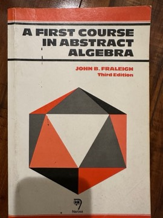 | John B. Fraleigh | 📕 | Undergraduate introduction to groups, rings, fields and Galois theory; one of the most widely used first texts in abstract algebra, valued for its gentle pace and many exercises. |
| **Geometric Algebra Applications Vol. I: Computer Vision, Graphics and Neurocomputing** | Bayro-Corrochano | 💾 | Develops geometric (Clifford) algebra and conformal geometric algebra and applies them to computer vision, graphics, robotics and neural computing. |
| **Module Theory: An Approach to Linear Algebra** 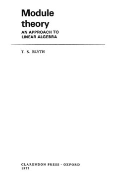 | T. S. Blyth | 💾 | Develops linear algebra through modules over rings, covering exact sequences, tensor products, the structure theorem for modules over a PID and canonical forms. A respected, rigorous text. |
| **Universal Algebra** 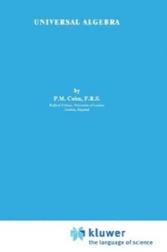 | P. M. Cohn | 💾 | A classic monograph on the general theory of algebraic structures: varieties, free algebras, lattices and model-theoretic aspects. One of the standard early texts of the field. |

### Analysis and Linear Algebra

| Book | Author | Format | About |
|------|--------|:------:|-------|
| **Algebra, Topology, Differential Calculus, and Optimization Theory for Computer Science and Machine Learning** | Jean Gallier & Jocelyn Quaintance | 💾 | A very large free text from the University of Pennsylvania covering the mathematics underlying ML, from topology and differential calculus to convex optimization, SVMs and kernel methods. Known for its breadth and rigor. |
| **Analysis I** | Terence Tao | 🔖 | 🔍 An undergraduate real-analysis text building the number systems from scratch; now accompanied by Tao's own Lean companion formalization. |
| **Computational Mathematics** 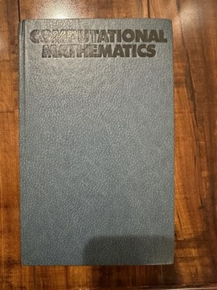 |  | 📕 | A textbook on computational mathematics (numerical methods and computation-oriented mathematics); the specific author and edition could not be identified from the photo. |
| **The Discrete Algebra of the Fourier Transform** | Peyré | 💾 | Covers discrete Fourier analysis: Fourier transforms on finite groups, the FFT, convolution, and applications to coding and signal processing. |
| **Div, Grad, Curl, and All That: An Informal Text on Vector Calculus** 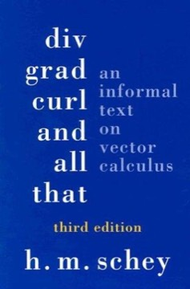 | H. M. Schey | 💾 | An informal introduction to vector calculus motivated through electrostatics, building divergence, gradient, curl and the integral theorems intuitively. A beloved supplement for physics and engineering students. |
| **Engineering Mathematics (VTU)** 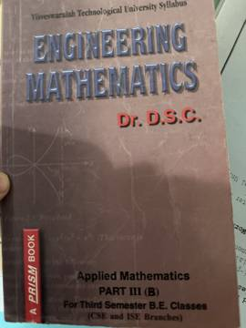 | D. S. Chandrasekharaiah | 📕 | A Bangalore-published engineering mathematics textbook written to the Visvesvaraya Technological University syllabus, covering calculus, differential equations, transforms and related applied topics. A regional course text with little published review. |
| **An Introduction to Measure Theory** | Terence Tao | 🔖 | 🔍 A graduate introduction to Lebesgue measure and integration, abstract measure spaces and product measures; free online, and a formalization target in Lean. |
| **Linear Algebra** | Georgi E. Shilov | 💾 | A classic Soviet textbook (Dover translation) that develops determinants, linear spaces, linear transformations, quadratic forms and Euclidean spaces with rigour and economy. Prized as an inexpensive, thorough second course. The Drive copy is a scan. |
| **Linear Algebra Done Wrong** | Sergei Treil | 💾 | A free textbook by a Brown University mathematician, written as a rigorous counterpoint to Axler's *Linear Algebra Done Right* — it keeps determinants central and covers spectral theory, inner products and canonical forms. Popular for honors and second courses. |
| **Linear Algebra for Computer Vision, Robotics, and Machine Learning** | Jean Gallier & Jocelyn Quaintance | 💾 | A rigorous, extensive free treatment of linear algebra and matrix decompositions (SVD, QR, spectral theory) with applications to vision, robotics and ML. A companion to the authors' optimization volume. |
| **Linear Algebra, Theory and Applications** | Kenneth Kuttler | 💾 | A free, open textbook covering matrices, determinants, vector spaces, linear transformations, spectral theory and numerical methods, with many applications and exercises. Comprehensive rather than concise. |
| **Linear Algebra via Exterior Products** 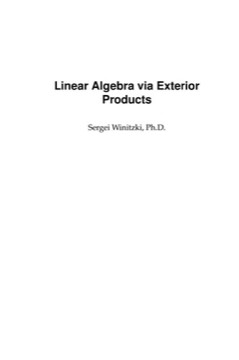 | Sergei Winitzki | 💾 | A free text presenting finite-dimensional linear algebra in a coordinate-free way through exterior products, deriving determinants and related results without matrices. Known as an unusual and elegant alternative approach. |

### Category Theory

| Book | Author | Format | About |
|------|--------|:------:|-------|
| **Basic Category Theory for Computer Scientists** 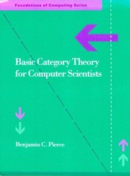 | Benjamin C. Pierce | 💾 | A short introduction to categories, functors, natural transformations, adjunctions and cartesian closed categories with applications to computing. A popular concise first text for programmers. |
| **Category Theory for Programmers** 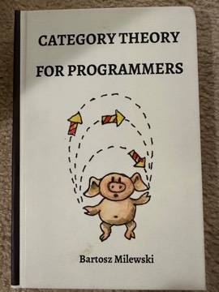 | Bartosz Milewski | 📕 | 🔍 Book version of Milewski's blog series explaining categories, functors, monads, adjunctions and more with Haskell and C++ examples; a popular entry point for programmers. |
| **Category Theory for Scientists** | David I. Spivak | 💾 | An introduction to category theory for scientists, built around sets, databases (ologs) and practical modelling rather than pure-mathematics examples; the drafts were published by MIT Press as *Category Theory for the Sciences* (2014). Praised as one of the most accessible applied introductions. |
| **Category Theory in Context** 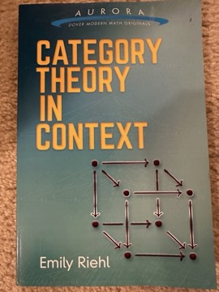 | Emily Riehl | 📕 | 🔍 Dover graduate introduction covering categories, universal properties, the Yoneda lemma, limits, adjunctions and monads, with examples drawn from across mathematics; freely available and widely recommended. |
| **Conceptual Mathematics: A First Introduction to Categories** 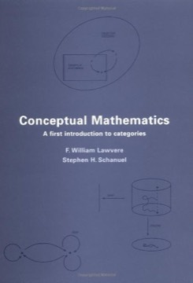 | F. William Lawvere & Stephen H. Schanuel | 💾 | An elementary, discussion-driven introduction to category theory assuming little background, by one of the field's founders. Praised for its gentle approach, though some readers find its pace slow. |
| **Elements of ∞-Category Theory** | Emily Riehl & Dominic Verity | 🔖 | 🔍 A model-independent development of (∞,1)-category theory using ∞-cosmoi (Cambridge, 2022); the basis of Riehl's ∞-cosmos Lean formalization project. |
| **Introducing Category Theory**, 2nd | Peter Smith | 💾 | A freely available, carefully paced introduction to category theory by a Cambridge logician, aimed at self-learners with some mathematical background. Valued for its clarity and leisurely explanations. |
| **Monoidal Category Theory: Unifying Concepts in Mathematics, Physics, and Computing** | Noson S. Yanofsky | 💾 | A textbook (MIT Press, 2024) that builds from basic categories to monoidal categories and their variations, with short "mini-courses" on topics such as linear algebra, categorical logic and self-referential paradoxes. Aimed at a broad audience across mathematics, physics and computing. Two copies are in Drive: an early draft and the 2024 version. |

### Discrete Mathematics and Combinatorics

| Book | Author | Format | About |
|------|--------|:------:|-------|
| **Deliberate Practice in Discrete Mathematics** |  | 📕 | A practice-oriented discrete mathematics workbook; author and publication details could not be confirmed and little published review coverage exists. |
| **Discrete Mathematical Structures**, 3rd 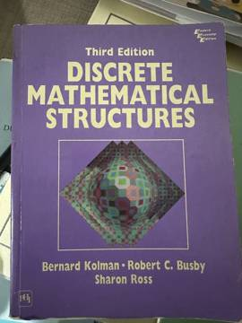 | Bernard Kolman, Robert C. Busby, Sharon Ross | 📕 | An introductory discrete mathematics text for computer science students covering logic, sets, relations, graphs, trees, Boolean algebra and automata. A commonly used course textbook. |
| **Discrete Mathematics** 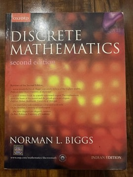 | Norman L. Biggs | 📕 | Oxford introductory text covering logic, counting, graphs, algorithms and algebraic structures; respected for its rigor and clarity at the undergraduate level. |
| **Discrete Mathematics and Its Applications** 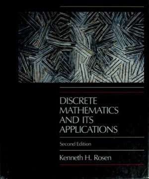 | Kenneth H. Rosen | 💾 | A comprehensive discrete mathematics text covering logic, proofs, sets, number theory, counting, graphs and automata with many exercises. One of the most widely used discrete math textbooks for computer science. |
| **Elements of Discrete Mathematics** 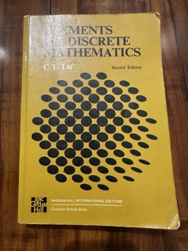 | C. L. Liu | 📕 | McGraw-Hill computer-science-oriented discrete mathematics text covering sets, combinatorics, graphs, recurrences and algebraic systems; a long-standing course text, especially in India. |
| **Graph Theory and Additive Combinatorics: Exploring Structure and Randomness** | Yufei Zhao | 💾 | A graduate text from Zhao's MIT course covering Szemerédi's regularity lemma, pseudorandomness, graph limits, and the links between graph theory and additive combinatorics such as Roth's theorem. Well received as a modern, unified treatment. |
| **Graph Theory with Applications to Engineering and Computer Science** 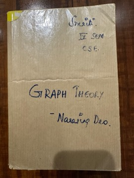 | Narsingh Deo | 📕 | Prentice-Hall text on graph theory with applications to networks, coding and algorithms; a staple of Indian engineering curricula. |

### Foundations and Logic

| Book | Author | Format | About |
|------|--------|:------:|-------|
| **Homotopy Type Theory: Univalent Foundations of Mathematics** | Univalent Foundations Program | 💾 | The HoTT book: develops type theory with the univalence axiom and higher inductive types as a foundation for mathematics, including homotopy theory, set theory and real numbers. |
| **A Programmer's Introduction to Mathematics** 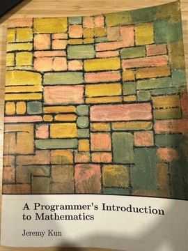 | Jeremy Kun | 📕 | Self-published introduction to proofs, sets, graphs, calculus, linear algebra and more, aimed at programmers and paired with code applications; well received by its target readers. |
| **An Infinite Descent into Pure Mathematics** | Clive Newstead | 💾 | A free introduction to proofs and pure mathematics developed for Carnegie Mellon's transition course, covering logic, sets, number theory, combinatorics and real numbers. Well regarded for clarity. |
| **Book of Proof**, 3rd | Richard Hammack | 💾 | A free introduction to proof writing covering logic, sets, direct proof, contradiction, induction, relations, functions and cardinality. One of the most widely adopted open textbooks for transition-to-proof courses. |
| **Everything You Always Wanted to Know About Mathematics (But Didn't Even Know to Ask)** | Brendan W. Sullivan | 💾 | Carnegie Mellon course notes introducing mathematical thinking, logic, proof techniques, sets, induction and functions for students moving to proof-based mathematics. A free, informal-in-tone text. |
| **First-Order Logic** 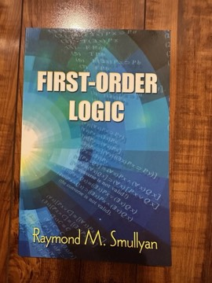 | Raymond M. Smullyan | 📕 | Concise monograph that popularized analytic tableaux as a proof method for first-order logic; admired for its elegance and still in print from Dover. |
| **How to Prove It: A Structured Approach** 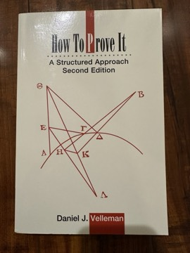 | Daniel J. Velleman | 📕 | Introduction to logic, sets and proof techniques for students moving into abstract mathematics; a widely recommended transition-to-proofs text. |
| **How to Solve It** 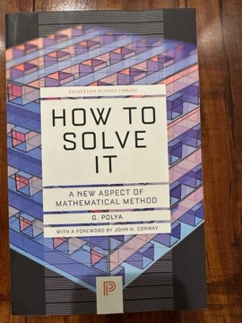 | G. Pólya | 📕 | Classic short book on mathematical problem-solving heuristics (understand, plan, carry out, look back); among the most influential works on mathematical thinking. |
| **Introduction to Logic and to the Methodology of the Deductive Sciences** 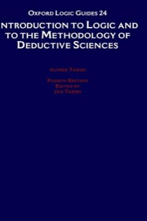 | Alfred Tarski | 💾 | Tarski's introductory text on sentential logic, quantifiers, identity, classes and relations, and the axiomatic method, illustrated with arithmetic. A classic of logic pedagogy translated into many languages. |
| **Intuitionistic Type Theory** | Per Martin-Löf | 💾 | Notes from Martin-Löf's 1980 Padua lectures presenting his constructive type theory, the basis of proof assistants such as Agda and NuPRL. A foundational primary source of the field. |
| **Set Theory and the Continuum Problem** 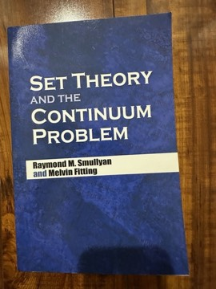 | Raymond M. Smullyan and Melvin Fitting | 📕 | Graduate text on axiomatic set theory leading to the independence of the continuum hypothesis via constructibility and forcing; praised for its clear, unified treatment. |
| **Theorem Proving in Lean 4** | Jeremy Avigad, Leonardo de Moura, Soonho Kong, Sebastian Ullrich | 💾 | The official tutorial on using Lean 4 as a proof assistant, covering dependent type theory, propositions as types, tactics, inductive types and type classes. The standard introduction to formal proof in Lean. |

### General and School Mathematics

| Book | Author | Format | About |
|------|--------|:------:|-------|
| **A Text Book of Mathematics for II Year Pre-University Course** 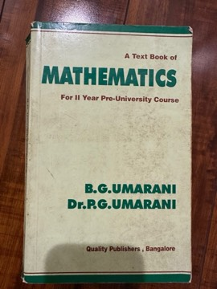 | B. G. Umarani & P. G. Umarani | 📕 | Karnataka second-year PUC mathematics textbook covering the state syllabus (algebra, calculus, coordinate geometry and related topics); a regional exam-preparation text with little published review coverage. |

### History of Mathematics

| Book | Author | Format | About |
|------|--------|:------:|-------|
| **A Synopsis of Elementary Results in Pure Mathematics** | Carr | 💾 | A compendium of about 6,000 theorems and formulae in algebra, trigonometry, geometry and calculus with abridged proofs; famous as the book from which Ramanujan learned mathematics. |

### Probability and Statistics

| Book | Author | Format | About |
|------|--------|:------:|-------|
| **Bayesian Data Analysis** 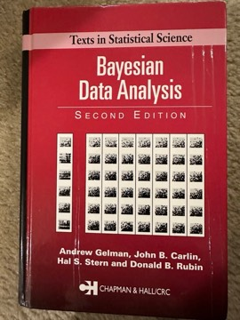 | Andrew Gelman, John B. Carlin, Hal S. Stern, Donald B. Rubin | 📕 | The standard reference on applied Bayesian statistics, covering hierarchical models, model checking and computation (MCMC); widely used as a graduate text. |
| **High-Dimensional Probability: An Introduction with Applications in Data Science** | Roman Vershynin | 💾 | A graduate text on concentration inequalities, random vectors and matrices, and random processes, with applications to covariance estimation, sparse recovery and machine learning. Widely used as the modern introduction to high-dimensional probability. |
| **Intro Stats**, 2nd 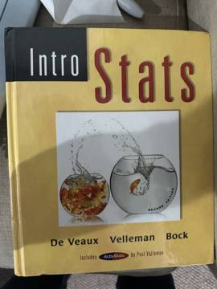 | Richard De Veaux, Paul Velleman, David Bock | 📕 | An introductory, data-first statistics textbook emphasizing reasoning, graphics and real examples over formulas. Popular for introductory and AP statistics courses for its conversational style. |
| **Introductory Probability and Statistical Applications** 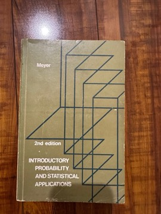 | Paul L. Meyer | 📕 | A classic engineering-oriented probability and statistics text covering random variables, distributions, reliability and inference. Long used in engineering curricula, especially in India. |
| **Mathematical Statistics with Applications**, 6th 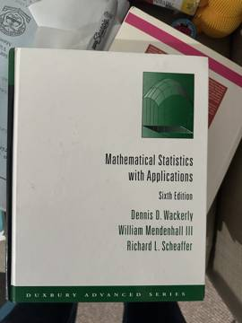 | Dennis D. Wackerly, William Mendenhall, Richard L. Scheaffer | 📕 | A calculus-based introduction to probability and statistical inference covering distributions, estimation, hypothesis testing and regression. A standard upper-undergraduate mathematical statistics text. |
| **Probability, Random Variables, and Stochastic Processes** 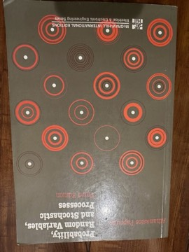 | Athanasios Papoulis | 📕 | Classic engineering-oriented text on probability theory and random processes; a standard reference in electrical engineering and signal processing for decades. |

### Recreational Mathematics

| Book | Author | Format | About |
|------|--------|:------:|-------|
| **Satan, Cantor and Infinity** 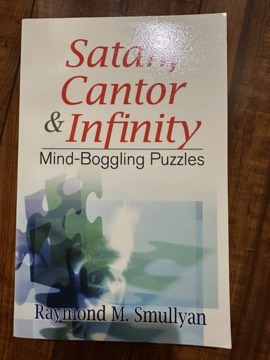 | Raymond M. Smullyan | 📕 | Collection of logic puzzles (knights and knaves and beyond) that build up to Cantor's ideas about infinity; typical of Smullyan's playful route into serious logic. |
| **Surreal Numbers** 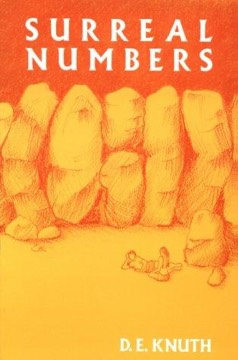 | Donald E. Knuth | 💾 | A short novelette in which two students discover and develop John Conway's surreal numbers from a few axioms. Celebrated as an introduction to the creative process of mathematical research. |
| **The Abacus: A Pocket Computer** 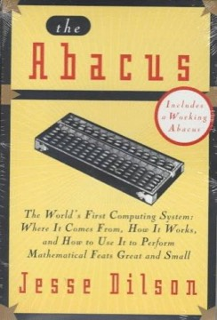 | Jesse Dilson | 📕 | Short St. Martin's Press book on the history of the abacus and how to calculate with it, later reissued as 'The Abacus: The World's First Computing System'. |
| **The Gödelian Puzzle Book: Puzzles, Paradoxes and Proofs** 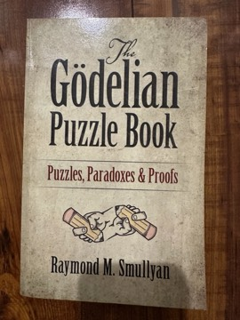 | Raymond M. Smullyan | 📕 | Dover collection of logic puzzles leading readers toward Gödel's incompleteness theorems, written in Smullyan's characteristic playful style. |
| **The Japanese Abacus Explained** 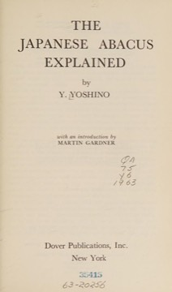 | Yozo Yoshino | 📕 | A classic guide to soroban arithmetic, explaining addition, subtraction, multiplication, division and roots on the Japanese abacus, reprinted by Dover. Valued as a clear, complete older manual on abacus technique. |
| **The Riddle of Scheherazade: And Other Amazing Puzzles, Ancient and Modern** 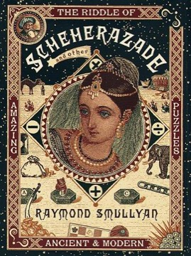 | Raymond M. Smullyan | 💾 | A collection of logic and number puzzles framed by Scheherazade telling puzzles to the king, building toward ideas about self-reference and Gödel. In the tradition of Smullyan's well-loved puzzle books. |
| **What Is the Name of This Book?**  | Raymond M. Smullyan | 📕 | Smullyan's best-known puzzle book, introducing knights-and-knaves puzzles and building to Gödel's incompleteness ideas; a classic of recreational logic. |

### Topology and Geometry

| Book | Author | Format | About |
|------|--------|:------:|-------|
| **Algebraic Topology: An Intuitive Approach** 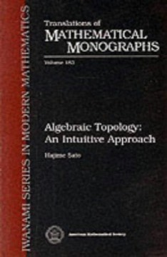 | Hajime Sato | 💾 | A concise introduction to homotopy, homology, fiber bundles and related ideas emphasizing intuition over full rigor, translated from Japanese for the AMS. Useful as a gentle overview before more formal texts. |
| **Geometric Structures on Manifolds** | William M. Goldman | 💾 | A graduate monograph on locally homogeneous (G,X)-structures such as affine and projective structures, developing maps and holonomy. Published in the AMS Graduate Studies series; a standard reference for the topic. |
| **The Geometry of Fractal Sets** | K. J. Falconer | 🔖 | 🔍 A classic monograph on Hausdorff measure and dimension, densities, projections and Kakeya-type sets — the standard reference behind much of geometric measure theory. |
| **Homotopy Theory** 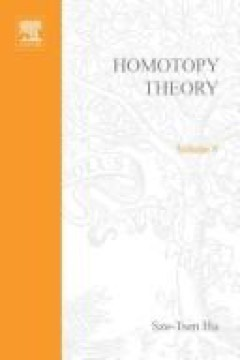 | Sze-Tsen Hu | 💾 | A classic early textbook on homotopy theory covering fibre spaces, homotopy groups, obstruction theory and related topics. Historically important, though superseded by later treatments. |
| **Intuitive Topology** 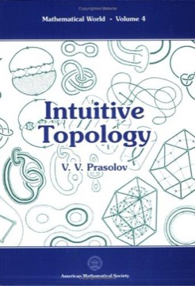 | V. V. Prasolov | 💾 | A short, picture-driven introduction to topological ideas such as knots, surfaces, vector fields and the Euler characteristic, aimed at students with little background. Published in the AMS Mathematical World series. |

---

## Computer Science

### Algorithms and Data Structures

| Book | Author | Format | About |
|------|--------|:------:|-------|
| **Algorithm Design** 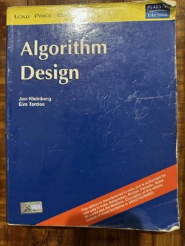 | Jon Kleinberg & Éva Tardos | 📕 | Algorithms textbook organized around design techniques (greedy, divide and conquer, dynamic programming, network flow, NP-completeness, approximation); praised for motivating each technique through real problems. |
| **Data Structures and Algorithms** 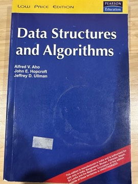 | Alfred V. Aho, John E. Hopcroft, Jeffrey D. Ullman | 📕 | Classic Addison-Wesley text on abstract data types, sorting, searching, graphs and algorithm analysis, presented with Pascal; a foundational undergraduate reference. |
| **Data Structures, Algorithms, and Applications in C++** 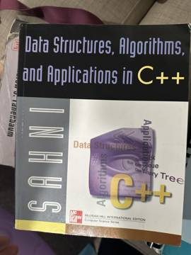 | Sartaj Sahni | 📕 | An undergraduate data structures text implementing lists, trees, graphs, hashing and sorting in C++, with many applications and exercises. Widely used in university courses, particularly in India. |
| **Introduction to Algorithms** 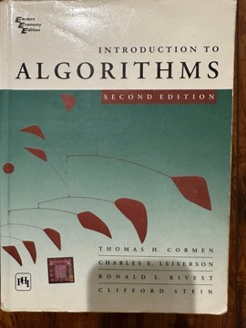 | Thomas H. Cormen, Charles E. Leiserson, Ronald L. Rivest, Clifford Stein | 📕 | 🔍 The comprehensive algorithms textbook known as CLRS, covering sorting, data structures, graph algorithms, dynamic programming, NP-completeness and more with rigorous analysis. The most widely used algorithms text in universities worldwide. |
| **Randomized Algorithms** 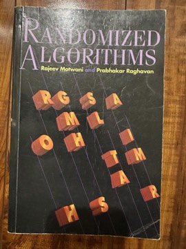 | Rajeev Motwani & Prabhakar Raghavan | 📕 | The standard reference on randomized algorithm design and probabilistic analysis, covering tail bounds, Markov chains and applications across computing. |
| **The Algorithm Design Manual** 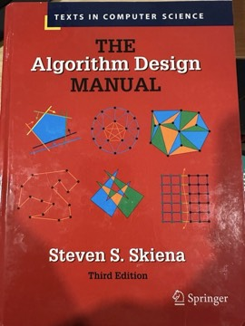 | Steven S. Skiena | 📕 | A practical algorithms text pairing design techniques and 'war stories' with a large catalog of standard problems and their known solutions. Popular with practitioners and for interview preparation for its applied, problem-oriented approach. |
| **The Art of Computer Programming, Volume 3: Sorting and Searching**, Vol. 3 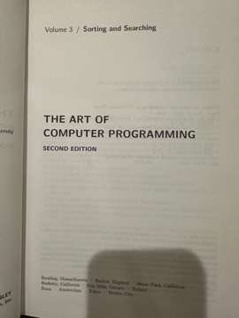 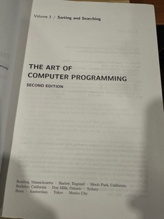 | Donald E. Knuth | 📕 | Knuth's exhaustive mathematical treatment of sorting and searching algorithms; part of the series widely considered the definitive work on algorithm analysis. |
| **The Boost Graph Library: User Guide and Reference Manual** 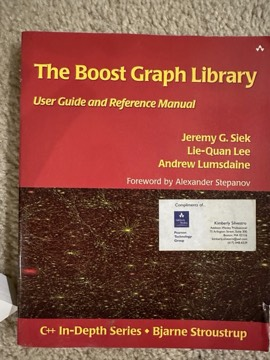 | Jeremy G. Siek, Lie-Quan Lee, Andrew Lumsdaine | 📕 | Guide and reference for the generic C++ BGL, demonstrating generic programming applied to graph algorithms. |

### Compilers and Language Implementation

| Book | Author | Format | About |
|------|--------|:------:|-------|
| **Advanced Compiler Design and Implementation** 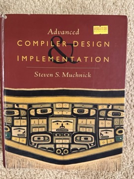 | Steven S. Muchnick | 📕 | An encyclopedic treatment of optimizing compilers: intermediate representations, data-flow and alias analysis, register allocation, scheduling and loop optimizations. Long a standard professional reference for back-end optimization. |
| **Calculating Compilers** | Erik Meijer | 💾 | Erik Meijer's Nijmegen doctoral dissertation on deriving compilers by program calculation in the algebraic, Bird-Meertens style. Of specialist interest; an early work in calculational program construction. |
| **Compilers: Course Notes** | Oleg Kiselyov | 💾 | Course notes by Oleg Kiselyov on building a compiler incrementally and extensibly, in his tagless-final style. An informal teaching resource with no published reviews. |
| **Crafting Interpreters** 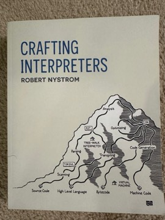 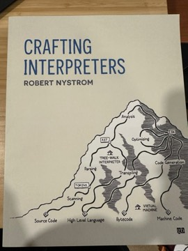 | Robert Nystrom | 📕 | Hands-on book building a tree-walking interpreter in Java and a bytecode VM in C for the Lox language; widely praised for its clarity and illustrations. |
| **Implementing Functional Languages: A Tutorial** 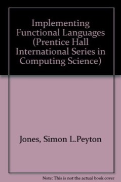 | Simon L. Peyton Jones & David R. Lester | 💾 | A hands-on guide to building implementations of a small lazy language, progressing through template instantiation, the G-machine, TIM and a parallel G-machine. Widely used as a practical companion to the 1987 book. |
| **Linkers and Loaders**  | John R. Levine | 📕 | The best-known book devoted to linking, loading, object file formats, relocation and shared libraries; still a go-to reference on the subject. |
| **The Implementation of Functional Programming Languages**  | Simon L. Peyton Jones | 💾 | Explains how lazy functional languages are compiled: translation to lambda calculus, pattern matching, type checking and graph reduction including the G-machine. A classic foundation for later work such as GHC. |

### Computer Architecture and Parallelism

| Book | Author | Format | About |
|------|--------|:------:|-------|
| **Computer Architecture: A Quantitative Approach**  | John L. Hennessy, David A. Patterson | 📕 | The graduate standard on processor and memory design, driven by quantitative performance analysis; credited with shaping how architecture is taught. |
| **Computer Organization and Design: The Hardware/Software Interface**  | David A. Patterson and John L. Hennessy | 📕 | The standard undergraduate text on processor design, the memory hierarchy and the hardware/software boundary, by the Turing Award-winning RISC pioneers. |
| **Intel Threading Building Blocks**   | James Reinders | 📕 | O'Reilly guide to Intel's C++ TBB library for task-based multicore parallelism, covering parallel algorithms, containers and the task scheduler. |
| **Learning Concurrent Programming in Scala**  | Aleksandar Prokopec | 📕 | Packt book covering the JVM memory model, futures and promises, parallel collections, reactive extensions, STM and actors in Scala; written by a Scala parallel collections author. |
| **Parallel Computer Architecture: A Hardware/Software Approach**  | David E. Culler, Jaswinder Pal Singh, Anoop Gupta | 📕 | Graduate text on multiprocessor design, cache coherence, interconnects and parallel program workloads; a classic reference for parallel architecture. |

### Distributed and Data Systems

| Book | Author | Format | About |
|------|--------|:------:|-------|
| **Database Management Systems**, 3rd  | Raghu Ramakrishnan & Johannes Gehrke | 📕 | Covers relational databases from query languages and design through storage, indexing, query evaluation and optimization, and transactions (the 'cow book'). Respected for its strong treatment of DBMS internals. |
| **Designing Data-Intensive Applications**  | Martin Kleppmann | 📕 | O'Reilly survey of the principles behind databases, replication, partitioning, transactions, consistency and stream processing; widely regarded as the go-to book on modern data systems. |
| **Distributed Computing Through Combinatorial Topology**  | Maurice Herlihy, Dmitry Kozlov, Sergio Rajsbaum | 💾 | Develops the topological approach to distributed computability, modeling protocols as simplicial complexes to prove possibility and impossibility results. The standard reference for this research area. |
| **Distributed Systems: Concepts and Design**   | George Coulouris, Jean Dollimore, Tim Kindberg | 📕 | Long-running textbook on distributed system models, communication, naming, time, coordination, replication and transactions; a standard course text. |
| **Fundamentals of Database Systems**, 3rd  | Ramez Elmasri & Shamkant B. Navathe | 📕 | A comprehensive database text covering ER modeling, the relational model, SQL, normalization, storage, indexing and transactions. One of the most widely adopted database textbooks. |
| **High Performance Spark**  | Holden Karau & Rachel Warren | 📕 | O'Reilly guide to tuning and scaling Apache Spark jobs (partitioning, joins, memory, Datasets) with Scala examples. |
| **Principles of Eventual Consistency** | Sebastian Burckhardt | 💾 | A monograph (Foundations and Trends in Programming Languages, 2014) that gives a formal framework for specifying and verifying eventually consistent replicated systems, including replicated data types and consistency guarantees. Valued as a rigorous treatment of a topic usually handled informally. |
| **Proof of Stake: The Making of Ethereum and the Philosophy of Blockchains**  | Vitalik Buterin (ed. Nathan Schneider) | 📕 | A curated collection of Buterin's essays from 2014 to 2021 on Ethereum's design, proof-of-stake consensus, governance and public goods. Reviewers saw it as a useful record of the thinking behind Ethereum, though uneven as a book. |
| **ZooKeeper: Distributed Process Coordination**  | Flavio Junqueira & Benjamin Reed | 📕 | O'Reilly guide by two of ZooKeeper's creators to using and operating it for coordination tasks such as leader election, locks and configuration. |

### Functional Programming

| Book | Author | Format | About |
|------|--------|:------:|-------|
| **Algorithm Design with Haskell** | Richard Bird & Jeremy Gibbons | 🔖 | 🔍 Develops classic algorithm-design strategies — divide and conquer, greedy, dynamic programming, exhaustive search — by equational reasoning in Haskell (Cambridge, 2020). |
| **Haskell: The Craft of Functional Programming, 3rd ed.** | Simon Thompson | 💾 | A long-standing introductory textbook on functional programming in Haskell, covering types, recursion, higher-order functions, type classes, lazy evaluation and reasoning about programs. A standard university course text. |
| **An Introduction to Functional Programming Through Lambda Calculus**  | Greg Michaelson | 💾 | Builds functional programming from the untyped lambda calculus up through data structures, recursion and evaluation strategies, with links to Lisp and ML. Valued as a gentle, self-contained introduction (reprinted by Dover). |
| **Effect Oriented Programming** | Bill Frasure, Bruce Eckel, James Ward | 💾 | (PDF and EPUB in Drive.) Introduces managing side effects, errors and dependencies as typed effects, with examples in Scala 3 and ZIO. Aimed at practitioners new to effect systems. |
| **Elements of ML Programming**  | Jeffrey D. Ullman | 📕 | Introduction to programming in Standard ML (ML97 in later editions), covering types, pattern matching, higher-order functions and modules; a well-known teaching text for SML. |
| **F# Deep Dives**  | Tomas Petricek, Phillip Trelford (eds.) | 📕 | A collection of chapters by F# practitioners applying the language to real domains such as finance, data science, games and web development. Valued as a showcase of applied functional programming rather than a language tutorial. |
| **Functional Programming for Mortals with Scalaz**   | Sam Halliday | 📕 | A practical guide to pure functional programming in Scala using the Scalaz library, built around a worked application and covering typeclasses, monads and effects. Well regarded in the Scala FP community for making the typelevel style approachable to working developers. |
| **Functional Programming in Lean**  | David Thrane Christiansen | 💾 | The official free introduction to Lean 4 as a programming language, covering structures, typeclasses, monads, dependent types and programs with proofs. The recommended starting point for programming in Lean. |
| **Functional Programming in Scala**  | Paul Chiusano & Rúnar Bjarnason | 📕 | The 'red book': an exercise-driven course in deriving functional abstractions (monoids, monads, applicatives, streams) from first principles; considered a classic of FP pedagogy. |
| **Functional and Reactive Domain Modeling**  | Debasish Ghosh | 📕 | Manning book applying algebraic, functional and reactive techniques to domain-driven design in Scala; noted for linking DDD with functional abstractions. |
| **Learn Programming with OCaml** | Sylvain Conchon & Jean-Christophe Filliâtre | 💾 | An introduction to programming and algorithms through OCaml, translated from the authors' French textbook *Apprendre à programmer avec OCaml*. Pairs worked programs with classic data structures and algorithms; well regarded as a modern OCaml teaching text. |
| **Parallel and Concurrent Programming in Haskell**  | Simon Marlow | 📕 | Covers deterministic parallelism (Eval, Strategies, the Par monad, Repa, Accelerate) and concurrency with threads, MVars and STM in GHC Haskell, by a principal developer of GHC's runtime. Regarded as the definitive book on the subject. |
| **Pearls of Functional Algorithm Design**  | Richard Bird | 📕 | Thirty short chapters deriving efficient Haskell algorithms through equational reasoning; a celebrated showcase of program calculation. |
| **The pigworker's StackOverflow answers** | Conor McBride | 💾 | A compiled collection of Conor McBride's ("pigworker") StackOverflow answers on Haskell, dependent types, applicative functors and related topics — an "accidental blook". Valued informally for its depth; not a published book. |
| **Program Design by Calculation** | José N. Oliveira | 💾 | A textbook draft from the University of Minho on deriving programs by algebraic, point-free calculation — functions, relations, catamorphisms and other recursion schemes. A key text of the Bird–Meertens / Algebra of Programming tradition. |
| **Programming in Lean** | Avigad, de Moura & Roesch | 💾 | An unfinished draft book on using Lean 3 as a programming language and for metaprogramming and tactics. |
| **Programming in Scala, 5th ed.** | Martin Odersky, Lex Spoon, Bill Venners & Frank Sommers | 💾 | The comprehensive introduction to Scala co-written by the language's creator, updated for Scala 3: syntax, objects, traits, pattern matching, collections, functional programming and the type system. Widely regarded as the definitive Scala book. In Drive as PDF and EPUB. |
| **Purely Functional Data Structures**  | Chris Okasaki | 📕 | Expanded from Okasaki's thesis, it shows how to design and analyze efficient immutable data structures using laziness and amortization; the classic work on the subject. |
| **Real World Haskell**  | Bryan O'Sullivan, John Goerzen & Don Stewart | 📕 | O'Reilly book applying Haskell to practical tasks (I/O, parsing, databases, concurrency, testing); influential in bringing Haskell to working programmers, though parts are now dated. |
| **Scala for the Impatient**, 3rd | Cay S. Horstmann | 📕 | A fast-paced, example-driven introduction to Scala for experienced programmers, updated in this edition for Scala 3. Well regarded as a concise practical guide. |
| **Scala with Cats** | Noel Welsh & Dave Gurnell | 💾 | Teaches functional abstractions such as monoids, functors, monads, applicatives and traversals through the Cats library, with case studies. A widely recommended free book for typed FP in Scala. |
| **The Haskell School of Music: From Signals to Symphonies**  | Paul Hudak, Donya Quick | 📕 | Cambridge book teaching Haskell through computer music using the Euterpea library, covering algorithmic composition and signal processing. |
| **The Science of Functional Programming: A Tutorial, with Examples in Scala** | Sergei Winitzki | 💾 | A long, free textbook deriving functional programming techniques (functors, monads, free structures, typeclasses) from mathematical first principles with Scala examples. Noted for its rigor and proofs, more mathematical than most FP books. |
| **Thinking with Types: Type-Level Programming in Haskell (sample)** | Maguire | 💾 | Sample chapters of a book on type-level programming in Haskell: kinds, type families, GADTs and related GHC features. |
| **Zionomicon** | John A. De Goes & Adam Fraser | 💾 | A comprehensive guide to ZIO, the Scala library for typed functional effects, covering fibers, error handling, resources, STM, streams and testing, by ZIO's creator and a core contributor. The main book-length reference for ZIO. |

### Interviews and Career

| Book | Author | Format | About |
|------|--------|:------:|-------|
| **Becoming a Technical Leader: An Organic Problem-Solving Approach**  | Gerald M. Weinberg | 📕 | Weinberg's guide to leadership for technical people, built around motivation, organization and innovation; regarded as a classic of software management writing. |
| **Cracking the Coding Interview**  | Gayle Laakmann McDowell | 📕 | Best-selling preparation guide with 189 programming problems and solutions plus advice on technical interviews at large tech companies. |
| **System Design Interview – An Insider's Guide, Volume 2**, Vol. 2   | Alex Xu & Sahn Lam | 📕 | Diagram-heavy walkthroughs of large-scale system design problems (proximity services, payment systems, stock exchanges and more); popular interview-preparation sequel. |
| **System Design Interview: An Insider's Guide, Vol. 1**   | Alex Xu | 📕 | Walks through common system design interview problems such as rate limiters, URL shorteners, news feeds and chat systems with a repeatable framework and diagrams. One of the most popular system design interview prep books, though critics note it stays at a high level. |

### Networks and Security

| Book | Author | Format | About |
|------|--------|:------:|-------|
| **Computer Networks**    |  | 📕 | A general textbook on computer networks (protocol layers, the Internet stack, routing and transport); the specific author and edition could not be identified from the photo. |
| **Cryptography and Network Security: Principles and Practice**, 2nd  | William Stallings | 📕 | Covers symmetric and public-key cryptography, hashing, authentication and network security protocols. A standard undergraduate security textbook through many editions. |
| **DSL Illuminated** |  | 📕 | A technical book on DSL; the author, edition and even whether it concerns Digital Subscriber Line networking or domain-specific languages could not be confirmed from available sources. |
| **Internetworking with TCP/IP, Volume II: Design, Implementation, and Internals**, Vol. II   | Douglas E. Comer, David L. Stevens | 📕 | Walks through the code of a working TCP/IP implementation, covering IP, ICMP, UDP, TCP and routing internals; a classic companion to Comer's protocol volume. |
| **Internetworking with TCP/IP, Volume III: Client-Server Programming and Applications**, Vol. III   | Douglas E. Comer, David L. Stevens | 📕 | Covers designing and implementing client-server network applications over sockets; part of Comer's well-regarded TCP/IP series. |
| **UNIX Network Programming**  | W. Richard Stevens | 📕 | The definitive guide to sockets and inter-process communication programming on Unix; long treated as the canonical reference for network programmers. |

### Operating Systems and Systems Programming

| Book | Author | Format | About |
|------|--------|:------:|-------|
| **Advanced Programming in the UNIX Environment**  | W. Richard Stevens | 📕 | A detailed guide to the UNIX system-call interface: files, processes, signals, terminals, IPC and daemons. Regarded as the classic reference for UNIX systems programming. |
| **Modern Systems Programming with Scala Native** | Whaling | 💾 | Teaches low-level systems programming with Scala Native: pointers and memory, C interop, sockets, HTTP servers, and async I/O with libuv. |
| **Operating System Concepts**  | Abraham Silberschatz, Peter B. Galvin, Greg Gagne | 📕 | The long-running 'dinosaur book' covering processes, scheduling, synchronization, memory, storage and file systems. One of the most widely adopted undergraduate operating systems textbooks, in print through many editions. |
| **Operating System Principles**  | Abraham Silberschatz, Peter B. Galvin, Greg Gagne | 📕 | Edition of the long-running 'dinosaur book' on processes, scheduling, memory, file systems and protection; one of the most widely adopted OS textbooks. |
| **The Little Book of Semaphores**  | Allen B. Downey | 💾 | A free textbook teaching synchronization through a sequence of classical and novel concurrency puzzles solved with semaphores. Popular as a hands-on supplement to operating systems courses. |
| **Unix System Programming in OCaml** | Xavier Leroy & Didier Rémy | 💾 | A course on UNIX systems programming (files, processes, signals, pipes, sockets, threads) using OCaml's Unix library, by two of OCaml's designers. A respected free text for systems programming in a functional language. |

### Programming Languages and Type Theory

| Book | Author | Format | About |
|------|--------|:------:|-------|
| **Advanced Topics in Types and Programming Languages**  | Benjamin C. Pierce (ed.) | 💾 | An edited sequel to TAPL with chapters on substructural types, dependent types, effect systems, module systems, type inference and typed assembly language. A standard graduate-level reference. |
| **C++ Primer**, 3rd  | Stanley B. Lippman & Josée Lajoie | 📕 | A thorough introduction to C++ updated for the then-new ISO C++98 standard, covering the language, the standard library and templates. A long-standing standard tutorial reference for the language. |
| **DSLs in Action**  | Debasish Ghosh | 📕 | Manning book on designing internal and external domain-specific languages in Scala, Groovy, Ruby and Clojure, with financial-domain examples. |
| **Foundations of Probabilistic Programming** | Barthe, Katoen & Silva (eds.) | 💾 | An edited volume on the semantics, verification, analysis and inference of probabilistic programs. |
| **[MiniLean4: Implementing an Interactive Theorem Prover from Scratch](https://learn.h5i.dev/)** | Hideaki Takahashi | 🌐 | A free interactive online book that builds a small Lean 4-style proof kernel in Rust, compiled to WebAssembly so it runs in the browser. It moves from propositions-as-types and a type checker for propositional logic to natural numbers, inductive types, equality, tactics, reduction and conversion, universes and metatheory. Playgrounds, steppers and trace trees show the kernel at work. No prior type theory or Lean is assumed. Available in English, Japanese and Chinese. |
| **Practical Foundations for Programming Languages**  | Robert Harper | 💾 | A unified type-theoretic account of programming language concepts (statics, dynamics, polymorphism, effects, concurrency, modules) using structural operational semantics. A demanding standard graduate text. |
| **Pragmatic Type-Level Design** | Alexander Granin | 💾 | Explores practical type-level programming in Haskell for application design, including type-level DSLs and extensible architectures. A niche, self-published work aimed at experienced Haskell developers. |
| **Programming Language Pragmatics**  | Michael L. Scott | 📕 | Broad survey of language design and implementation, linking syntax, semantics and compilation across many paradigms; a common text for comparative programming languages courses. |
| **The C Programming Language**    | Brian W. Kernighan, Dennis M. Ritchie | 📕 | 'K&R', the concise original description of C by its co-designer; celebrated as a model of clear technical writing. |
| **The Definition of Standard ML (Revised)**  | Robin Milner, Mads Tofte, Robert Harper, David MacQueen | 📕 | The formal definition of Standard ML '97, giving its static and dynamic semantics as inference rules. Widely cited as a landmark: one of the few full-scale languages to be completely and rigorously specified. |
| **The Formal Semantics of Programming Languages: An Introduction**  | Glynn Winskel | 💾 | Introduces operational, denotational and axiomatic semantics, domain theory and recursive types, with careful proofs. A standard graduate textbook on semantics. |
| **The Rust Programming Language**  | Steve Klabnik and Carol Nichols | 📕 | The official introduction to Rust ("the book"), covering ownership, borrowing, lifetimes, traits, error handling and concurrency. The standard starting point for learning the language, maintained alongside the Rust project. |
| **Type Theory and Functional Programming**  | Simon Thompson | 💾 | An introduction to Martin-Löf constructive type theory as a foundation for functional programming and program verification. A well-known text, now freely available online. |
| **Type-Driven Development with Idris**  | Edwin Brady | 📕 | Manning book by Idris's creator showing how dependent types can guide program construction; an accessible practical introduction to dependently typed programming. |
| **Types and Programming Languages**  | Benjamin C. Pierce | 📕 | The standard graduate text on type systems, from the untyped lambda calculus through subtyping, recursive types and polymorphism, with OCaml implementations. |

### Software Design and Engineering

| Book | Author | Format | About |
|------|--------|:------:|-------|
| **Design Patterns: Elements of Reusable Object-Oriented Software**  | Erich Gamma, Richard Helm, Ralph Johnson, John Vlissides | 📕 | The 'Gang of Four' catalog of 23 object-oriented design patterns; hugely influential on software design vocabulary, though critics note several patterns compensate for missing language features. |
| **Domain Modeling Made Functional: Tackle Software Complexity with Domain-Driven Design and F#**  | Scott Wlaschin | 📕 | Combines domain-driven design with functional programming in F#, showing how algebraic types and function composition can encode business rules and make illegal states unrepresentable. Widely praised as one of the clearest arguments for type-driven domain modeling. |
| **Programming Well: Abstraction and Design in Computation** | Stuart M. Shieber | 💾 | The textbook for Harvard's CS51, teaching abstraction, types, functional and imperative programming, and design principles using OCaml. Aimed at second-course programming students. |
| **Software Engineering Basics** |  | 📕 | An introductory software engineering text; the specific author and edition could not be identified from the photo. |

### Theory of Computation

| Book | Author | Format | About |
|------|--------|:------:|-------|
| **Computability, Unsolvability, Randomness** | Stephen G. Simpson | 💾 | Lecture notes by a Penn State logician covering computability theory, degrees of unsolvability and algorithmic randomness. An informal course text rather than a published book. |
| **Introduction to Automata Theory, Languages, and Computation**  | John E. Hopcroft, Rajeev Motwani, Jeffrey D. Ullman | 📕 | The 'Cinderella book', a standard text on finite automata, grammars, Turing machines, decidability and complexity; later editions with Motwani made it more accessible. |
| **Lambda-Calculus and Combinators: An Introduction**  | J. Roger Hindley & Jonathan P. Seldin | 💾 | A rigorous introduction to untyped and typed lambda calculus and combinatory logic, covering reduction, computability and type assignment. A standard introductory text. |
| **The Lambda Calculus: Its Syntax and Semantics** | H. P. Barendregt | 💾 | The standard reference on the untyped lambda calculus (North-Holland, revised 1984), covering conversion, reduction, Böhm trees and models. Encyclopedic and authoritative; the Drive copy is a publisher preview excerpt. |
| **Mathematics and Computation: A Theory Revolutionizing Technology and Science** | Wigderson | 💾 | A broad survey of computational complexity theory and its connections to mathematics, science and technology. |

---

## AI and Machine Learning

### Applied ML

| Book | Author | Format | About |
|------|--------|:------:|-------|
| **AI Engineering: Building Applications with Foundation Models**  | Chip Huyen | 📕 | Covers building products on foundation models: evaluation, prompt engineering, RAG, agents, finetuning, dataset engineering and inference optimization. Widely praised and a bestseller as a practical overview of the LLM application stack. |
| **Data Scientists at Work**  | Sebastian Gutierrez | 📕 | A collection of interviews with sixteen practicing data scientists from industry and research about their careers, methods and the emerging profession. Valued as a snapshot of the field in its early boom years rather than as a technical text. |
| **Scala for Machine Learning**  | Patrick R. Nicolas | 📕 | Packt book implementing classic machine learning algorithms (regression, clustering, Markov models, SVMs, neural networks) in Scala. |

### Deep Learning

| Book | Author | Format | About |
|------|--------|:------:|-------|
| **Deep Learning**  | Ian Goodfellow, Yoshua Bengio, Aaron Courville | 📕 | Comprehensive MIT Press text covering the mathematical background, modern practice and research frontiers of deep neural networks; long regarded as the field's standard reference. |
| **Deep Learning and Computational Physics (Lecture Notes)** | Deep Ray, Orazio Pinti & Assad A. Oberai | 💾 | Lecture notes from the University of Southern California that introduce deep learning — MLPs, CNNs, generative models, physics-informed networks and operator learning — through the lens of computational physics. |
| **Mathematical Theory of the Transformer, Vol. I: Foundations, Rationality, and the Incremental Transformer** | Giansalvo Cirrincione | 💾 | 🔍 A pre-publication draft (Zenodo, headed for MIT Press) of a mathematical treatment of the transformer, built from the author's series of arXiv preprints, including the companion *Hierarchical Kernel Transformer* paper. Gone through in detail with Claude via those seven preprints. |
| **The Hundred-Page Language Models Book**  | Andriy Burkov | 📕 | A compact introduction to language models, building from ML basics and count-based models through RNNs to Transformers and LLM practice, with code. Follows the well-received format of the author's Hundred-Page Machine Learning Book. (Title inferred from a partly hidden spine.) |
| **The Little Learner: A Straight Line to Deep Learning**  | Daniel P. Friedman & Anurag Mendhekar | 📕 | MIT Press book in the 'Little' question-and-answer style that builds deep learning concepts from scratch in a Scheme dialect. |
| **Multimodal Deep Learning** | Akkus et al. | 💾 | A book from an LMU seminar surveying multimodal deep learning: NLP and vision foundations, image-text models, text-to-image generation, and multimodal architectures. |
| **Understanding Deep Learning** | Simon J. D. Prince | 💾 | A textbook (MIT Press, 2023, free online) covering the ideas behind modern deep learning — supervised learning, network architectures, training, transformers, diffusion models and reinforcement learning — with notably clear diagrams. Very well received as a modern standard text. |

### Foundations

| Book | Author | Format | About |
|------|--------|:------:|-------|
| **Foundations of Reinforcement Learning with Applications in Finance** | Rao & Jelvis | 💾 | Covers Markov decision processes, dynamic programming and RL algorithms, applied to finance problems such as asset allocation, derivatives pricing and hedging, order execution and market making. |
| **An Introduction to Statistical Learning** | Gareth James, Daniela Witten, Trevor Hastie, Robert Tibshirani | 📕 | Accessible introduction to regression, classification, resampling, trees, SVMs and unsupervised learning with R (later Python) labs; a widely used free textbook. |
| **Concise Machine Learning** | Jonathan Richard Shewchuk | 💾 | Lecture notes from Shewchuk's Berkeley CS 189 course covering linear classifiers, SVMs, regression, decision theory, PCA, neural networks and more. Known for clear, compact explanations. |
| **Machine Learning**  |  | 📕 | A general machine learning textbook; the specific author and edition could not be identified from the photo. |
| **Optimization for Machine Learning** | Bernd Gärtner & Martin Jaggi | 💾 | ETH Zurich / EPFL lecture notes on convex and nonconvex optimization for ML, including gradient descent variants, stochastic and coordinate methods, and Newton-type methods with convergence proofs. A course text rather than a published book. |
| **Pattern Classification**  | Richard O. Duda, Peter E. Hart, David G. Stork | 📕 | Classic text on statistical pattern recognition (Bayesian decision theory, parametric and nonparametric methods, neural networks, clustering); the 2001 second edition added Stork. |
| **Reinforcement Learning: An Introduction**, 2nd  | Richard S. Sutton & Andrew G. Barto | 💾 | The foundational reinforcement learning textbook covering bandits, MDPs, dynamic programming, Monte Carlo and temporal-difference methods, function approximation and policy gradients. The standard reference for the field, by two of its founders. |

---

## Physics and Engineering

### Communications and Signal Processing

| Book | Author | Format | About |
|------|--------|:------:|-------|
| **Coordinated MultiPoint Transmission with Incomplete Information**  | Tilak Rajesh Lakshmana | 📕 | A Chalmers University of Technology doctoral thesis on coordinated multipoint (CoMP) transmission in cellular networks when channel and data information at base stations is incomplete. An academic research work with no wider critical reception. |
| **Efficient Backhauling in Cooperative MultiPoint Cellular Networks**  | Tilak Rajesh Lakshmana | 📕 | A Chalmers University of Technology thesis studying how to reduce backhaul load in cooperative multipoint cellular systems. An academic research work, a precursor to the author's later doctoral thesis. |

### Electrical Engineering

| Book | Author | Format | About |
|------|--------|:------:|-------|
| **Electromagnetics**  | John D. Kraus | 📕 | Classic engineering electromagnetics text covering static fields, Maxwell's equations, waves, transmission lines and antennas, by the noted antenna pioneer. |
| **Principles of Digital Communication**  | J. Das, S. K. Mullick, P. K. Chatterjee | 📕 | Indian engineering textbook (Wiley Eastern / New Age) on signal representation, detection and estimation for digital communication; a standard text in Indian EE curricula. |

### Physics

| Book | Author | Format | About |
|------|--------|:------:|-------|
| **Drawing Physics: 2,600 Years of Discovery from Thales to Higgs**  | Don S. Lemons | 📕 | MIT Press survey of 51 key ideas in physics, each explained with a hand-drawn illustration and a short essay; well received as an accessible history. |
| **Electricity and Magnetism (2nd ed.)** | Bleaney & Bleaney | 💾 | A university physics textbook on electrostatics, currents, magnetism, electromagnetic induction, Maxwell's equations, AC circuits and the magnetic and dielectric properties of matter. |
| **Learn Physics with Functional Programming**  | Scott N. Walck | 📕 | No Starch Press book teaching Haskell through Newtonian mechanics and electromagnetism simulations; noted for treating physics as code with types. |
| **The Dialogues: Conversations about the Nature of the Universe**  | Clifford V. Johnson | 📕 | Graphic novel by a theoretical physicist in which pairs of characters discuss cosmology, quantum mechanics and other physics ideas; praised as an inventive work of science communication. |

### Popular Science and History

| Book | Author | Format | About |
|------|--------|:------:|-------|
| **The Great Equations: Breakthroughs in Science from Pythagoras to Heisenberg**  | Robert P. Crease | 📕 | A popular history of ten landmark equations, from the Pythagorean theorem and Newton's laws to Maxwell, Einstein and Heisenberg, told through the people and context behind them. Reviewers found it accessible and engaging as an introduction rather than a technical treatment. |

---

## Linguistics and Languages

### Dravidian and Kannada Linguistics

| Book | Author | Format | About |
|------|--------|:------:|-------|
| **A Generative Grammar of Kannada** | A. K. Ramanujan | 💾 | A. K. Ramanujan's Indiana University doctoral dissertation applying early transformational-generative grammar to Kannada. Of mainly historical and specialist interest; little published criticism exists. |
| **The Dravidian Languages**  | Bhadriraju Krishnamurti | 💾 | A comprehensive comparative and historical study of the Dravidian language family, covering phonology, morphology, syntax and reconstruction of Proto-Dravidian. Regarded as the definitive modern survey of the family. |
| **A Manual of Modern Kannada** | Zydenbos | 💾 | A course and reference grammar of modern standard Kannada for learners, covering script, pronunciation, grammar, lessons with exercises, and vocabulary. |

### Japanese

| Book | Author | Format | About |
|------|--------|:------:|-------|
| **Remembering the Kanji**  | James W. Heisig | 📕 | Mnemonic method for learning the meanings and writing of the jōyō kanji through stories built from components; very popular, though critics note it defers readings and vocabulary. |
| **The Kodansha Kanji Learner's Course**  | Andrew Scott Conning | 📕 | Sequenced course covering 2,300 kanji with mnemonics and example vocabulary, ordered so components appear before the characters that use them; well regarded among self-learners. |
| **The Modern English-Nihongo Dictionary (日本語学習英日辞典)** | Nihongo Gakushū Ei-Nichi Jiten editorial committee | 📕 | English-to-Japanese learner's dictionary designed for non-native students of Japanese, with example sentences and usage notes; little published review coverage. |
| **Understanding Kanji Characters by Their Ancestral Forms**  | Ping-gam Go | 📕 | Explains kanji through their ancient pictographic and seal-script origins; the kanji edition of the author's book on Chinese characters, with limited critical coverage. |

### Writing Systems and Unicode

| Book | Author | Format | About |
|------|--------|:------:|-------|
| **The Unicode Standard, Version 15.0 – Core Specification** | Unicode Consortium | 💾 | The core specification of Unicode 15.0: the character model, encoding forms, properties, algorithms, and script-by-script descriptions of the encoded writing systems. |

---

## Other

### Martial Arts

| Book | Author | Format | About |
|------|--------|:------:|-------|
| **Analysis of Genuine Karate: Misconceptions, Origins, Development, and True Purpose**  | Hermann Bayer | 📕 | YMAA book examining karate kata, bunkai and history to argue for the art's original self-defense purpose; followed by a second volume, with little published criticism. |
| **Comprehensive Asian Fighting Arts**  | Donn F. Draeger & Robert W. Smith | 📕 | Survey of fighting arts across Asia by two pioneering Western martial arts scholars; long valued as a reference, though later research has revised some historical claims. |
| **Iai: The Art of Drawing the Sword**  | Darrell Max Craig | 📕 | Tuttle manual on Japanese iaido covering etiquette, equipment and solo sword-drawing forms; an early English-language introduction with little published criticism. |
| **Wing Chun Kung-Fu: A Complete Guide, Volume 1 – Basic Forms and Principles**, Vol. 1    | Dr. Joseph Wayne Smith | 📕 | Tuttle manual presenting Wing Chun's foundational forms and principles with photo sequences; little published criticism exists. |

### Not technical

| Book | Author | Format | About |
|------|--------|:------:|-------|
| **A Life Decoded: My Genome: My Life**   | J. Craig Venter | 📕 | Venter's memoir of his career and the race to sequence the human genome; reviewers found it vivid but self-promoting. |
| **Harmonica for Dummies**  | Winslow Yerxa | 📕 | A beginner's guide to the diatonic harmonica covering breathing, single notes, bending and playing blues, folk and rock styles. Well reviewed by learners as a thorough introduction for a self-help music book. |
| **Life at the Speed of Light: From the Double Helix to the Dawn of Digital Life**  | J. Craig Venter | 📕 | Popular-science account of synthetic biology and his team's creation of a cell with a synthetic genome; praised for its subject, though critics noted its self-congratulatory tone. |
| **The Climbing Handbook: The Complete Guide to Safe and Exciting Rock Climbing**  | Steve Long | 📕 | An illustrated practical guide to rock climbing technique, equipment, ropework and safety by a British mountaineering instructor. A general instructional manual rather than a technical textbook. |
| **Thinking, Fast and Slow**   | Daniel Kahneman | 📕 | Nobel laureate's popular account of the two-systems model of thought and research on heuristics and biases; a bestseller, though some of the priming studies it cites have since failed to replicate. |
| **Wing Chun Bil Jee: The Deadly Art of Thrusting Fingers**  | William Cheung | 📕 | An Ohara Publications manual on Bil Jee, the third empty-hand form of Wing Chun kung fu, by a senior student of Ip Man. A martial arts instructional book, not a technical text. |

---

*See also: [Books](Books.md)*

---

_Cover images are photos of my own copies where I have one; otherwise stock covers from [Open Library](https://openlibrary.org) or Wikipedia._
