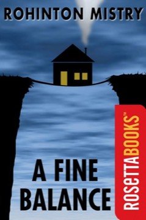

# A Fine Balance
**Author:** Rohinton Mistry | **Published:** 1995

---

## Summary

*A Fine Balance* is set largely in 1975–1977, during the State of Emergency declared by Indira Gandhi, in an unnamed city by the sea modelled on Bombay. Dina Dalal, a widowed Parsi seamstress trying to stay independent of her brother, takes in a paying guest, Maneck Kohlah, a young student from a hill town, and employs two tailors, Ishvar Darji and his nephew Omprakash. The tailors' backstory reaches back to their village, where their family left its hereditary leatherworking caste occupation to become tailors and suffered brutal upper-caste violence as a result.

Over the course of the novel the four form an improvised family, but the Emergency's slum demolitions, forced labour camps and sterilisation drives, together with landlords, debt and caste power, repeatedly overturn their fragile arrangements. The narrative accumulates small kindnesses and humour alongside catastrophe, and an epilogue set in 1984 shows what has become of each of them.

The novel won the Giller Prize and the Commonwealth Writers' Prize and was shortlisted for the 1996 Booker Prize. Its selection for Oprah's Book Club in 2001 brought it a large international readership. It is often compared to the great nineteenth-century realist novels for its scale and its attention to how history acts on the powerless.

---

## Critical Takeaways

- **Realist epic:** Reviewers frequently compare Mistry to Dickens and Tolstoy for his panoramic social canvas, detailed characterisation and willingness to follow ordinary lives across decades.
- **Political indictment:** Critics highlight its depiction of the Emergency—forced sterilisations, demolitions, bonded labour—as one of the most sustained fictional treatments of that period.
- **Caste violence:** The tailors' village storyline is noted for its unflinching portrayal of caste oppression, which many readers find the novel's most harrowing material.
- **Relentless bleakness:** A common criticism is that the accumulation of misfortune becomes overwhelming or even manipulative; defenders argue the suffering is grounded in documented history and balanced by warmth and humour.
- **Title as theme:** Commentators often discuss the title, taken from a character's remark about keeping a fine balance between hope and despair, as the novel's moral centre.

---

## My Takeaways

_To be written — Vishwas's personal takeaways._

---

## Footnotes

- [Wikipedia — A Fine Balance](https://en.wikipedia.org/wiki/A_Fine_Balance)
- [Wikipedia — Rohinton Mistry](https://en.wikipedia.org/wiki/Rohinton_Mistry)
- [Goodreads — A Fine Balance](https://www.goodreads.com/search?q=A+Fine+Balance+Rohinton+Mistry)
