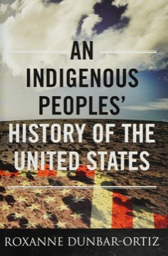

# An Indigenous Peoples' History of the United States
**Author:** Roxanne Dunbar-Ortiz | **Published:** 2014

---

## Summary

Dunbar-Ortiz argues that the United States was founded and expanded as a settler-colonial state, and that the conventional narrative of discovery, frontier and progress obscures a history of land seizure, broken treaties and violence against Indigenous nations. She begins with the sophisticated societies present before European arrival and traces colonization through the colonial wars, the Revolution, Indian Removal, westward expansion, and the 20th century.

She emphasizes Native resistance and survival as well as dispossession, and links the military methods used against Native nations to later US wars abroad. She describes US policy as genocidal, a deliberately strong claim.

The book is part of Beacon Press's ReVisioning American History series and won the 2015 American Book Award; a young-readers adaptation followed.

---

## Critical Takeaways

- **Perspective shift:** Reviewers credit it with making Indigenous perspectives central to US history and challenging familiar national myths.
- **Settler colonialism:** Its consistent use of the settler-colonial framework is seen as its main analytic contribution.
- **Polemical tone:** Some reviewers find it more an argument than a balanced history, with sweeping claims and selective emphasis.
- **Genocide framing:** Its characterization of US policy as genocide is praised by some scholars and contested by others.
- **Synthesis, not original research:** Critics note it relies mainly on secondary sources, which suits its aim as an accessible overview.

---

## My Takeaways

_To be written — Vishwas's personal takeaways._

---

## Footnotes

- [Wikipedia: An Indigenous Peoples' History of the United States](https://en.wikipedia.org/wiki/An_Indigenous_Peoples%27_History_of_the_United_States)
- [Goodreads](https://www.goodreads.com/search?q=An+Indigenous+Peoples+History+of+the+United+States+Dunbar-Ortiz)
