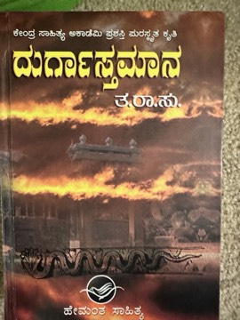

# Durgastamana (ದುರ್ಗಾಸ್ತಮಾನ)
**Author:** T. R. Subba Rao (Ta. Ra. Su.)

---

## Summary

*Durgastamana* ('the setting of the fort,' i.e. the fall of Durga/Chitradurga) is a historical novel by T. R. Subba Rao (Ta. Ra. Su., 1920–1984), who was born in the Chitradurga region and wrote a series of novels about its Nayaka rulers. This last novel centres on Madakari Nayaka, the final ruler of Chitradurga, and the circumstances in which his fort fell to Hyder Ali of Mysore.

The novel treats the fall of the fort as a parallel to the decline of a society, depicting the court intrigue, conflicts of self-interest and divided loyalties that weakened Chitradurga from within, as well as the lives of ordinary people caught up in the war. Ta. Ra. Su. is reported to have carried the idea for decades and completed the novel shortly before his death.

The book received the Sahitya Akademi Award for Kannada in 1985, a year after the author's death, making him one of the few Kannada writers honoured posthumously. It is widely regarded as his finest work and as one of the major Kannada historical novels.

---

## Critical Takeaways

- **Author's masterpiece:** Kannada critics generally regard it as the culmination of Ta. Ra. Su.'s writing, showing a fuller range than his earlier well-known novel *Hamsageethe*.
- **History as fiction:** It is valued for fictionalising regional Karnataka history with research and local knowledge, especially of Chitradurga.
- **Decline from within:** Commentators note its emphasis on internal betrayal and self-interest, rather than only external conquest, as the cause of the fort's fall.
- **Recognition:** The posthumous Sahitya Akademi Award (1985) confirmed its standing in modern Kannada literature.
- **Limited English coverage:** Little published criticism exists in English; most discussion is in Kannada literary writing.

---

## My Takeaways

_To be written — Vishwas's personal takeaways._

---

## Footnotes

- [Wikipedia — T. R. Subba Rao](https://en.wikipedia.org/wiki/T._R._Subba_Rao)
- [South First — TaRaSu, the novelist of Chitradurga](https://thesouthfirst.com/karnataka/tarasu-the-novelist-of-chitradurga-whose-last-novel-was-his-masterpiece/)
- [Goodreads — Durgastamana](https://www.goodreads.com/search?q=Durgastamana)
