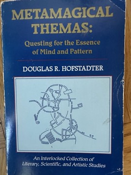

# Gödel, Escher, Bach: An Eternal Golden Braid
**Author:** Douglas Hofstadter | **Published:** 1979 | **Status:** partially read

---

## Summary

*Gödel, Escher, Bach*, published in 1979, uses three figures—Gödel's incompleteness theorems, Escher's self-referential drawings and Bach's canons and fugues—to explore how meaning, self-reference and recursion arise in formal systems. Hofstadter's central idea is the 'strange loop', in which moving through levels of a hierarchy unexpectedly returns one to the starting point, and he proposes that the self or 'I' is such a loop emerging from the activity of the brain.

The book alternates between expository chapters and dialogues featuring Achilles, the Tortoise and other characters, many structured like Bach's musical forms. It introduces formal systems through puzzles such as the MU puzzle, builds up to an accessible account of Gödel's proof, and ranges across recursion, molecular biology and the genetic code, Zen koans, computation, the Church–Turing thesis and artificial intelligence.

The book won the Pulitzer Prize for General Nonfiction in 1980 and became a cult classic, especially among students of computer science, mathematics and cognitive science. Hofstadter later restated its central argument about the self in *I Am a Strange Loop* (2007).

---

## Critical Takeaways

- **Unique form:** Reviewers celebrate its blend of rigour and play, with dialogues that enact the ideas they discuss.
- **Influence:** It inspired many readers to pursue computer science, AI and cognitive science, and is frequently cited as a formative book.
- **Central thesis:** Hofstadter has said many readers missed its main point—that minds emerge from strange loops—and treated it as a book about the links between mathematics, art and music.
- **Length and density:** Critics note its length, wordplay and digressions can be exhausting, and some find the connections among Gödel, Escher and Bach more metaphorical than substantive.
- **AI perspective:** Its views on artificial intelligence reflect late-1970s symbolic AI; commentators note how the field has since developed differently, though its questions about meaning and self-reference remain relevant.

---

## My Takeaways

_To be written — Vishwas's personal takeaways._

---

## Footnotes

- [Wikipedia — Gödel, Escher, Bach](https://en.wikipedia.org/wiki/G%C3%B6del,_Escher,_Bach)
- [Wikipedia — Douglas Hofstadter](https://en.wikipedia.org/wiki/Douglas_Hofstadter)
- [Goodreads — Gödel, Escher, Bach](https://www.goodreads.com/search?q=Godel+Escher+Bach+Hofstadter)
