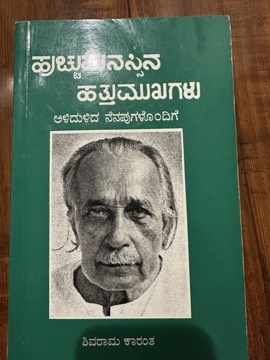

# Huchchu Manassina Hattu Mukhagalu (ಹುಚ್ಚು ಮನಸ್ಸಿನ ಹತ್ತು ಮುಖಗಳು)
**Author:** K. Shivarama Karanth | **Status:** partially read

---

## Summary

*Huchchu Manassina Hattu Mukhagalu* is K. Shivarama Karanth's account of his own life, organised around the many 'faces' of his activity. Karanth (1902–1997), born in Kota in coastal Karnataka, left formal education to join the freedom movement and went on to work as a novelist, playwright, journalist, encyclopaedist, educator, filmmaker, photographer, Yakshagana scholar and performer, and environmental activist.

The autobiography describes this variety of pursuits with candour and characteristic self-deprecating humour, presenting them as the projects of a restless, 'crazy' mind. It reflects his rationalist outlook, his commitment to self-education and his deep ties to the coastal region of Dakshina Kannada. It was translated into English by the journalist H. Y. Sharada Prasad as *Ten Faces of a Crazy Mind*.

Karanth received the Jnanpith Award in 1977, and his autobiography is an important companion to his fiction for readers seeking to understand one of the central figures of twentieth-century Kannada culture.

---

## Critical Takeaways

- **Polymath's self-portrait:** Commentators value it as a record of Karanth's extraordinary range across literature, the arts, science popularisation and activism.
- **Candour and humour:** Its frank, ironic tone about his own failings and eccentricities is often noted.
- **Regional and historical document:** It offers insight into coastal Karnataka and the cultural life of the freedom movement era.
- **Accessible in translation:** H. Y. Sharada Prasad's English translation made it available to non-Kannada readers.
- **Limited English criticism:** Little published criticism of the autobiography exists in English; most discussion is in Kannada.

---

## My Takeaways

_To be written — Vishwas's personal takeaways._

---

## Footnotes

- [Wikipedia — Shivaram Karanth](https://en.wikipedia.org/wiki/Shivaram_Karanth)
- [Goodreads — Ten Faces of a Crazy Mind](https://www.goodreads.com/search?q=Ten+Faces+of+a+Crazy+Mind+Karanth)
