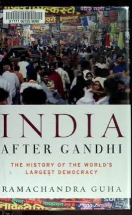

# India After Gandhi: The History of the World's Largest Democracy
**Author:** Ramachandra Guha | **Published:** 2007

---

## Summary

Ramachandra Guha set out to write the narrative history of independent India that he felt was missing. The book begins with Partition and the immense task of integrating hundreds of princely states, writing the Constitution, and reorganizing states along linguistic lines, and follows the country through the Nehru era, the wars with China and Pakistan, Indira Gandhi's rule and the Emergency, the rise of regional and caste-based parties, the Ram Janmabhoomi movement, and economic liberalization.

Guha gives attention to social movements, regional conflicts (Kashmir, the Northeast, Punjab) and figures beyond prime ministers, and draws on archival sources, newspapers and memoirs. His central question is how India, which many predicted would break up or turn authoritarian, held together as a democracy.

The book won the 2011 Sahitya Akademi Award for English and was updated in a tenth-anniversary edition in 2017.

---

## Critical Takeaways

- **Landmark synthesis:** Reviewers widely hailed it as the definitive one-volume history of post-independence India.
- **Narrative readability:** It is praised for combining scholarship with engaging storytelling.
- **Democratic optimism:** Critics note its broadly liberal, Nehruvian sympathies; some see this as a balanced judgment and others as bias.
- **Emphasis on politics:** Some reviewers felt economic and social history received less attention than political events.
- **Recent history:** Its coverage of the decades closest to publication is more journalistic and less settled than its earlier chapters.

---

## My Takeaways

_To be written — Vishwas's personal takeaways._

---

## Footnotes

- [Wikipedia: India After Gandhi](https://en.wikipedia.org/wiki/India_After_Gandhi)
- [Goodreads](https://www.goodreads.com/search?q=India+After+Gandhi+Ramachandra+Guha)
