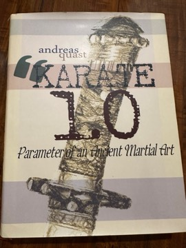

# Karate 1.0: Parameter of an Ancient Martial Art
**Author:** Andreas Quast | **Published:** 2013

---

## Summary

*Karate 1.0* is a roughly 500-page English-language study published in 2013 by Andreas Quast, a researcher of Ryūkyūan martial arts history who also runs the Ryukyu Bugei website. Rather than relying on the oral lineage stories common in karate literature, the book attempts to reconstruct the historical setting of karate and kobudō in the Ryūkyū Kingdom from documentary sources.

Its central approach is to examine the kingdom's military and security institutions—the officials, guards and administrative structures in which martial skills were cultivated—and to identify the individuals who practised martial arts during the kingdom period. The book gathers the accepted written historical sources relating to karate and kobudō, and includes forewords by several martial arts figures.

Published independently and sold through Lulu.com, it has been distributed mainly within the community of karate practitioners and historians.

---

## Critical Takeaways

- **Source-based history:** Readers in the karate history community value its effort to ground the subject in documents rather than legend.
- **Institutional framing:** Its focus on Ryūkyū officialdom and security organisation offers a perspective different from traditional style-lineage histories.
- **Reference value:** The compilation of sources and names makes it useful as a reference for researchers.
- **Niche publication:** As an independently published specialist work, it has had limited distribution and little mainstream or academic review; little published criticism exists.

---

## My Takeaways

_To be written — Vishwas's personal takeaways._

---

## Footnotes

- [Ryukyu Bugei — Karate 1.0](https://ryukyu-bugei.com/?p=1413)
- [Goodreads — Karate 1.0](https://www.goodreads.com/search?q=Karate+1.0+Andreas+Quast)
