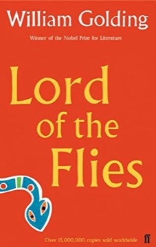

# Lord of the Flies
**Author:** William Golding | **Published:** 1954

---

## Summary

*Lord of the Flies* opens with a group of British schoolboys, evacuated during an unnamed war, stranded on a tropical island with no adults. Ralph is elected leader and uses a conch shell to call assemblies; the bespectacled, asthmatic Piggy supplies reason; Jack, head of a choir, becomes leader of the hunters. Their attempt to keep a signal fire burning and maintain order gradually collapses as Jack's hunters turn to face paint, ritual chants and violence. A pig's head on a stick, the ‘Lord of the Flies’ (a rendering of Beelzebub), becomes the emblem of the 'beast' the boys fear, which the visionary Simon realises is inside themselves.

The descent is sharp: Simon is killed in a frenzied dance, Piggy is crushed by a boulder and the conch shattered, and Ralph is hunted across the island by the tribe that has set it ablaze. He is saved only when a naval officer, drawn by the smoke, lands on the beach—an adult rescuer who is himself engaged in a war, an irony that frames the boys' violence as continuous with the adult world.

Golding, a schoolteacher who had served in the Royal Navy in the Second World War, wrote the novel partly as a rebuttal to R. M. Ballantyne's *The Coral Island* (1857), in which castaway British boys behave admirably. The book was rejected by many publishers before Faber and Faber accepted it. Slow to sell at first, it became a staple of school curricula in Britain and the United States, and Golding received the Nobel Prize in Literature in 1983.

---

## Critical Takeaways

- **Allegory of human nature:** Critics most often read the novel as a moral fable arguing that the 'defects of society' trace back to the defects of human nature; Golding himself described its theme in these terms.
- **Symbolic economy:** The conch (democratic order), Piggy's glasses (reason and technology), the fire and the pig's head are frequently analysed as a tightly controlled set of symbols, which some critics find powerful and others find schematic.
- **Rewriting the castaway tradition:** The novel is widely discussed as a deliberate inversion of *The Coral Island* and the imperial adventure story, questioning assumptions about British civility.
- **Post-war context:** Reviewers connect its pessimism to the Second World War, the Holocaust and the nuclear age, with the naval officer's war framing the island as a microcosm.
- **Contested pessimism:** Later commentators have challenged its view of human nature; Rutger Bregman, in *Humankind* (2020), contrasted it with a real 1960s case of Tongan boys marooned on 'Ata who cooperated successfully. Others note the all-male, all-British cast limits its claims to universality.

---

## My Takeaways

_To be written — Vishwas's personal takeaways._

---

## Footnotes

- [Wikipedia — Lord of the Flies](https://en.wikipedia.org/wiki/Lord_of_the_Flies)
- [Wikipedia — William Golding](https://en.wikipedia.org/wiki/William_Golding)
- [Goodreads — Lord of the Flies](https://www.goodreads.com/search?q=Lord+of+the+Flies+William+Golding)
