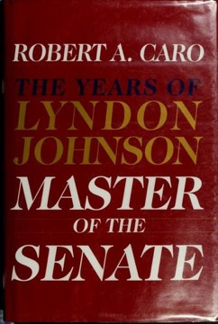

# Master of the Senate (The Years of Lyndon Johnson, Vol. 3)
**Author:** Robert A. Caro | **Published:** 2002

---

## Summary

*Master of the Senate* opens with a long history of the United States Senate, arguing that by mid-century it had become an obstructive body dominated by Southern senators who used seniority and the filibuster to block civil rights legislation. Caro then follows Johnson's arrival in 1949 and his rapid rise, through cultivation of patrons such as Richard Russell of Georgia, to party whip and, by 1955, Majority Leader.

Caro shows how Johnson transformed the role of leader through relentless attention to individual senators' needs, control of committee assignments and information, and the famous 'Johnson treatment' of personal persuasion. Episodes include the destruction of Leland Olds's nomination to the Federal Power Commission, Johnson's handling of the censure of Joseph McCarthy, and his heart attack in 1955.

The climax is the passage of the Civil Rights Act of 1957, the first civil rights law since Reconstruction. Caro argues that although the act was weak, Johnson's ability to steer it past the Southern bloc showed both his legislative mastery and a genuine, if ambition-entwined, compassion rooted in his early experiences of poverty. The volume won the 2003 Pulitzer Prize for Biography and the 2002 National Book Award for Nonfiction.

---

## Critical Takeaways

- **Institutional history:** Reviewers single out the book's account of the Senate itself as a major contribution, explaining how procedure and seniority entrenched power.
- **Anatomy of legislative power:** It is widely cited as one of the best studies of how legislative leadership actually works, and is read by politicians and staffers for that reason.
- **Complex portrait:** Critics noted that this volume presents a more balanced Johnson than *Means of Ascent*, showing both his ruthlessness and his capacity for compassion on civil rights.
- **Length and digression:** Its more than 1,100 pages and long background chapters drew some complaints about length, though most reviewers judged the detail essential.
- **Civil rights interpretation:** Some historians argue that Caro overstates Johnson's personal role and the significance of the 1957 act relative to the civil rights movement itself.

---

## My Takeaways

_To be written — Vishwas's personal takeaways._

---

## Footnotes

- [Wikipedia — Master of the Senate](https://en.wikipedia.org/wiki/Master_of_the_Senate)
- [Wikipedia — The Years of Lyndon Johnson](https://en.wikipedia.org/wiki/The_Years_of_Lyndon_Johnson)
- [Goodreads — Master of the Senate](https://www.goodreads.com/search?q=Master+of+the+Senate+Robert+Caro)
