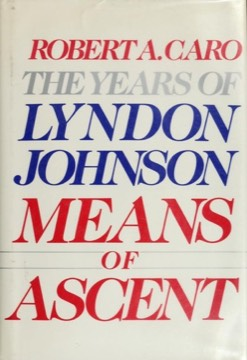

# Means of Ascent (The Years of Lyndon Johnson, Vol. 2)
**Author:** Robert A. Caro | **Published:** 1990

---

## Summary

*Means of Ascent* picks up after Johnson's failed 1941 Senate bid and follows him through a frustrating period in the House of Representatives, his brief and much-embellished naval service in the Second World War, and the building of his personal fortune through the radio station KTBC, held in his wife Lady Bird's name and helped by favourable decisions from federal regulators. Caro portrays a man stalled in his ambitions and determined never to lose again.

The heart of the book is the 1948 Democratic Senate primary against Coke Stevenson, a laconic, widely respected former governor. Caro describes Johnson's innovative use of a helicopter in campaigning and heavy spending, and then reconstructs in detail how a late return of votes from Box 13 in Jim Wells County, controlled by the political boss George Parr, gave Johnson his 87-vote margin. The ensuing legal battle ended when Justice Hugo Black declined to intervene, and Johnson went to the Senate as 'Landslide Lyndon.'

The volume also traces Lady Bird Johnson's growing role. Its stark contrast between Johnson and Stevenson made it the most controversial book in the series when it appeared in 1990.

---

## Critical Takeaways

- **Definitive account of 1948:** Reviewers credit Caro with the most thorough reconstruction of the Box 13 episode, drawing on interviews with participants, and treat it as settling the question that the election was stolen.
- **Moral framing:** Critics argued that Caro idealised Coke Stevenson as a frontier hero to sharpen the contrast with Johnson, and that the portrait of Johnson is unremittingly harsh.
- **Theory of political method:** The book is admired for showing how money, media and new campaign technology were changing American politics in the postwar years.
- **Narrower canvas:** Compared with the first and third volumes, some reviewers found its focus on a single campaign intense but limited in scope.
- **Research and prose:** As with the whole series, Caro's archival depth and dramatic narrative style are widely praised, though some find the prose emphatic and repetitive.

---

## My Takeaways

_To be written — Vishwas's personal takeaways._

---

## Footnotes

- [Wikipedia — The Years of Lyndon Johnson](https://en.wikipedia.org/wiki/The_Years_of_Lyndon_Johnson)
- [Wikipedia — Robert Caro](https://en.wikipedia.org/wiki/Robert_Caro)
- [Goodreads — Means of Ascent](https://www.goodreads.com/search?q=Means+of+Ascent+Robert+Caro)
