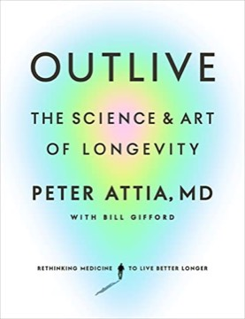

# Outlive: The Science and Art of Longevity
**Author:** Peter Attia (with Bill Gifford) | **Published:** 2023

---

## Summary

Peter Attia contrasts conventional medicine, which mostly intervenes after disease appears, with a proactive approach he calls Medicine 3.0, which aims to delay or prevent the "four horsemen" of chronic disease: atherosclerotic cardiovascular disease, cancer, neurodegenerative diseases such as Alzheimer's, and type 2 diabetes and related metabolic dysfunction. He argues for earlier and more aggressive screening and risk management.

The book's largest section is on exercise, which Attia treats as the most potent longevity intervention: building cardiorespiratory fitness (Zone 2 training and VO2 max), strength, and stability. He frames training around a "centenarian decathlon" of physical tasks one wants to be able to perform late in life. Further chapters cover nutrition, sleep and emotional health, including Attia's account of his own struggles.

Written with journalist Bill Gifford, the book became a number-one bestseller and helped popularize longevity medicine.

---

## Critical Takeaways

- **Practical emphasis:** Reviewers praised its concrete, actionable focus on exercise and healthspan rather than lifespan alone.
- **Evidence limits:** Critics note that some recommendations rest on observational data or extrapolation rather than randomized trials, which Attia sometimes acknowledges.
- **Access and cost:** Several reviewers observe that its testing-heavy approach is expensive and geared toward affluent readers.
- **Nuance on diet:** The nutrition section is noted for being less dogmatic than many diet books.
- **Personal candor:** His discussion of emotional health and his own struggles was singled out as an unexpected strength.

---

## My Takeaways

_To be written — Vishwas's personal takeaways._

---

## Footnotes

- [Wikipedia: Peter Attia](https://en.wikipedia.org/wiki/Peter_Attia)
- [Goodreads](https://www.goodreads.com/search?q=Outlive+Peter+Attia)
