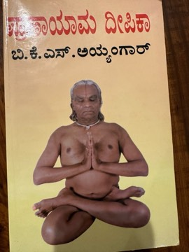

# Pranayama Dipika (ಪ್ರಾಣಾಯಾಮ ದೀಪಿಕಾ) / Light on Pranayama
**Author:** B. K. S. Iyengar | **Published:** 1981 | **Status:** partially read

---

## Summary

*Light on Pranayama: Pranayama Dipika* was first published in 1981 as the companion volume to *Light on Yoga*. Its first part explains the place of pranayama in Patanjali's eight-limbed yoga and in hatha yoga texts, discussing prana, the nadis and chakras, the respiratory system and the relationship between breath, mind and meditation.

The main part is practical. Iyengar insists on preparation through asana and on correct seated and supine positions, and gives step-by-step instructions, with photographs, for techniques including ujjayi, viloma, bhastrika, kapalabhati, anuloma and pratiloma, nadi shodhana, and breath retention (kumbhaka). He sets out a graded course and repeatedly emphasises caution, as he considered pranayama potentially harmful if forced.

Later sections cover dhyana (meditation) and savasana (relaxation). The book has been widely translated, and Kannada editions use the title *Pranayama Dipika*.

---

## Critical Takeaways

- **Systematic method:** Practitioners and teachers regard it as one of the most detailed modern manuals of pranayama, notable for its precision.
- **Emphasis on safety:** Reviewers note Iyengar's stress on gradual progression and the dangers of incorrect practice.
- **Traditional framework:** The book links breathwork to classical yoga philosophy, though some readers find the physiological and esoteric explanations mixed or dated.
- **Demanding for beginners:** Some readers find it difficult to follow without a teacher, and Iyengar himself recommends guidance.
- **Standard reference:** It is a core text in the Iyengar yoga curriculum and is frequently recommended alongside *Light on Yoga*.

---

## My Takeaways

_To be written — Vishwas's personal takeaways._

---

## Footnotes

- [Wikipedia — B. K. S. Iyengar](https://en.wikipedia.org/wiki/B._K._S._Iyengar)
- [Goodreads — Light on Pranayama](https://www.goodreads.com/search?q=Light+on+Pranayama+Iyengar)
