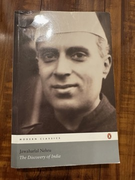

# The Discovery of India
**Author:** Jawaharlal Nehru | **Published:** 1946 | **Status:** partially read

---

## Summary

*The Discovery of India* was written by Jawaharlal Nehru during his imprisonment in Ahmednagar Fort following the Quit India movement, and published in 1946. Composed largely from memory and the limited books available to him, it ranges from the Indus Valley civilisation through the Vedas, Upanishads and epics, Buddhism and Jainism, the Mauryan and Gupta empires, the arrival of Islam and the Mughals, to British rule and the nationalist struggle.

Nehru's central argument is that India possesses an underlying cultural unity formed through millennia of absorption and synthesis of diverse peoples and ideas—a palimpsest on which successive layers were written without erasing what came before. He combines historical narrative with personal reflection, his rationalist and socialist outlook, and a critique of colonial exploitation.

The book became a defining statement of the pluralist, secular idea of India that shaped the early republic. It was adapted as the television series *Bharat Ek Khoj* (1988), directed by Shyam Benegal.

---

## Critical Takeaways

- **Nationalist vision:** Historians regard it as a key articulation of the idea of India as a composite, pluralist civilisation, and a document of the independence era.
- **Literary quality:** Reviewers note its eloquence and personal voice, blending autobiography with history.
- **Historical reliability:** Professional historians point out that, written in prison without full resources, it contains generalisations and outdated interpretations and should be read as interpretation rather than scholarship.
- **Selective emphasis:** Critics from various positions argue that its narrative of synthesis downplays conflict, regional diversity and caste, or reflects a north-Indian and elite perspective.
- **Enduring debate:** Its vision remains central to contemporary arguments over Indian secularism and national identity.

---

## My Takeaways

_To be written — Vishwas's personal takeaways._

---

## Footnotes

- [Wikipedia — The Discovery of India](https://en.wikipedia.org/wiki/The_Discovery_of_India)
- [Wikipedia — Jawaharlal Nehru](https://en.wikipedia.org/wiki/Jawaharlal_Nehru)
- [Goodreads — The Discovery of India](https://www.goodreads.com/search?q=The+Discovery+of+India+Nehru)
