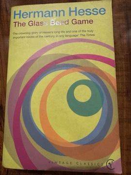

# The Glass Bead Game
**Author:** Hermann Hesse | **Published:** 1943

---

## Summary

*The Glass Bead Game* (*Das Glasperlenspiel*, also published in English as *Magister Ludi*) was published in Switzerland in 1943. It is presented as a biography written by a future historian of Joseph Knecht, a gifted student who rises through the elite schools of Castalia, a secluded province of scholars set apart from society after an age of cultural decline. The Glass Bead Game itself is never fully explained: it is a contemplative art that combines and relates ideas across music, mathematics, philosophy and other disciplines.

Knecht becomes Magister Ludi, master of the Game, but his friendships with Plinio Designori, a man of the outside world, and with the Benedictine historian Father Jacobus lead him to question Castalia's detachment from history and ordinary life. He ultimately resigns to become a tutor in the world outside and dies soon afterwards, drowning in a mountain lake. The novel ends with Knecht's own writings: poems and three 'lives' imagining him in other times and cultures, including India.

Written during the Nazi period, the book is often read as a meditation on the relationship between intellectual culture and political responsibility. Hesse received the Nobel Prize in Literature in 1946.

---

## Critical Takeaways

- **Intellect and life:** Critics see the central theme as the tension between contemplative purity and engagement with the world, resolved ambiguously by Knecht's departure.
- **Political subtext:** Scholars read Castalia's isolation as a response to the rise of fascism and a critique of intellectuals who withdraw from history.
- **Eastern influence:** The novel's interest in Indian and Chinese thought, especially in the appended lives, reflects Hesse's long engagement with Asian philosophy.
- **Demanding form:** Its slow pace, scholarly narrator and lack of conventional drama are frequent points of criticism; admirers see these as integral to its contemplative design.
- **Anticipation of interdisciplinary thought:** Later commentators have connected the Game to ideas of information, computation and the synthesis of knowledge.

---

## My Takeaways

_To be written — Vishwas's personal takeaways._

---

## Footnotes

- [Wikipedia — The Glass Bead Game](https://en.wikipedia.org/wiki/The_Glass_Bead_Game)
- [Wikipedia — Hermann Hesse](https://en.wikipedia.org/wiki/Hermann_Hesse)
- [Goodreads — The Glass Bead Game](https://www.goodreads.com/search?q=The+Glass+Bead+Game+Hermann+Hesse)
