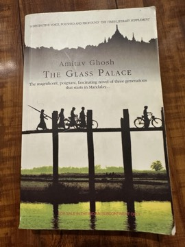

# The Glass Palace
**Author:** Amitav Ghosh | **Published:** 2000

---

## Summary

*The Glass Palace* opens in Mandalay in 1885, as British forces depose King Thebaw and send him and Queen Supayalat into exile in Ratnagiri on India's west coast. Rajkumar, an eleven-year-old Indian orphan working at a food stall, glimpses Dolly, a young attendant of the queen, in the turmoil of the palace's looting. He grows up to make his fortune in the Burmese teak trade and later in rubber plantations in Malaya, and eventually seeks out Dolly in Ratnagiri to marry her.

The novel expands across three generations and several countries, through the friendship between Dolly and Uma, the wife of the British-appointed Collector at Ratnagiri, and through their descendants. It covers the First and Second World Wars, the dilemmas of Indian officers in the British Indian Army, the formation of the Indian National Army, the Japanese invasion of Burma and the long refugee march to India, and closes in the later twentieth century with Burma under military rule.

Ghosh drew on extensive research into the history of Burma and the Indian diaspora. The novel was a commercial success. In 2001 Ghosh withdrew it from consideration for the Commonwealth Writers' Prize, objecting to the term 'Commonwealth' as a description of literature written in English.

---

## Critical Takeaways

- **Historical scope:** Reviewers praise its breadth and research, particularly its rare fictional treatment of Burma's colonial history and Indian communities in Southeast Asia.
- **Colonial soldiers:** Critics highlight its exploration of Indian soldiers' moral conflicts about serving the empire, a subject often neglected in fiction.
- **Saga form:** The novel is frequently compared to nineteenth-century family sagas; some reviewers felt its characters, especially in later generations, are sketched more thinly than its history.
- **Dialogue and exposition:** A recurrent criticism is that historical information is sometimes delivered through expository dialogue rather than dramatised.
- **Postcolonial politics:** Ghosh's refusal of the Commonwealth Writers' Prize drew attention to the novel's critique of empire and became part of its reception.

---

## My Takeaways

_To be written — Vishwas's personal takeaways._

---

## Footnotes

- [Wikipedia — The Glass Palace](https://en.wikipedia.org/wiki/The_Glass_Palace)
- [Wikipedia — Amitav Ghosh](https://en.wikipedia.org/wiki/Amitav_Ghosh)
- [Goodreads — The Glass Palace](https://www.goodreads.com/search?q=The+Glass+Palace+Amitav+Ghosh)
