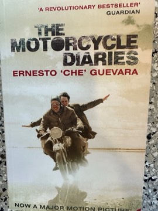

# The Motorcycle Diaries
**Author:** Ernesto 'Che' Guevara | **Published:** 1993 | **Status:** partially read

---

## Summary

In January 1952, Ernesto Guevara, then a 23-year-old medical student in Buenos Aires, set out with his friend Alberto Granado, a biochemist, on a 1939 Norton 500 motorcycle they called *La Poderosa* ('The Mighty One'). They travelled through Argentina and Chile until the motorcycle broke down, then continued through Peru, Colombia and Venezuela by hitchhiking, on foot and by raft along the Amazon.

The journal mixes youthful comedy—scrounging food, charming hosts, minor misadventures—with encounters that left a deep impression: a destitute communist miner couple in Chile, the conditions at the Chuquicamata copper mine, the indigenous people of the Andes and the ruins of Machu Picchu, and the weeks spent working at the San Pablo leper colony in the Peruvian Amazon. Guevara's reflections increasingly turn to the shared fate of Latin America's poor.

The text, edited from Guevara's notes, was first published in Spanish in 1993 and soon translated into English. Its popularity grew with Walter Salles's 2004 film adaptation.

---

## Critical Takeaways

- **Portrait of the young Che:** Readers and critics value it as a humanising picture of Guevara before his revolutionary career, showing curiosity, humour and growing social conscience.
- **Political awakening:** It is frequently read as the origin story of his political radicalism, though critics note that this framing is partly retrospective.
- **Editorial shaping:** Some commentators point out that the text was revised and edited, so it is not a raw diary.
- **Romanticisation:** Critics of Guevara's later actions argue that the book and film contribute to an idealised Che myth that omits his record of violence.
- **Road narrative:** As travel writing, it is often compared to other road classics for its sense of youthful freedom and discovery.

---

## My Takeaways

_To be written — Vishwas's personal takeaways._

---

## Footnotes

- [Wikipedia — Che Guevara](https://en.wikipedia.org/wiki/Che_Guevara)
- [Wikipedia — Alberto Granado](https://en.wikipedia.org/wiki/Alberto_Granado)
- [Goodreads — The Motorcycle Diaries](https://www.goodreads.com/search?q=The+Motorcycle+Diaries+Che+Guevara)
