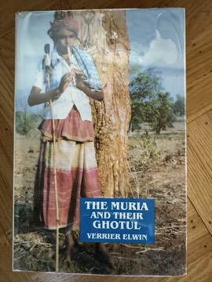

# The Muria and Their Ghotul
**Author:** Verrier Elwin | **Published:** 1947 | **Status:** partially read

---

## Summary

*The Muria and Their Ghotul*, published by Oxford University Press in 1947, is the result of Elwin's fieldwork among the Muria, a Gond people of the Bastar region in present-day Chhattisgarh. Its focus is the ghotul, a communal institution in which adolescents of a village lived together at night, with their own officers and rules, learning songs, dances, work and social duties.

Elwin describes the ghotul's organisation, its myths and rituals, and its role in preparing young people for adult life, including the regulated premarital sexual relationships that were part of it. He presents the institution as a humane and well-ordered system of education and socialisation, and contrasts its openness with the repressive attitudes he associated with both missionary and mainstream Indian society.

The book was later abridged as *The Kingdom of the Young*. It established Elwin as a leading ethnographer of central Indian tribes and fed into his later role as an adviser on tribal policy in independent India.

---

## Critical Takeaways

- **Ethnographic richness:** Anthropologists recognise it as one of the most detailed studies of an Indian tribal institution, with extensive documentation of songs, myths and customs.
- **Sympathetic advocacy:** Critics note that Elwin wrote as an advocate for tribal ways of life, which gives the book warmth but also shapes its interpretations.
- **Romanticism:** Later scholars have argued that Elwin idealised the ghotul and tribal life, presenting it as freer and more harmonious than the evidence may support.
- **Sexuality and controversy:** Its candid treatment of adolescent sexuality made it controversial and has also fed sensationalised outside perceptions of the ghotul.
- **Methodological context:** As a largely self-trained anthropologist outside the academic mainstream, Elwin's methods have been debated; Ramachandra Guha's biography *Savaging the Civilized* discusses this reception.

---

## My Takeaways

_To be written — Vishwas's personal takeaways._

---

## Footnotes

- [Wikipedia — Verrier Elwin](https://en.wikipedia.org/wiki/Verrier_Elwin)
- [Wikipedia — Ghotul](https://en.wikipedia.org/wiki/Ghotul)
- [Goodreads — The Muria and Their Ghotul](https://www.goodreads.com/search?q=The+Muria+and+Their+Ghotul+Verrier+Elwin)
