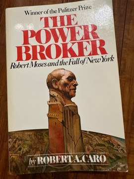

# The Power Broker: Robert Moses and the Fall of New York
**Author:** Robert A. Caro | **Published:** 1974 | **Status:** partially read

---

## Summary

*The Power Broker* follows Robert Moses from his idealistic beginnings as a reformer in the 1910s to his decades as the most powerful builder in New York. Without ever winning an election, Moses held numerous state and city posts simultaneously and, through public authorities such as the Triborough Bridge Authority, controlled vast revenues insulated from political control. He built Jones Beach, the parkways of Long Island, bridges, expressways, parks, playgrounds and public housing.

Caro shows the cost of this power: neighbourhoods destroyed by highways, most famously the Cross-Bronx Expressway's displacement of East Tremont; the neglect of mass transit in favour of the automobile; and the use of bridges and parkways designed in ways that, Caro argues, excluded poorer and Black New Yorkers. Moses's methods included intimidation, the strategic use of patronage and the drafting of laws whose fine print gave him authority others did not notice.

Published in 1974 after years of research and interviews, including with Moses himself, the book is over 1,200 pages long. It won the Pulitzer Prize for Biography in 1975 and has remained one of the most influential books on urban planning and political power.

---

## Critical Takeaways

- **Study of power:** Critics consistently describe it as a classic account of how power works in practice, admired across political and academic fields.
- **Influence on urbanism:** It profoundly shaped views of urban planning, strengthening criticism of highway-building and top-down renewal.
- **Balance debates:** Some historians, notably in later reassessments, argue Caro underplays Moses's achievements and the context of the era; others question specific claims such as the low parkway bridges.
- **Research and narrative:** Its depth of reporting and novelistic storytelling are widely praised as setting a standard for biography.
- **Length:** Its size is a frequent caveat, though most readers consider the detail central to its force.

---

## My Takeaways

_To be written — Vishwas's personal takeaways._

---

## Footnotes

- [Wikipedia — The Power Broker](https://en.wikipedia.org/wiki/The_Power_Broker)
- [Wikipedia — Robert Moses](https://en.wikipedia.org/wiki/Robert_Moses)
- [Goodreads — The Power Broker](https://www.goodreads.com/search?q=The+Power+Broker+Robert+Caro)
