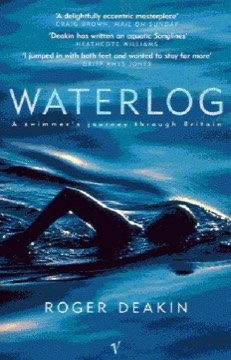

# Waterlog: A Swimmer's Journey Through Britain
**Author:** Roger Deakin | **Published:** 1999 | **Status:** partially read

---

## Summary

*Waterlog* begins with Deakin swimming in the moat at Walnut Tree Farm, his home in Suffolk, and resolving, in the spirit of John Cheever's story 'The Swimmer', to make a journey across Britain by water. Over the following months he swims in rivers, streams, lakes, mountain tarns, the sea, lidos and flooded quarries, from the Fens and the Cambridge colleges to Wales, the Lake District, the Scottish islands and Cornwall.

The book combines descriptions of each swim and the creatures and plants seen at water level with digressions on history, literature, local characters and the law. Deakin repeatedly raises the question of the public's right to swim and roam, criticising the fencing off and privatisation of water and land, and celebrates the physical and imaginative freedom of immersion in natural water.

Published in 1999, the book became a much-loved work of British nature writing. Deakin (1943–2006), an environmentalist and a co-founder of the arts and environment charity Common Ground, was widely seen after his death as a key figure in the revival of nature writing.

---

## Critical Takeaways

- **Nature writing classic:** Critics regard it as a landmark of modern British nature writing, praising its curiosity and lyrical, conversational prose.
- **Wild swimming movement:** It is widely credited with inspiring the resurgence of outdoor swimming in Britain.
- **Politics of access:** Reviewers note its argument for public access to rivers and land, linking a personal pursuit to questions of ownership and enclosure.
- **Digressive structure:** Its episodic, meandering form is admired by many but found uneven by some readers.
- **Influence on writers:** Later nature writers, including Robert Macfarlane, have cited Deakin as a significant influence.

---

## My Takeaways

_To be written — Vishwas's personal takeaways._

---

## Footnotes

- [Wikipedia — Roger Deakin](https://en.wikipedia.org/wiki/Roger_Deakin)
- [Goodreads — Waterlog](https://www.goodreads.com/search?q=Waterlog+Roger+Deakin)
