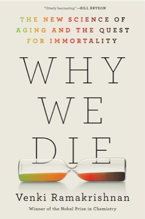

# Why We Die: The New Science of Aging and the Quest for Immortality
**Author:** Venki Ramakrishnan | **Published:** 2024

---

## Summary

*Why We Die* begins with the evolutionary question of why organisms age at all, explaining that natural selection favours reproduction over indefinite maintenance of the body. Ramakrishnan, who shared the 2009 Nobel Prize in Chemistry for work on the structure of the ribosome and later served as President of the Royal Society, then works through the main mechanisms researchers now link to aging: accumulated DNA damage and failures of repair, telomere shortening, the breakdown of protein synthesis and folding, faulty recycling through autophagy, mitochondrial decline, cellular senescence and inflammation.

The later chapters examine interventions: caloric restriction, drugs such as rapamycin and metformin, the removal of senescent cells, young-blood experiments and cellular reprogramming. Ramakrishnan describes the evidence from model organisms and the much thinner evidence in humans, and is sceptical of the billionaire-funded longevity companies and the claims of some advocates.

He closes with ethical and social questions—inequality of access, the burden of an extended lifespan without extended healthspan, and whether death plays a necessary role in renewal. The book was published in 2024 and was widely reviewed as a sober, accessible guide to a field prone to exaggeration.

---

## Critical Takeaways

- **Authoritative and accessible:** Reviewers credit Ramakrishnan's standing as a working scientist and Nobel laureate, and praise his clear explanations of molecular biology for general readers.
- **Antidote to hype:** Critics frequently describe the book as a corrective to the longevity industry, carefully separating established findings from speculation.
- **Breadth over depth:** Some reviewers noted that its survey format means individual topics are covered briefly, and that readers seeking practical advice will find little.
- **Ethical dimension:** The closing discussion of the social consequences of longer lives is often singled out as thoughtful, though some found it tentative.
- **Personal voice:** Commentators note Ramakrishnan's measured, occasionally wry tone and his candour about the limits of current knowledge.

---

## My Takeaways

_To be written — Vishwas's personal takeaways._

---

## Footnotes

- [Wikipedia — Venki Ramakrishnan](https://en.wikipedia.org/wiki/Venki_Ramakrishnan)
- [Goodreads — Why We Die](https://www.goodreads.com/search?q=Why+We+Die+Venki+Ramakrishnan)
