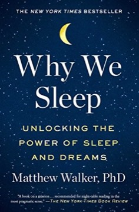

# Why We Sleep: Unlocking the Power of Sleep and Dreams
**Author:** Matthew Walker | **Published:** 2017

---

## Summary

*Why We Sleep* is neuroscientist Matthew Walker's comprehensive account of what sleep is, what it does for every major system in the human body and brain, and what happens when it is insufficient. Walker synthesizes decades of sleep research to argue that sleep is not a passive state of rest but an active, biologically essential process: the brain during sleep consolidates memories, clears metabolic waste (via the glymphatic system, discovered in 2013), regulates emotional processing, repairs DNA damage, calibrates immune function, and performs numerous other restorative operations that cannot be accomplished during waking hours. The book is structured to move from the basic biology of sleep (circadian rhythms, sleep stages, REM and non-REM functions) to the consequences of deprivation, to the specific vulnerabilities of dreaming, and finally to the societal crisis of chronic sleep insufficiency.

Walker's central argument is polemical: modern society systematically under-sleeps, treats sleep deprivation as a badge of productivity, and is paying an enormous collective cost in health, cognitive performance, emotional regulation, and longevity. The research he cites is extensive and alarming: sleep deprivation under six hours per night is associated with significantly elevated risk for cardiovascular disease, type 2 diabetes, obesity, Alzheimer's disease, and various cancers; cognitive impairment from mild chronic deprivation is poorly self-perceived (sleep-deprived people do not notice how impaired they are); the two-week half-life of performance debt means that weekend catch-up sleep does not restore the full loss. Walker argues that this constitutes a public health emergency that is largely unacknowledged.

The book became a bestseller and sparked significant public conversation about sleep, but also faced detailed scientific criticism. A blog post by Alexey Guzey documented numerous factual errors, exaggerations of statistical claims, and misrepresentations of research in the book. Walker has defended some points but acknowledged others. Despite these criticisms, the book's core argument—that sleep is dramatically undervalued and that the consequences of chronic deprivation are serious—has solid scientific support even where specific claims are exaggerated.

---

## Critical Takeaways

- **Scientific accuracy controversy:** Alexey Guzey's detailed critique (2019) identified multiple factual errors and overstated claims in the book; this is important context for reading it. The broad argument about sleep's importance is supported by the literature; some specific claims require more skepticism.
- **Glymphatic system:** The discovery of the brain's glymphatic waste-clearance system (which operates primarily during sleep) is one of the most significant neuroscience findings in the book and was genuinely new at publication.
- **REM sleep and emotional processing:** Walker's account of REM sleep's role in emotional memory processing—"overnight therapy"—is well-supported and has practical implications for understanding PTSD, anxiety, and emotional resilience.
- **Circadian biology:** The book's treatment of circadian rhythms—including the catastrophic effects of artificial light on melatonin and the pathological mismatch between teenage circadian phase and school start times—is among its most policy-relevant sections.
- **Public health framing:** Whatever its specific inaccuracies, *Why We Sleep* succeeded in moving sleep from a personal lifestyle choice to a public health issue in the popular imagination. The societal consequences of this framing shift are real.
- **Sleep apnea as a cardiometabolic disease:** each obstructive episode drops blood oxygen and ends in a brief arousal that triggers a fight-or-flight surge: sympathetic activation, spikes in heart rate and blood pressure, and stress hormones. This repeats many times an hour, all night. Over years it drives hypertension, insulin resistance and higher HbA1c, and atrial fibrillation. It is also common and mostly undiagnosed. This mechanism is well established independently of the book.
- **Alcohol and caffeine harm sleep in different ways:** alcohol is a sedative rather than a sleep aid. It fragments the second half of the night and suppresses REM. Caffeine has a half-life of roughly five to six hours, so an afternoon coffee still reduces deep non-REM sleep at bedtime, even if you fall asleep easily. Sleeping pills and anaesthesia likewise produce sedation or unconsciousness, not natural sleep architecture.
- **What holds up and what doesn't:** the near-universality of sleep holds up well: sleep-like states have now been shown even in jellyfish and nematode worms. The causal rankings hold up less well. "Sleep matters more than exercise" and the claims linking sleep to ageing are among the points the Guzey critique and later reviewers dispute. Sleep loss is one contributor to ageing and dementia, but the arrows run both ways: amyloid build-up itself degrades deep sleep. Excessive daytime sleepiness predicts later dementia partly because it can be an early symptom of it (reverse causation).
- **The opposing view, *Sleep Less, Live More* (Everett Mattlin, 1979):** Mattlin argued that there is no fixed norm for sleep, that most people sleep more than they need, and that by cutting back gradually you can reclaim hours a day without losing anything. He supported this with accounts of famous short sleepers. Later research shows the claim is mostly wrong. In the landmark restriction study (Van Dongen et al., 2003), two weeks at 6 hours a night degraded attention and reaction time as much as one to two nights of total deprivation, yet participants rated themselves only slightly sleepy. "I feel fine on less" is exactly the self-report that sleep loss makes unreliable. Mattlin was partly right that sleep need varies. But genuine short sleepers carry rare gene variants (such as *DEC2*/*BHLHE41* and *ADRB1*), make up well under 1% of people, and never had to train themselves down. For everyone else, sleeping less is a sleep debt, not an adaptation. The idea that older people need less sleep belongs to the same era. The one technique that survives is restricting time in bed for people who lie awake far longer than they sleep, but that is an insomnia therapy (CBT-I), not a way to lower how much sleep you need. In fairness, the book predates most of the evidence linking short sleep to cardiovascular, metabolic and cognitive harm. [Open Library](https://openlibrary.org/books/OL4401513M/Sleep_less_live_more)

---

## My Takeaways

1. The discovery that sleep deprivation impairs self-assessment of impairment—that you don't notice how bad you are—is the most practically important finding in the book. It removes the feedback loop that would otherwise self-correct.
2. The glymphatic system revelations changed how I think about what sleep is for: it is not rest from activity but the active maintenance of the biological machinery that makes activity possible.
3. The chapters on REM sleep and dreaming—particularly the theory that REM re-processes emotional memories to extract their informational content while reducing their emotional charge—are among the most interesting, though also among the most speculative.
4. Reading the Guzey critique alongside the book is actually more valuable than reading either alone: it taught me to distinguish robust findings from oversold claims, and to ask what the actual effect sizes are behind alarming statistics.
5. It is surprising that essentially every animal studied sleeps, despite how dangerous it is to be unconscious. Evolution kept it anyway.
6. Sleep apnea's effect on cardiovascular disease and diabetes (HbA1c) runs through panic-waking: every choking episode ends in a fight-or-flight arousal, many times a night.
7. Going to sleep earlier gives better-quality sleep than going to sleep later, even for a lifelong night owl.
8. Sleep quality declines with age.
9. Alcohol and caffeine affect different kinds of sleep: alcohol suppresses REM and fragments the night, and caffeine eats into deep sleep.
10. Sleep drives long-term memory and skill formation.
11. From personal experience: I remember nothing from exams I wrote after cramming and losing sleep, unlike subjects I studied slowly over a long time.
12. Sleep is as important as exercise, if not more.
13. Screens, ADD and stress-induced thought loops all disrupt sleep.
14. Sleep affects the next day's exercise performance.
15. Reasons to get a sleep test: high blood pressure, high HbA1c, high visceral fat, daytime drowsiness, snoring or teeth grinding.
16. No disease leaves good sleep alone.
17. Sleep and anaesthesia are fundamentally different.
18. Needing less sleep as we age is a myth. What actually happens is that hormonal changes take away our ability to get enough sleep.
19. Open question: is ageing primarily the result of lower-quality sleep?
20. Excessive daytime sleeping is linked to dementia.

---

## Footnotes

- [Wikipedia — Why We Sleep](https://en.wikipedia.org/wiki/Why_We_Sleep)
- [Wikipedia — Matthew Walker (scientist)](https://en.wikipedia.org/wiki/Matthew_Walker_(scientist))
- [Goodreads — Why We Sleep](https://www.goodreads.com/book/show/34466963-why-we-sleep)
- [Alexey Guzey's critique of Why We Sleep](https://guzey.com/books/why-we-sleep/)
- Related: the sleep entry in [Deep Dives › Health and Fitness › *Outlive* against the papers](https://vwulf.github.io/ettuge/Deep-Dives/fitness/ch9)
