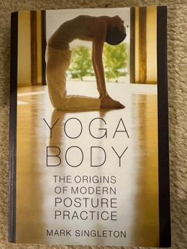

# Yoga Body: The Origins of Modern Posture Practice
**Author:** Mark Singleton | **Published:** 2010

---

## Summary

*Yoga Body*, published by Oxford University Press in 2010, investigates why modern yoga—especially in the West—centres on flowing sequences of postures, when premodern yoga texts devote relatively little attention to asana. Singleton describes how hatha yogis were often viewed with suspicion by colonial observers and by Indian reformers such as Vivekananda, who presented yoga primarily as a philosophical and meditative discipline.

He then traces the influence of the international physical culture movement: Scandinavian and other gymnastics systems, bodybuilding, YMCA programmes and Indian nationalist efforts to build physically strong citizens. A central chapter examines T. Krishnamacharya's teaching at the Mysore palace in the 1930s, where Singleton finds parallels between the vigorous sequences taught to young students and contemporary gymnastics manuals, suggesting a hybrid origin for styles later popularised by his students, including B. K. S. Iyengar and K. Pattabhi Jois.

Singleton argues that modern postural yoga is a genuinely new synthesis rather than a direct continuation of ancient practice, while stressing that newness does not make it inauthentic.

---

## Critical Takeaways

- **Paradigm shift:** Scholars regard the book as a foundational work in modern yoga studies, alongside work by Elizabeth De Michelis and others.
- **Archival evidence:** Reviewers praise its use of physical culture manuals, colonial sources and Indian periodicals to document transnational influences.
- **Practitioner controversy:** Some practitioners and teachers objected that it undermined claims of ancient lineage; Singleton's view that modern yoga is new but not illegitimate is often misunderstood.
- **Contested parallels:** Critics have questioned how direct the influence of specific gymnastics systems on Krishnamacharya was, arguing the evidence is suggestive rather than conclusive.
- **Scope:** Some reviewers note that its focus on posture leaves aside the spiritual and devotional dimensions that many modern practitioners still emphasise.

---

## My Takeaways

_To be written — Vishwas's personal takeaways._

---

## Footnotes

- [Wikipedia — Yoga Body](https://en.wikipedia.org/wiki/Yoga_Body)
- [Goodreads — Yoga Body](https://www.goodreads.com/search?q=Yoga+Body+Mark+Singleton)
