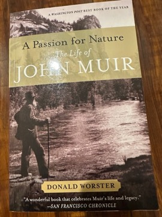

# A Passion for Nature: The Life of John Muir
**Author:** Donald Worster | **Published:** 2008

---

## Summary

*A Passion for Nature* is Donald Worster's biography of John Muir (1838–1914), the Scottish-born American naturalist, writer and advocate of wilderness preservation. Worster, one of the founders of environmental history as a field, traces Muir's upbringing under a severe, religious father on a Wisconsin farm, his early inventiveness, the eye injury that turned him toward nature, his thousand-mile walk to the Gulf of Mexico, and his formative years in Yosemite.

The book covers Muir's emergence as a writer and public figure, his marriage and years running a fruit ranch in California, his travels to Alaska, the founding of the Sierra Club in 1892, and the campaigns for Yosemite and other parks, ending with the losing fight against the damming of Hetch Hetchy Valley. Worster places Muir's ideas in the context of American religion, science and politics of the late nineteenth century.

A recurring theme is that Muir's love of nature was bound up with a democratic and egalitarian vision, and that he was more engaged with family, friends and public life than the image of the lone mountaineer suggests.

---

## Critical Takeaways

- **Authoritative scholarship:** Reviewers regarded it as the most thorough and well-researched Muir biography, drawing on his journals and correspondence.
- **Revisionist portrait:** Critics noted Worster's emphasis on Muir as a family man, businessman and political operator, complicating the romantic wilderness-prophet image.
- **Historical context:** The book is praised for situating Muir within the intellectual and religious currents of his time, reflecting Worster's background as an environmental historian.
- **Length and pace:** Some readers found the book long and detailed, with the density of research slowing the narrative.

---

## My Takeaways

_To be written — Vishwas's personal takeaways._

---

## Footnotes

- [Wikipedia — John Muir](https://en.wikipedia.org/wiki/John_Muir)
- [Goodreads — A Passion for Nature](https://www.goodreads.com/search?q=A+Passion+for+Nature+Donald+Worster)
