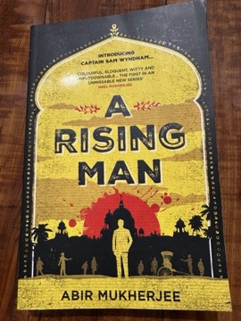

# A Rising Man
**Author:** Abir Mukherjee | **Published:** 2016

---

## Summary

Captain Sam Wyndham arrives in Calcutta in 1919, a war veteran and widower with a growing opium habit, to join the Imperial Police. His first case is the murder of Alexander MacAuley, a senior official found with his throat cut in an alley in a poor part of the city, with a note warning the British to leave India. The investigation pulls Wyndham and his two subordinates, the brusque Inspector Digby and the Cambridge-educated Indian sergeant Surendranath Banerjee, into the worlds of the colonial administration, military intelligence, business interests and the nationalist movement, and toward a train robbery and a conspiracy reaching high up the colonial hierarchy.

Mukherjee, a British author of Indian descent, uses the conventions of the classic detective story to examine how the Raj governed: the casual racism of the clubs, the emergency powers of the Rowlatt Act, the shadow of Amritsar, and the awkward position of Indians like Banerjee serving the colonial police. Wyndham, an outsider with a conscience and his own weaknesses, gives the reader a way into these questions without making the book a lecture.

---

## Critical Takeaways

- **Award-winning debut:** The novel won the Crime Writers' Association Historical Dagger in 2017 and was widely praised as an assured first book.
- **Colonial setting:** Reviewers singled out the vivid rendering of 1919 Calcutta and the novel's frank, critical treatment of British rule as its main distinction from more nostalgic Raj fiction.
- **Detective partnership:** The pairing of the jaded Wyndham with the idealistic Banerjee is often cited as the series' engine, with Banerjee's divided loyalties giving it moral texture.
- **Genre conventions:** Some readers find the plot mechanics fairly traditional and the conspiracy resolution conventional, with the book's strength lying more in atmosphere and character than in puzzle.
- **Series launch:** Its success led to further Wyndham and Banerjee novels, including *A Necessary Evil* and *Smoke and Ashes*, which critics generally regard as deepening the series.

---

## My Takeaways

_To be written — Vishwas's personal takeaways._

---

## Footnotes

- [Wikipedia: Abir Mukherjee](https://en.wikipedia.org/wiki/Abir_Mukherjee)
- [Goodreads](https://www.goodreads.com/search?q=A+Rising+Man+Abir+Mukherjee)
