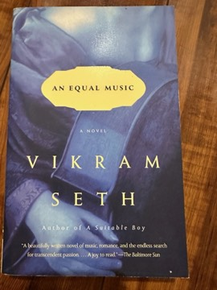

# An Equal Music
**Author:** Vikram Seth | **Published:** 1999

---

## Summary

*An Equal Music* is narrated by Michael Holme, a working-class violinist from Rochdale who plays second violin in the Maggiore Quartet in London. A decade earlier, as a student in Vienna, he broke down under the pressure of his teacher and fled, abandoning Julia McNicholl, a pianist he loved. He glimpses her on a London bus, and when they meet again she is married with a young son and is concealing that she is going deaf. Their renewed affair unfolds alongside the quartet's rehearsals, tensions and tours, including concerts in Vienna and Venice, and a performance of Schubert's *Trout* Quintet in which Julia plays.

The novel is steeped in specific works, among them Bach's *Art of Fugue*, Beethoven's quartets and a rare Beethoven string quintet arranged from a piano trio, and Seth describes rehearsal, interpretation and the physical feel of instruments in close detail. The love story is tied to the music's themes of harmony, repetition and loss, and the book ends not with romantic resolution but with Michael's solitary act of listening.

---

## Critical Takeaways

- **Music on the page:** Reviewers almost universally single out the depiction of chamber music, of how musicians listen, argue and breathe together, as the novel's great achievement.
- **Contrast with A Suitable Boy:** Critics noted the shift from Seth's vast Indian family saga to a compact, inward, first-person novel set in Europe, read by many as evidence of his range.
- **Julia's deafness:** The theme of a musician losing her hearing is praised as poignant and handled with restraint, though some found it a convenient device.
- **The narrator:** Michael's obsessive, self-pitying intensity is seen by some as the book's emotional truth and by others as wearing over the length of the novel.
- **Prose:** The writing is generally praised as lyrical and precise; a recorded companion CD of the music in the novel was issued, reflecting how central the pieces are to the reading experience.

---

## My Takeaways

_To be written — Vishwas's personal takeaways._

---

## Footnotes

- [Wikipedia: An Equal Music](https://en.wikipedia.org/wiki/An_Equal_Music)
- [Wikipedia: Vikram Seth](https://en.wikipedia.org/wiki/Vikram_Seth)
- [Goodreads](https://www.goodreads.com/search?q=An+Equal+Music+Vikram+Seth)
