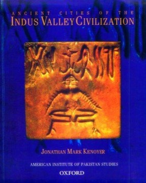

# Ancient Cities of the Indus Valley Civilization
**Author:** Jonathan Mark Kenoyer | **Published:** 1998

---

## Summary

Jonathan Mark Kenoyer, an archaeologist long associated with excavations at Harappa, presents an overview of the Indus civilization from its origins in earlier village cultures through its urban peak in the third millennium BCE and its later transformation. The book draws on decades of excavation and research.

Chapters treat city planning and architecture, the Indus script and seals, crafts such as bead-making, pottery and metallurgy, trade networks extending to Mesopotamia, social organization, and religious and ritual life. Kenoyer emphasizes evidence from artifacts and craft production, reflecting his own specialization.

The book is richly illustrated with photographs of sites and objects, many from the exhibitions it accompanied, and is often recommended as the most accessible authoritative introduction to the subject.

---

## Critical Takeaways

- **Authoritative introduction:** Reviewers regard it as a reliable, expert overview by a leading field archaeologist.
- **Visual richness:** Its photographs of artifacts and sites are frequently praised.
- **Material focus:** Critics note its strength in crafts and technology, reflecting Kenoyer's specialization.
- **Interpretive caution:** It is generally careful on contested questions such as the undeciphered script and the causes of decline.
- **Dating:** Some later findings, including ancient-DNA research, postdate the book, so it does not cover the most recent debates.

---

## My Takeaways

_To be written — Vishwas's personal takeaways._

---

## Footnotes

- [Wikipedia: Jonathan Mark Kenoyer](https://en.wikipedia.org/wiki/Jonathan_Mark_Kenoyer)
- [Goodreads](https://www.goodreads.com/search?q=Ancient+Cities+of+the+Indus+Valley+Civilization+Kenoyer)
