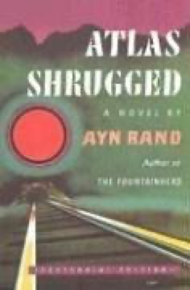

# Atlas Shrugged
**Author:** Ayn Rand | **Published:** 1957

---

## Summary

In a near-future United States, the economy is decaying as government regulation and a culture of self-sacrifice grow. Dagny Taggart, who runs operations at the Taggart Transcontinental railroad, and Hank Rearden, who has invented a new metal, try to keep their businesses alive while the most capable industrialists, scientists and artists vanish one by one. The recurring question "Who is John Galt?" points to the answer: Galt is leading a strike of the productive, who have withdrawn to a hidden valley.

As society collapses, Dagny and Rearden come to understand the strike, and Galt seizes the airwaves to deliver a speech of some sixty pages setting out Rand's philosophy: reason, rational self-interest, and laissez-faire capitalism, against altruism and collectivism.

The novel was Rand's last work of fiction. She devoted her later years to promoting Objectivism, and the book became a foundational text for many libertarians and free-market conservatives.

---

## Critical Takeaways

- **Hostile reviews:** On publication it was widely panned; Whittaker Chambers' review in *National Review* attacked it for its tone and ideology.
- **Philosophical novel:** Critics agree its long speeches subordinate story to doctrine, which some find powerful and others tedious.
- **Moral black and white:** Characters are divided into heroes and villains, a common criticism of its depiction of human motives.
- **Political influence:** It is frequently cited as one of the most influential books for American libertarians and free-market advocates.
- **Enduring sales:** Its continuing popularity, often spiking during political debates over government's role, contrasts sharply with its critical reputation.

---

## My Takeaways

_To be written — Vishwas's personal takeaways._

---

## Footnotes

- [Wikipedia: Atlas Shrugged](https://en.wikipedia.org/wiki/Atlas_Shrugged)
- [Goodreads](https://www.goodreads.com/search?q=Atlas+Shrugged+Ayn+Rand)
