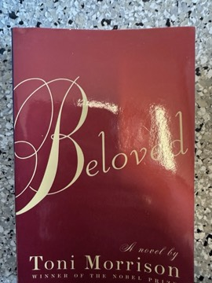

# Beloved
**Author:** Toni Morrison | **Published:** 1987 | **Status:** partially read

---

## Summary

*Beloved* is set in 1873 in Cincinnati, where Sethe, who escaped from the Kentucky plantation called Sweet Home, lives with her daughter Denver in a house at 124 Bluestone Road haunted by the angry spirit of Sethe's dead baby daughter. When Paul D, another former Sweet Home slave, arrives, he drives out the ghost, but soon a mysterious young woman named Beloved appears, whom Sethe comes to believe is her daughter returned.

Through fragmented memories, the novel reveals the past: the brutality of Sweet Home under the slaveholder called schoolteacher, Sethe's escape, and the moment when, faced with recapture, she killed her infant daughter rather than let her be taken back into slavery. The story was inspired by the historical case of Margaret Garner. Beloved's presence consumes Sethe, until Denver reaches out to the community and the women of the town gather to drive Beloved away.

Morrison dedicated the novel to the "Sixty Million and more" who died in the Atlantic slave trade. It won the Pulitzer Prize for Fiction in 1988 and was a major factor in her receiving the Nobel Prize in Literature in 1993.

---

## Critical Takeaways

- **Memory and trauma:** Critics read the novel as a profound study of how the trauma of slavery persists in memory, family and the body; the concept of "rememory" is central.
- **Form:** Morrison's non-linear structure, shifting perspectives and lyrical prose are widely seen as enacting the fragmentation of traumatic memory.
- **Moral complexity:** Sethe's act of infanticide is at the center of critical debate about love, freedom and what slavery made possible and impossible for mothers.
- **Canonical status:** The novel won the Pulitzer Prize and was named the best American novel of the previous 25 years in a 2006 *New York Times* survey of writers and critics.
- **Difficulty:** Some readers and early reviewers found its density and ambiguity demanding; it has also been a frequent target of school-book challenges.

---

## My Takeaways

_To be written — Vishwas's personal takeaways._

---

## Footnotes

- [Wikipedia — Beloved (novel)](https://en.wikipedia.org/wiki/Beloved_(novel))
- [Wikipedia — Toni Morrison](https://en.wikipedia.org/wiki/Toni_Morrison)
- [Goodreads — Beloved](https://www.goodreads.com/search?q=Beloved+Toni+Morrison)
