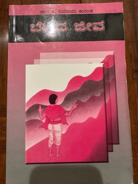

# Bettada Jeeva (ಬೆಟ್ಟದ ಜೀವ)
**Author:** K. Shivaram Karanth | **Published:** 1943

---

## Summary

*Bettada Jeeva* ('the life of the hills') is narrated by a man who loses his way in the dense forests of the Western Ghats in Dakshina Kannada and finds shelter with Gopalayya and his wife Shankari, an ageing couple who live on a remote farm they have cleared from the jungle. Over his stay, the narrator learns of Gopalayya's decades of work to tame the land, his practical knowledge of the forest and its animals, his generosity to neighbours and labourers, and the couple's grief and hope over their son Shambhu, who left home years earlier and never returned.

Karanth, one of the giants of modern Kannada literature and a Jnanpith Award winner, writes with close attention to the ecology and agriculture of the coastal hill country. The novel celebrates self-reliance and a deep relationship with nature without romanticising its hardships, and it explores the generational shift as young people leave the land for towns.

---

## Critical Takeaways

- **Ecological sensibility:** Critics read it as an early and important work of environmental consciousness in Indian literature, with the forest as a living presence rather than a backdrop.
- **Character of Gopalayya:** The protagonist is admired as one of Karanth's most memorable figures, embodying perseverance, hospitality and quiet stoicism.
- **Realism:** The novel is praised for its documentary-like detail of farming, forest life and the speech of the region, typical of Karanth's realist method.
- **Spare plot:** Its slow, episodic structure and minimal plot are seen by admirers as contemplative and by some readers as uneventful.
- **Adaptation:** P. Sheshadri's 2011 film adaptation won the National Film Award for Best Film on Environment Conservation/Preservation, renewing interest in the novel.

---

## My Takeaways

_To be written — Vishwas's personal takeaways._

---

## Footnotes

- [Wikipedia: K. Shivaram Karanth](https://en.wikipedia.org/wiki/K._Shivaram_Karanth)
- [Goodreads](https://www.goodreads.com/search?q=Bettada+Jeeva+Shivarama+Karanth)
