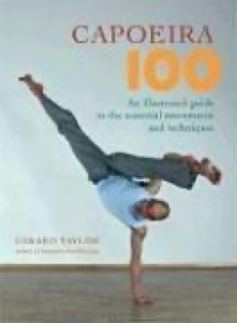

# Capoeira 100: An Illustrated Guide to the Essential Movements and Techniques
**Author:** Gerard Taylor | **Published:** 2007

---

## Summary

*Capoeira 100* (Blue Snake Books, 2007) is divided into two main parts. The first presents 100 movements of capoeira, the Afro-Brazilian martial art that blends fighting, dance and music, each shown in step-by-step photographs with tips, and grouped from basic defences and the ginga through kicks, takedowns and escapes to acrobatic floreios. The second offers 100 exercises, games and drills for solo and partner training, and the book closes with a glossary of 100 Portuguese terms and a question-and-answer section.

Taylor began training in the 1980s, graduated from the London School of Capoeira in 1996, and founded the Oslo Capoeira Klubb; he had previously written *Capoeira: The Jogo de Angola from Luanda to Cyberspace* and *Capoeira Conditioning*. The book is aimed at students, other martial artists, dancers and fitness enthusiasts, and is intended as a complement to, not a replacement for, training in a roda with a teacher.

---

## Critical Takeaways

- **Practical reference:** Reader reviews value its clear photographs and systematic organisation by level as useful for revising techniques learned in class.
- **Drills section:** The 100 training exercises are often cited as the most useful part for practitioners building conditioning and fluency.
- **Limits of a manual:** Reviewers note that a book cannot convey the rhythm, music and interaction of the roda, which are central to capoeira.
- **Limited critical coverage:** Little published criticism exists beyond reader reviews and martial-arts retailers.

---

## My Takeaways

_To be written — Vishwas's personal takeaways._

---

## Footnotes

- [Penguin Random House: Capoeira 100](https://penguinrandomhouse.com/books/176838/capoeira-100-by-gerard-taylor)
- [Goodreads](https://www.goodreads.com/search?q=Capoeira+100+Gerard+Taylor)
