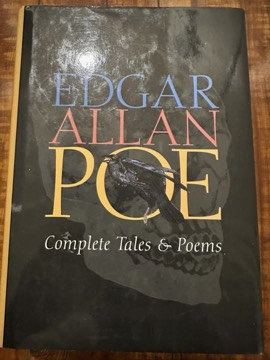

# Complete Tales and Poems of Edgar Allan Poe
**Author:** Edgar Allan Poe | **Status:** partially read

---

## Summary

Edgar Allan Poe (1809–1849) was an American writer, poet and critic whose work spans gothic horror, detective fiction, early science fiction, satire and lyric poetry. A complete tales and poems edition gathers his short stories, his only complete novel (*The Narrative of Arthur Gordon Pym of Nantucket*), and his poetry.

The tales include psychological horror narrated by unreliable or deranged narrators ("The Tell-Tale Heart", "The Black Cat", "The Cask of Amontillado"), stories of decay and the macabre ("The Fall of the House of Usher", "The Masque of the Red Death", "The Pit and the Pendulum"), and the three C. Auguste Dupin stories that created the modern detective story ("The Murders in the Rue Morgue", "The Mystery of Marie Rogêt", "The Purloined Letter"), as well as hoaxes and comic pieces. The poetry includes "The Raven", "Annabel Lee", "The Bells" and "Lenore".

Poe's theory of the short story as a work aimed at a single unified effect, and his obsessive themes of death, guilt and the loss of beautiful women, recur throughout the collection.

---

## Critical Takeaways

- **Genre founder:** Critics credit Poe with inventing the detective story and shaping horror and science fiction.
- **Psychological depth:** His first-person narrators of guilt and madness are seen as forerunners of psychological fiction.
- **Uneven body of work:** Readers of complete editions note that alongside the masterpieces are many minor, dated or comic pieces.
- **Divided reputation:** Poe was admired by the French Symbolists (Baudelaire translated him) but dismissed by some American critics, such as T. S. Eliot and Henry James, as immature or overwrought.
- **Musical poetry:** His poems are celebrated for sound and rhythm, though critics have long debated whether their effects outweigh their substance.

---

## My Takeaways

_To be written — Vishwas's personal takeaways._

---

## Footnotes

- [Wikipedia — Edgar Allan Poe](https://en.wikipedia.org/wiki/Edgar_Allan_Poe)
- [Goodreads — Complete Tales and Poems of Edgar Allan Poe](https://www.goodreads.com/search?q=Complete+Tales+and+Poems+Edgar+Allan+Poe)
