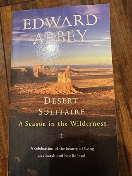

# Desert Solitaire: A Season in the Wilderness
**Author:** Edward Abbey | **Published:** 1968 | **Status:** partially read

---

## Summary

*Desert Solitaire* draws on Edward Abbey's time as a seasonal ranger at Arches National Monument near Moab, Utah, in the late 1950s, compressed into the narrative of a single season. Abbey describes living alone in a trailer in the desert, the plants, animals, weather and rock of the canyon country, and encounters with tourists and locals.

The book includes episodes such as a search for a lost tourist's body, cattle drives, climbing in the canyons, and a raft trip down Glen Canyon on the Colorado River shortly before it was flooded by the Glen Canyon Dam, which Abbey mourns. Alongside the nature writing are attacks on "industrial tourism": paved roads, cars in national parks and development that he argues destroys the wildness that parks exist to protect.

Abbey's voice is personal, irreverent and combative, and the book's case for wilderness as a necessity of the human spirit made it a foundational text of the environmental movement.

---

## Critical Takeaways

- **Environmental classic:** Critics rank it alongside works by Thoreau and Aldo Leopold as a landmark of American nature writing.
- **Polemic power:** Its argument against industrial tourism and dams influenced the environmental movement and groups like Earth First!
- **Lyrical prose:** Reviewers consistently praise Abbey's descriptions of the desert landscape as some of the finest in the genre.
- **Contested persona:** Some critics find Abbey's misanthropy, attitudes toward women and Native Americans, and contempt for tourists off-putting or contradictory.
- **Fact and craft:** Critics note that Abbey condensed and shaped events from several seasons, so the book is a crafted narrative rather than a literal journal.

---

## My Takeaways

_To be written — Vishwas's personal takeaways._

---

## Footnotes

- [Wikipedia — Desert Solitaire](https://en.wikipedia.org/wiki/Desert_Solitaire)
- [Wikipedia — Edward Abbey](https://en.wikipedia.org/wiki/Edward_Abbey)
- [Goodreads — Desert Solitaire](https://www.goodreads.com/search?q=Desert+Solitaire+Edward+Abbey)
