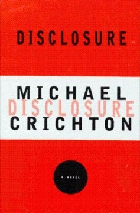

# Disclosure
**Author:** Michael Crichton | **Published:** 1994

---

## Summary

Tom Sanders, a mid-level manager at DigiCom, a Seattle technology company preparing for a merger, expects a promotion but instead sees the job go to Meredith Johnson, an ambitious executive he once dated. After a late-night meeting in which she makes sexual advances that he ultimately rebuffs, Johnson accuses him of harassment, and Sanders realizes his career is at stake.

Sanders counterclaims with the help of a lawyer, and the case proceeds through a mediation process while he uncovers problems with a key product line and maneuvering linked to the merger. The harassment dispute turns out to be entangled with corporate politics.

Crichton's afterword argues that the story is about power rather than gender, and that harassment is an abuse of position available to anyone with power. The 1994 film starred Michael Douglas and Demi Moore.

---

## Critical Takeaways

- **Role reversal:** Critics discussed the inverted premise extensively; some saw it as a provocative thought experiment, others as a backlash against concerns about harassment of women.
- **Power, not gender:** Crichton's stated thesis that harassment is about power was taken seriously by some reviewers and dismissed as disingenuous by others.
- **Corporate detail:** Reviewers praised its depiction of 1990s tech-company office politics and mergers.
- **Dated technology:** Its virtual-reality and database sequences now read as period pieces.
- **Timeliness:** Published after the Anita Hill hearings, it was seen as tapping directly into contemporary debates.

---

## My Takeaways

_To be written — Vishwas's personal takeaways._

---

## Footnotes

- [Wikipedia: Disclosure (novel)](https://en.wikipedia.org/wiki/Disclosure_(novel))
- [Goodreads](https://www.goodreads.com/search?q=Disclosure+Michael+Crichton)
