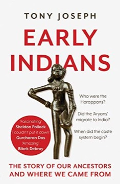

# Early Indians: The Story of Our Ancestors and Where We Came From
**Author:** Tony Joseph | **Published:** 2018

---

## Summary

Tony Joseph, a former editor of *Business Standard*, sets out the genetic evidence that has emerged from studies by population geneticists, including David Reich and colleagues. He argues that India's population is the product of several major migrations: modern humans who arrived from Africa roughly 65,000 years ago; people with ancestry from the Iranian plateau who mixed with them and contributed to the Harappan population; later migrants from East Asia associated with Austroasiatic languages; and Steppe pastoralists who arrived during the second millennium BCE and are associated with Indo-European languages.

He connects the genetics with archaeology of sites like Mehrgarh and Harappa and with linguistic evidence, and argues that Indians are a mixed population, "like a pizza," with no group being the sole original inhabitant.

The book became a bestseller and entered public debates in India about the Aryan migration question, drawing both praise and strong objections.

---

## Critical Takeaways

- **Accessible synthesis:** Reviewers praised it for explaining complex genetic research clearly to a general Indian audience.
- **Steppe migration debate:** Its support for a second-millennium BCE migration of Indo-European speakers drew sharp criticism from proponents of indigenous Aryan theories.
- **Pace of research:** Critics note that ancient-DNA findings are evolving and some details may need revision.
- **Journalistic framing:** Some scholars find the narrative simplifies scientific uncertainty and complex linguistics.
- **Political relevance:** The book is notable for engaging directly with identity politics while arguing for India's mixed heritage.

---

## My Takeaways

_To be written — Vishwas's personal takeaways._

---

## Footnotes

- [Wikipedia: Tony Joseph](https://en.wikipedia.org/wiki/Tony_Joseph)
- [Goodreads](https://www.goodreads.com/search?q=Early+Indians+Tony+Joseph)
