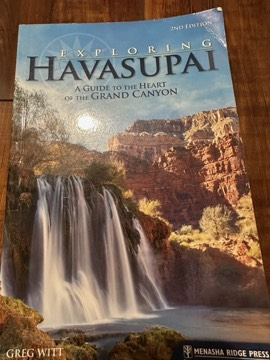

# Exploring Havasupai: A Guide to the Heart of the Grand Canyon
**Author:** Greg Witt

---

## Summary

Havasu Canyon, surrounded by Grand Canyon National Park but governed by the Havasupai Tribe, is one of the most sought-after hiking destinations in the American Southwest, reached only on foot, by mule or by helicopter. Greg Witt's guide sets out the practicalities: the permit system, the trail down from Hualapai Hilltop, Supai village, the campground, and the routes to Navajo, Havasu, Mooney and Beaver Falls and on toward the Colorado River confluence.

Around the logistics the book offers context on the canyon's travertine geology, its plants and wildlife, and the history and culture of the Havasupai people, with an emphasis on travelling respectfully as a guest on tribal land. It has appeared in more than one edition, updated for changes in access and permitting.

---

## Critical Takeaways

- **Practical guide:** Little published criticism exists; as a guidebook it is judged mainly by readers and hikers on accuracy and usefulness for planning a trip.
- **Context beyond trail notes:** Readers appreciate that it pairs route information with natural and cultural history rather than giving bare directions.
- **Time-sensitive details:** As with any Havasupai guide, the tribe's permitting rules and access (including closures after floods) change, so details in older editions date quickly.
- **Respect for tribal land:** Its emphasis on the Havasupai as hosts reflects a broader shift in Southwest travel writing toward acknowledging Indigenous stewardship.

---

## My Takeaways

_To be written — Vishwas's personal takeaways._

---

## Footnotes

- [Goodreads — Exploring Havasupai](https://www.goodreads.com/search?q=Exploring+Havasupai+Greg+Witt)
- [Wikipedia — Havasupai](https://en.wikipedia.org/wiki/Havasupai)
- [Barnes & Noble — Exploring Havasupai](https://www.barnesandnoble.com/w/exploring-havasupai-greg-witt/1100123477)
