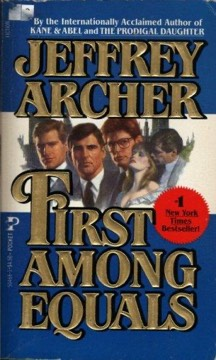

# First Among Equals
**Author:** Jeffrey Archer | **Published:** 1984

---

## Summary

The novel follows the careers of four men who enter the House of Commons in the 1960s: Charles Seymour, an aristocratic Conservative; Simon Kerslake, a self-made Conservative; Raymond Gould, a Labour barrister from a working-class Leeds background; and Andrew Fraser, a Scottish politician. Each rises, stumbles, marries, and faces scandal and financial trouble while the real political history of Britain plays out in the background.

Their rivalry culminates in the question of which, if any, will become Prime Minister. Archer, a former Conservative MP, builds the plot around the mechanics of Westminster: elections, leadership contests, cabinet reshuffles and party maneuvering.

The book was published in different editions with varying endings, and it was adapted as an ITV series in 1986.

---

## Critical Takeaways

- **Insider flavor:** Reviewers credit Archer's parliamentary experience for the book's convincing picture of Westminster life.
- **Storytelling over style:** Critics generally consider the prose plain and the characters broadly drawn, while acknowledging the narrative pull.
- **Real history:** The weaving of fictional careers into real postwar British political events is a commonly noted strength.
- **Melodrama:** Some find the personal scandals and coincidences overdone.
- **Popular success:** It is one of Archer's most popular novels and a successful television adaptation.

---

## My Takeaways

_To be written — Vishwas's personal takeaways._

---

## Footnotes

- [Wikipedia: First Among Equals (novel)](https://en.wikipedia.org/wiki/First_Among_Equals_(novel))
- [Goodreads](https://www.goodreads.com/search?q=First+Among+Equals+Jeffrey+Archer)
