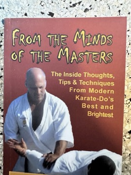

# From the Minds of the Masters: The Inside Thoughts, Tips & Techniques From Modern Karate-Do's Best and Brightest
**Author:** Jerry Figgiani & Jeff Slutsky | **Published:** 2015

---

## Summary

*From the Minds of the Masters* was written by Jerry Figgiani, a senior karate teacher, with Jeff Slutsky, and grew out of Figgiani's articles for *Masters Magazine*. It collects interviews with karate teachers including Frank Grant, Joseph Carbonara, Kensei Taba, Takeshi Tamaki and Masahiko Tokashiki.

The book also contains tributes to figures important to Okinawan and American karate, among them Takayoshi Nagamine (son of the Matsubayashi-ryu founder Shoshin Nagamine), Ansei Ueshiro, James Wax, Parker Shelton and Joe Lewis. A practical section explains seven yakusoku kumite (prearranged partner fighting sequences), and the book is illustrated with many historical photographs.

Its value lies largely in preserving the recollections and advice of teachers in a particular lineage, much of which is not documented elsewhere in print.

---

## Critical Takeaways

- **Little published criticism exists:** As a self-published martial-arts book, its reception is limited to reader reviews and karate community discussion.
- **Oral-history value:** Readers note its worth as a record of first-hand recollections from teachers in the Okinawan and American karate lineages it covers.
- **Lineage focus:** The book's perspective is shaped by the authors' own lineage, so it is more a community record than a balanced historical survey.
- **Practical content:** The yakusoku kumite section gives it use as a training reference in addition to its interviews.

---

## My Takeaways

_To be written — Vishwas's personal takeaways._

---

## Footnotes

- [Books-A-Million — From the Minds of the Masters](https://www.booksamillion.com/p/From-Minds-Masters/Jeff-Slutsky/9781507598948)
- [Goodreads — From the Minds of the Masters](https://www.goodreads.com/search?q=From+the+Minds+of+the+Masters+Figgiani)
