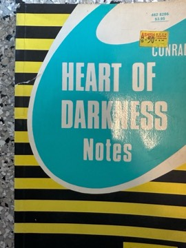

# Heart of Darkness
**Author:** Joseph Conrad | **Published:** 1899

---

## Summary

On a yawl moored in the Thames, Charles Marlow tells his companions about his voyage, years earlier, to the Congo Free State as a steamboat captain for an ivory company. He witnesses the brutality and absurdity of the colonial enterprise: chained labourers, a French warship shelling the bush, managers obsessed with ivory. Everywhere he hears of Kurtz, the company's most successful agent. When he finally reaches the inner station he finds Kurtz ill, surrounded by heads on stakes and worshipped by local people; Kurtz dies on the voyage downriver with the words 'The horror! The horror!' Back in Brussels, Marlow lies to Kurtz's fiancée about his last words.

First serialised in *Blackwood's Magazine* in 1899 and published in book form in 1902, the novella draws on Conrad's own 1890 journey on the Congo. Its frame narrative, impressionistic style and ambiguity about what Kurtz's 'horror' means made it a foundational modernist text, and it has been adapted and echoed widely, most famously in Francis Ford Coppola's *Apocalypse Now*.

---

## Critical Takeaways

- **Critique of imperialism:** For much of the twentieth century the novella was read as a powerful indictment of the hypocrisy and violence of European colonialism, especially Leopold II's Congo.
- **Achebe's challenge:** In his 1975 lecture 'An Image of Africa', Chinua Achebe argued that Conrad dehumanises Africans, using Africa only as a backdrop for a European's moral crisis; this critique reshaped how the book is taught and debated.
- **Modernist technique:** Critics highlight the nested narration, Marlow's unreliable and hesitant voice, and the deliberate vagueness that makes meaning recede, techniques influential on later modernists.
- **Darkness everywhere:** The opening reminder that the Thames too 'has been one of the dark places of the earth' is often cited as evidence that Conrad locates savagery in 'civilisation' as much as in the jungle.
- **Enduring adaptability:** Its afterlife, from T. S. Eliot's epigraph to *Apocalypse Now*, makes it one of the most re-imagined short works in English.

---

## My Takeaways

_To be written — Vishwas's personal takeaways._

---

## Footnotes

- [Wikipedia — Heart of Darkness](https://en.wikipedia.org/wiki/Heart_of_Darkness)
- [Wikipedia — Joseph Conrad](https://en.wikipedia.org/wiki/Joseph_Conrad)
- [Goodreads — Heart of Darkness](https://www.goodreads.com/search?q=Heart+of+Darkness+Joseph+Conrad)
