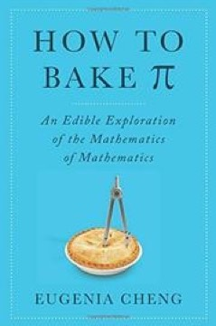

# How to Bake Pi: An Edible Exploration of the Mathematics of Mathematics
**Author:** Eugenia Cheng | **Published:** 2015

---

## Summary

*How to Bake Pi* is Eugenia Cheng's attempt to explain what mathematicians actually do, and why, to readers who may have found school mathematics alienating. Cheng, a category theorist, uses cooking as a running metaphor: each chapter begins with a recipe whose structure illustrates a mathematical concept such as abstraction, axioms, generalization or structure.

The first part of the book addresses mathematics broadly: what abstraction is for, why mathematicians prove things, and how logic and rigor work. The second part turns to category theory, which Cheng describes as "the mathematics of mathematics", explaining objects and morphisms, the idea of studying things through their relationships rather than their intrinsic properties, and notions such as universal properties.

The book's central claim is that mathematics is not about numbers or calculation but about understanding structure, and that its purpose is to make difficult things easier. It was one of the first trade books to present category theory to a general audience.

---

## Critical Takeaways

- **Rare popular treatment of category theory:** Reviewers highlighted the book as an unusual attempt to bring a highly abstract field to general readers, written by a working researcher in that field.
- **Recipe device:** The baking analogies were widely praised as charming and memorable, though some reviewers felt they became strained or decorative in the more technical chapters.
- **Uneven difficulty:** Readers often report that the first half is easy going while the category-theory half is noticeably harder, leaving the book between audiences.
- **Advocacy for mathematics:** Critics noted Cheng's enthusiasm and her argument against the view of maths as rote calculation as a key part of the book's appeal.

---

## My Takeaways

_To be written — Vishwas's personal takeaways._

---

## Footnotes

- [Wikipedia — Eugenia Cheng](https://en.wikipedia.org/wiki/Eugenia_Cheng)
- [Goodreads — How to Bake Pi](https://www.goodreads.com/search?q=How+to+Bake+Pi+Eugenia+Cheng)
