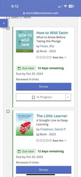

# How to Wild Swim: What to Know Before Taking the Plunge
**Author:** Ella Foote | **Published:** 2023

---

## Summary

*How to Wild Swim* is a beginner-oriented guide to outdoor swimming written by Ella Foote, a journalist who writes regularly about open-water swimming. It explains how to choose safe places to swim, how to judge currents, tides and water quality, how the body responds to cold water and how to acclimatise and warm up afterwards, and what equipment is actually useful.

Alongside the practical material the book discusses the reasons people take up wild swimming, including community, connection with nature and the claimed benefits of cold water for mood and resilience, while encouraging readers to be cautious about risks such as cold-water shock. It is published in DK's illustrated, short-chapter format.

---

## Critical Takeaways

- **Accessible primer:** Little formal criticism exists; reader reviews describe it as a clear, approachable introduction for beginners.
- **Safety-first:** Its emphasis on cold-water shock, entry and exit planning and swimming with others reflects current open-water safety guidance.
- **Benefits versus evidence:** As with much writing on the wild-swimming trend, the mental-health benefits are presented largely through experience, while scientific evidence on cold-water immersion remains limited.
- **UK-oriented:** The book reflects the British wild-swimming scene, so some details on access and conditions apply less directly elsewhere.

---

## My Takeaways

_To be written — Vishwas's personal takeaways._

---

## Footnotes

- [Penguin Random House — How to Wild Swim](https://www.penguinrandomhouse.com/books/730567/how-to-wild-swim-by-ella-foote/)
- [Goodreads — How to Wild Swim](https://www.goodreads.com/search?q=How+to+Wild+Swim+Ella+Foote)
