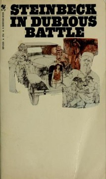

# In Dubious Battle
**Author:** John Steinbeck | **Published:** 1936

---

## Summary

Jim Nolan, a young man embittered by his family's ruin, joins 'the Party' and is sent with the experienced organiser Mac to the Torgas Valley, where growers have cut pickers' wages. Mac's methods are coldly instrumental: he uses a difficult childbirth to win the workers' trust, and treats injuries and deaths, even the killing of an old man, as opportunities to inflame the strikers. The strike is besieged by vigilantes and hunger, and Jim, who grows ever more zealous, is finally shot; Mac uses his faceless corpse to rally the men.

The title comes from Milton's *Paradise Lost*, describing Satan's war against heaven. Steinbeck based the story on the California agricultural strikes of the early 1930s, and the character Doc Burton, who observes the strike as a biologist might observe a 'group-man', voices Steinbeck's own interest in collective behaviour, developed in his friendship with Ed Ricketts.

---

## Critical Takeaways

- **Even-handedness:** Critics have long noted that the novel satisfied neither left nor right; it condemns the growers' violence while depicting the organisers as manipulative and willing to sacrifice individuals.
- **The 'group-man':** Doc Burton's phenomenological view of the mob as an organism is seen as an early statement of Steinbeck's biological, non-teleological thinking.
- **Talk over drama:** Some reviewers find the book heavy with dialogue and argument, a novel of ideas more than of character.
- **Precursor to The Grapes of Wrath:** It is usually read as a darker, more austere forerunner to Steinbeck's masterpiece, less sentimental about the dispossessed.
- **Adaptation:** It was filmed in 2016 by James Franco, which brought it renewed but limited attention.

---

## My Takeaways

_To be written — Vishwas's personal takeaways._

---

## Footnotes

- [Wikipedia — In Dubious Battle](https://en.wikipedia.org/wiki/In_Dubious_Battle)
- [Wikipedia — John Steinbeck](https://en.wikipedia.org/wiki/John_Steinbeck)
- [Goodreads — In Dubious Battle](https://www.goodreads.com/search?q=In+Dubious+Battle+John+Steinbeck)
