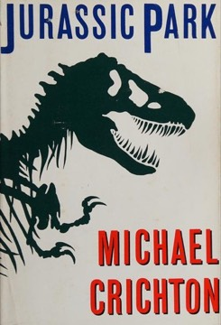

# Jurassic Park
**Author:** Michael Crichton | **Published:** 1990

---

## Summary

John Hammond, founder of the genetic-engineering company InGen, has built a park on Isla Nublar off Costa Rica, stocked with dinosaurs recreated from DNA recovered from blood in amber-preserved insects, with gaps filled by frog DNA. Before opening, he brings in paleontologist Alan Grant, paleobotanist Ellie Sattler, mathematician Ian Malcolm and a lawyer to reassure investors, along with his two grandchildren.

A programmer, Dennis Nedry, sabotages the security systems to steal embryos for a rival company, and the park's carefully engineered controls fail: the dinosaurs escape, the animals turn out to be breeding despite being engineered as all-female, and the visitors must survive. Malcolm's running commentary applies chaos theory to argue that complex systems cannot be controlled as the park's designers believed.

The novel is darker and more argumentative than the film, with characters who meet harsher fates and more explicit warnings about scientific power driven by commerce.

---

## Critical Takeaways

- **Techno-thriller craft:** Critics credit Crichton with making scientific concepts accessible within a gripping, cinematic plot.
- **Cautionary theme:** The book is often discussed as a warning about biotechnology, unchecked commercial science, and the limits of control.
- **Lecturing:** A common criticism is that Malcolm's speeches turn into extended lectures that slow the story.
- **Scientific plausibility:** Scientists note that recovering dinosaur DNA as described is not feasible, though the book helped popularize genetics and paleontology.
- **Cultural impact:** Through the film, it reshaped public images of dinosaurs and became one of the most influential popular novels of its decade.

---

## My Takeaways

_To be written — Vishwas's personal takeaways._

---

## Footnotes

- [Wikipedia: Jurassic Park (novel)](https://en.wikipedia.org/wiki/Jurassic_Park_(novel))
- [Goodreads](https://www.goodreads.com/search?q=Jurassic+Park+Michael+Crichton)
