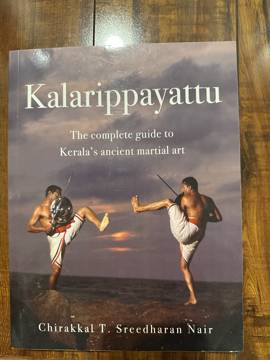

# Kalarippayattu: The Complete Guide to Kerala's Ancient Martial Art
**Author:** Chirakkal T. Sreedharan Nair | **Published:** 2007

---

## Summary

Kalarippayattu is the traditional martial art of Kerala, practised in the *kalari* (training hall) and combining conditioning, flexibility, footwork, unarmed combat and weapons. Chirakkal T. Sreedharan Nair's book is a teacher's practical guide to it, presented as accessible to both beginners and experienced practitioners.

It works through the preparatory body training and stances, the sequences of movements, unarmed techniques and the use of weapons, illustrated with action photographs. A distinctive feature is that it carries over the traditional oral commands of the kalari from Malayalam into English, preserving the vocabulary in which the art has long been taught.

---

## Critical Takeaways

- **Rare practitioner source:** It is one of relatively few detailed manuals on Kalarippayattu available in English written from inside the tradition.
- **Practical rather than historical:** Its focus is on how to train, with comparatively little scholarly treatment of the art's history or lineages.
- **Preserves terminology:** The rendering of the traditional Malayalam commands is valued for keeping the art's teaching language intact.
- **Limited criticism:** Little formal critical review exists; it is mainly known among practitioners and students of Indian martial arts.

---

## My Takeaways

_To be written — Vishwas's personal takeaways._

---

## Footnotes

- [Open Library](https://openlibrary.org/works/OL13820281W)
- [Wikipedia: Kalaripayattu](https://en.wikipedia.org/wiki/Kalaripayattu)
