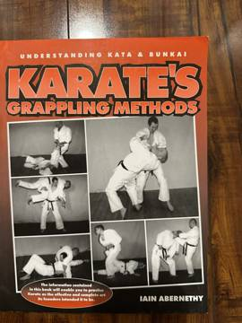

# Karate's Grappling Methods: Understanding Kata & Bunkai
**Author:** Iain Abernethy | **Published:** 2001

---

## Summary

Iain Abernethy, a British karate teacher and one of the most prominent voices in the "practical" or "applied" karate movement, argues that the traditional kata were never intended as a striking-only syllabus. Read properly, he says, the forms record a complete close-range fighting system, and a large share of what they encode is grappling: throws and takedowns, joint locks, chokes and strangles, and ground fighting.

The book works through these categories, showing how specific kata sequences can be interpreted (bunkai) as grappling techniques, with photographed demonstrations. It is part of Abernethy's wider project — continued in *Bunkai-Jutsu* and his other works — of reconnecting kata practice with realistic civilian self-defence rather than sport competition.

---

## Critical Takeaways

- **Influential reinterpretation:** It is widely cited in the applied-karate community as a key text for reading kata as a grappling as well as striking system.
- **Practical focus:** Reviewers appreciate the clear photographs and the emphasis on drills that can be trained with a partner.
- **Historical debate:** Traditionalists question how much grappling the kata creators actually intended; Abernethy's readings are interpretations rather than documented history.
- **Companion to Bunkai-Jutsu:** It is best read alongside his *Bunkai-Jutsu*, which sets out the general method for analysing kata.

---

## My Takeaways

_To be written — Vishwas's personal takeaways._

---

## Footnotes

- [Iain Abernethy: Karate's Grappling Methods](https://iainabernethy.co.uk/shop/product/karates-grappling-methods)
- [Goodreads](https://www.goodreads.com/search?q=Karate%27s+Grappling+Methods+Abernethy)
