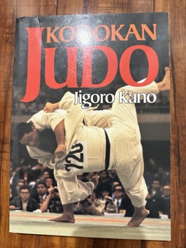

# Kodokan Judo
**Author:** Jigoro Kano | **Published:** 1986

---

## Summary

*Kodokan Judo* presents the system of judo as founded by Jigoro Kano (1860–1938), who created judo from older jujutsu schools in 1882 and established the Kodokan institute in Tokyo. The English edition, published by Kodansha International, was compiled by the Kodokan from Kano's writings and teaching.

The book opens with Kano's account of judo's origins and its guiding principles: seiryoku zenyo (maximum efficient use of energy) and jita kyoei (mutual welfare and benefit), which framed judo as physical education and moral training rather than only combat. It then covers posture, breakfalls, the classification of throwing techniques (nage-waza), grappling techniques (katame-waza) including pins, chokes and joint locks, and the formal kata such as nage-no-kata and katame-no-kata.

Additional sections address striking techniques in self-defense kata and kappo, traditional resuscitation methods.

---

## Critical Takeaways

- **Definitive reference:** The book is regarded as the standard technical reference for Kodokan judo.
- **Founder's philosophy:** Critics note its importance in preserving Kano's educational and ethical vision of judo.
- **Dry presentation:** Readers often describe it as encyclopedic and technical rather than instructional for beginners.
- **Traditional scope:** Some note it reflects classical Kodokan judo rather than the modern competitive sport.

---

## My Takeaways

_To be written — Vishwas's personal takeaways._

---

## Footnotes

- [Wikipedia — Kanō Jigorō](https://en.wikipedia.org/wiki/Kan%C5%8D_Jigor%C5%8D)
- [Wikipedia — Kodokan](https://en.wikipedia.org/wiki/Kodokan)
- [Goodreads — Kodokan Judo](https://www.goodreads.com/search?q=Kodokan+Judo+Jigoro+Kano)
