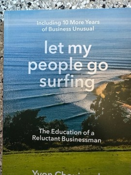

# Let My People Go Surfing: The Education of a Reluctant Businessman
**Author:** Yvon Chouinard | **Published:** 2005 | **Status:** partially read

---

## Summary

*Let My People Go Surfing* combines Yvon Chouinard's personal history with a statement of how Patagonia is run. The first part recounts his life as a climber in Yosemite, his early business forging climbing hardware (Chouinard Equipment), the shift to clean climbing gear, and the founding of Patagonia as a clothing company.

The second, larger part sets out the company's philosophies area by area: design (make the best product, with minimal harm), production, distribution, image, finance, human resources, management and environmental responsibility. Chouinard explains decisions such as switching to organic cotton, committing a percentage of sales to environmental groups, and allowing employees flexible time (the "let my people go surfing" policy) when conditions are good.

The book presents business as a tool for environmental change and argues for growth that is slow, deliberate and responsible. A revised edition appeared in 2016.

---

## Critical Takeaways

- **Influential business book:** It is widely cited as a foundational text for purpose-driven and environmentally responsible business.
- **Authenticity:** Reviewers credit Chouinard's candor and the fact that the philosophy is backed by Patagonia's actual practices.
- **Limited generalizability:** Critics note that Patagonia's model, as a privately held company with a devoted niche market, may be hard for public companies to replicate.
- **Structure:** Some readers find the memoir section more engaging than the more manual-like philosophy chapters.

---

## My Takeaways

_To be written — Vishwas's personal takeaways._

---

## Footnotes

- [Wikipedia — Yvon Chouinard](https://en.wikipedia.org/wiki/Yvon_Chouinard)
- [Wikipedia — Patagonia, Inc.](https://en.wikipedia.org/wiki/Patagonia,_Inc.)
- [Goodreads — Let My People Go Surfing](https://www.goodreads.com/search?q=Let+My+People+Go+Surfing+Chouinard)
