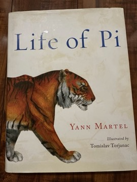

# Life of Pi
**Author:** Yann Martel | **Published:** 2001

---

## Summary

*Life of Pi* is framed as a story told to a Canadian author by the adult Piscine Molitor 'Pi' Patel. The first part covers Pi's boyhood in Pondicherry, where his family runs a zoo, and his simultaneous embrace of three religions. When the family emigrates to Canada with some of the animals, their Japanese cargo ship sinks, and Pi is left in a lifeboat with a zebra, a hyena, an orangutan and a tiger; soon only the tiger, Richard Parker, remains. The long middle section details Pi's survival: fishing, managing the tiger through training and territory, an encounter with a carnivorous floating island, and finally landfall in Mexico.

In the last part, two investigators from the shipping company refuse to believe the animal story, and Pi gives them another version in which the animals are replaced by people and the events are cannibalistic and violent. Neither story can be verified, and Pi asks which is 'the better story'. The investigators choose the one with animals, and Pi draws the analogy to belief in God, which is the novel's stated aim: to be 'a story that will make you believe in God'.

---

## Critical Takeaways

- **Booker Prize:** The novel won the 2002 Man Booker Prize and was widely praised for its inventiveness, humour and storytelling energy.
- **Two stories:** The ending is the most discussed element; critics read it variously as a meditation on faith, on the psychology of trauma, and on the value of fiction itself.
- **Religion:** Pi's pluralistic devotion is admired by many as generous and playful, while some critics find the book's argument for belief sentimental or too easily won.
- **Survival narrative:** The lifeboat section is noted for its concrete, almost technical detail, which gives the fantastical premise its plausibility.
- **Origins and adaptation:** Martel acknowledged the spark of the premise in Moacyr Scliar's novella *Max and the Cats*, which caused a brief controversy; Ang Lee's 2012 film adaptation won four Academy Awards, including Best Director.

---

## My Takeaways

_To be written — Vishwas's personal takeaways._

---

## Footnotes

- [Wikipedia: Life of Pi](https://en.wikipedia.org/wiki/Life_of_Pi)
- [Wikipedia: Yann Martel](https://en.wikipedia.org/wiki/Yann_Martel)
- [Goodreads](https://www.goodreads.com/search?q=Life+of+Pi+Yann+Martel)
