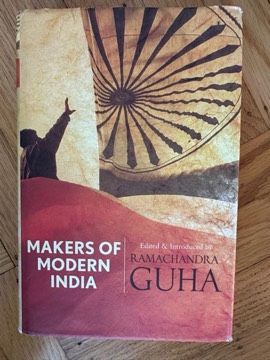

# Makers of Modern India
**Author:** Ramachandra Guha | **Published:** 2010 | **Status:** partially read

---

## Summary

*Makers of Modern India* (Penguin India, 2010; Belknap/Harvard, 2011) is organised chronologically, starting with nineteenth-century reformers such as Rammohan Roy, Syed Ahmad Khan and Jotirao Phule, moving through the moderates and radicals of the national movement, Gokhale and Tilak, to the dominant figures of the twentieth century: Gandhi, Tagore, Ambedkar, Jinnah and Nehru. It also includes figures often left out of such collections, such as the reformer Tarabai Shinde, the Tamil rationalist E. V. Ramasamy (Periyar), Kamaladevi Chattopadhyay, the RSS leader M. S. Golwalkar, C. Rajagopalachari, Ram Manohar Lohia, Jayaprakash Narayan and the Muslim reformer Hamid Dalwai.

Guha's introductions place each writer in context and highlight the debates between them, about how to reform caste and religion, the place of women, the relationship of Hindus and Muslims, the shape of the economy, and the nature of democracy. His argument is that, unlike in many other new nations, India's founders were also serious writers whose arguments remain directly relevant to the country's politics.

---

## Critical Takeaways

- **Valuable anthology:** Reviewers welcomed a single volume that lets readers encounter these figures in their own words, much of which had been out of print or scattered.
- **Breadth of views:** The inclusion of figures who opposed each other sharply, including Golwalkar and Jinnah alongside Gandhi and Nehru, was praised as even-handed.
- **Selection debates:** Some critics questioned omissions, such as particular religious or Hindu nationalist thinkers, and others felt the selection still reflects Guha's liberal, Nehruvian sympathies.
- **Introductions:** Guha's linking essays are generally praised as lucid and informative, consistent with his reputation as a leading historian of modern India.
- **Political thought as tradition:** The book is often cited for its argument that modern Indian political thought deserves study as a tradition in its own right.

---

## My Takeaways

_To be written — Vishwas's personal takeaways._

---

## Footnotes

- [Wikipedia: Ramachandra Guha](https://en.wikipedia.org/wiki/Ramachandra_Guha)
- [Goodreads](https://www.goodreads.com/search?q=Makers+of+Modern+India+Ramachandra+Guha)
